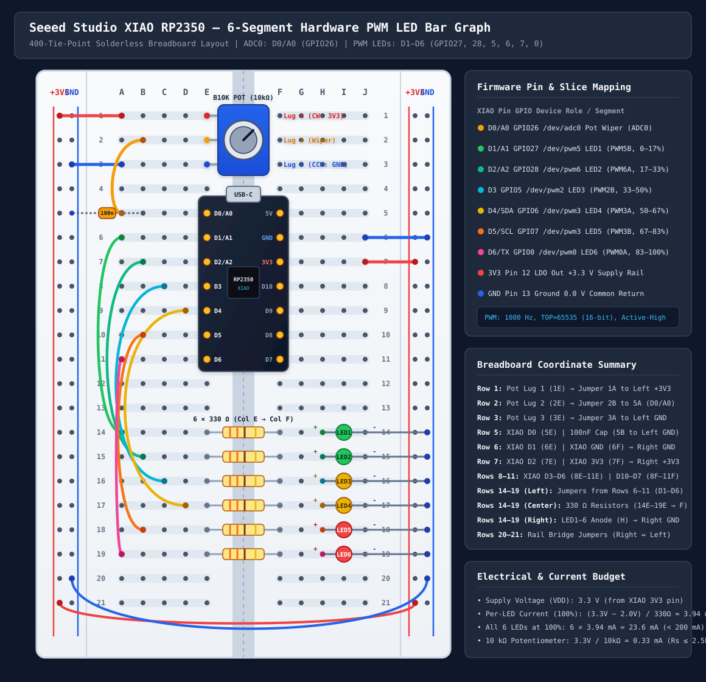

# Seeed Studio XIAO RP2350 6-Segment PWM LED Bar Graph — Breadboard Wiring Guide

This document provides the complete bill of materials, pinout mapping, coordinate-by-coordinate breadboard assembly instructions, and electrical current budget for the `xiao-rp2350-bargraph` firmware.



---

## 1. Parts List (Bill of Materials)

| Ref | Qty | Component Description | Value / Spec | Notes |
| :--- | :---: | :--- | :--- | :--- |
| `U1` | 1 | **Seeed Studio XIAO RP2350** | RP2350A (Dual Cortex-M33 @ 150 MHz) | Solder the two 7-pin `2.54 mm` (`0.1"`) male header strips pointing downward |
| `BB1` | 1 | **Solderless Breadboard** | 400 tie-points (Rows `1`–`30`, Cols `A`–`E` & `F`–`J`) | Dual split power rails (`+` Red and `-` Blue) on both left and right edges |
| `VR1` | 1 | **Linear Rotary Potentiometer** | `10 kΩ` linear taper (`B10K`) | 3-pin breadboard-friendly `2.54 mm` pitch (`Lug 1`: CW, `Lug 2`: Wiper, `Lug 3`: CCW) |
| `R1`–`R6` | 6 | **Current-Limiting Resistors** | `330 Ω` ($\pm 1\%$ or $\pm 5\%$, $1/4\text{ W}$) | Color code (4-band): Orange–Orange–Brown–Gold (`330 Ω`) |
| `LED1`–`LED6` | 6 | **Through-Hole Diffused LEDs** | 3 mm or 5 mm ($V_F \approx 2.0\text{ V}$) | Recommended: `LED1`–`LED2` Green, `LED3`–`LED4` Yellow, `LED5`–`LED6` Red |
| `C1` | 1 | **Ceramic Decoupling Capacitor** *(Optional)* | `100 nF` (`0.1 µF`, `104`) | Filters mechanical wiper noise between `D0/A0` (`GPIO26`) and `GND` |
| `W1`–`W13` | 13 | **Breadboard Jumper Wires** | 22 AWG solid-core or M-M dupont jumpers | Assorted colors (Red for `+3.3V`, Blue/Black for `GND`, colored for signals) |
| `USB1` | 1 | **USB-C Cable** | USB Type-C data/power cable | Powers the board (5V USB) and provides the `/dev/ttyACM0` NSH console |

---

## 2. Firmware Pinout & Hardware Peripheral Mapping

The firmware configures the Seeed Studio XIAO RP2350 pins as follows (`xiao-rp2350-bargraph/board/configs/bargraph/defconfig` and `xiao-rp2350-bargraph/apps/bargraph/bargraph_main.c`):

| XIAO Pin Label | Physical Header Pin | RP2350 GPIO | NuttX Device | Hardware Peripheral | Bar Graph Role & Range |
| :--- | :--- | :--- | :--- | :--- | :--- |
| **`D0 / A0`** | Left Pin 1 (Top-Left) | `GPIO26` | `/dev/adc0` | `ADC` Channel 0 | Potentiometer Wiper Input (`0.0 V – 3.3 V`, `0.0% – 100.0%`) |
| **`D1 / A1`** | Left Pin 2 | `GPIO27` | `/dev/pwm5` | PWM Slice 5, Channel B (`PWM5B`) | **`LED1`** (Lowest segment: `0.0% – 16.7%`) |
| **`D2 / A2`** | Left Pin 3 | `GPIO28` | `/dev/pwm6` | PWM Slice 6, Channel A (`PWM6A`) | **`LED2`** (Segment 2: `16.7% – 33.3%`) |
| **`D3`** | Left Pin 4 | `GPIO5` | `/dev/pwm2` | PWM Slice 2, Channel B (`PWM2B`) | **`LED3`** (Segment 3: `33.3% – 50.0%`) |
| **`D4 / SDA`** | Left Pin 5 | `GPIO6` | `/dev/pwm3` | PWM Slice 3, Channel A (`PWM3A`) | **`LED4`** (Segment 4: `50.0% – 66.7%`) |
| **`D5 / SCL`** | Left Pin 6 | `GPIO7` | `/dev/pwm3` | PWM Slice 3, Channel B (`PWM3B`) | **`LED5`** (Segment 5: `66.7% – 83.3%`) |
| **`D6 / TX`** | Left Pin 7 (Bottom-Left) | `GPIO0` | `/dev/pwm0` | PWM Slice 0, Channel A (`PWM0A`) | **`LED6`** (Highest segment: `83.3% – 100.0%`) |
| **`5V`** | Right Pin 1 (Top-Right) | `VBUS` | — | USB 5V Input | **Leave unconnected** (do not connect 5V to any RP2350 GPIO) |
| **`GND`** | Right Pin 2 | `GND` | — | Common Ground (`0.0 V`) | Connect to Breadboard Blue (`-`) `GND` Rails |
| **`3V3`** | Right Pin 3 | `3V3_OUT` | — | On-board 3.3 V LDO Output | Connect to Breadboard Red (`+`) `+3.3V` Rails |
| **`D10`–`D7`** | Right Pins 4–7 | `GPIO2, 4, 3, 1` | — | Unassigned (`PWM*` sibling pins = `-1`) | Leave unconnected |

---

## 3. Step-by-Step Breadboard Wiring Instructions

### Step 1: Seat the Seeed Studio XIAO RP2350 (`Rows 5–11`, `Cols E & F`)
Position the XIAO RP2350 vertically across the breadboard's center trench with the **USB-C connector pointing UP** (toward Row 1):
*   **Left Header (`D0`–`D6`)**: Insert into **Column `E`**, spanning **Row `5` (`5E`)** down to **Row `11` (`11E`)**.
    *   `5E` = `D0/A0` (`GPIO26`), `6E` = `D1/A1` (`GPIO27`), `7E` = `D2/A2` (`GPIO28`), `8E` = `D3` (`GPIO5`), `9E` = `D4` (`GPIO6`), `10E` = `D5` (`GPIO7`), `11E` = `D6` (`GPIO0`).
*   **Right Header (`5V`, `GND`, `3V3`, `D10`–`D7`)**: Insert into **Column `F`**, spanning **Row `5` (`5F`)** down to **Row `11` (`11F`)**.
    *   `5F` = `5V` (unconnected), `6F` = `GND`, `7F` = `3V3`, `8F` = `D10`, `9F` = `D9`, `10F` = `D8`, `11F` = `D7`.

### Step 2: Wire the `+3.3V` and `GND` Power Rails
> **Important:** The RP2350 ADC and GPIO pads are **3.3 V only**. Always power the potentiometer from the **`3V3`** pin (`Row 7F`), never from the `5V` pin (`Row 5F`).

| Wire # | Wire Color | From Coordinate | To Coordinate | Purpose |
| :--- | :--- | :--- | :--- | :--- |
| `W1` | Blue / Black | **`Row 6J`** (`XIAO GND`) | **Right `GND` (`-`) Rail** | Connects XIAO ground to right negative rail |
| `W2` | Red | **`Row 7J`** (`XIAO 3V3`) | **Right `+3.3V` (`+`) Rail** | Connects XIAO `3.3 V` regulator output to right positive rail |
| `W3` | Blue / Black | **Right `GND` (`-`) Rail** (Row 20) | **Left `GND` (`-`) Rail** (Row 20) | Bridges ground reference to left negative rail |
| `W4` | Red | **Right `+3.3V` (`+`) Rail** (Row 21) | **Left `+3.3V` (`+`) Rail** (Row 21) | Bridges `+3.3 V` supply to left positive rail |

### Step 3: Seat and Wire the `10 kΩ` Linear Potentiometer (`Rows 1–3`)
Insert the three pins of the `10 kΩ` potentiometer (`VR1`) into **Column `E`**, **Rows `1`, `2`, and `3`**:
*   **`Row 1E`**: Lug 1 (Clockwise / High end)
*   **`Row 2E`**: Lug 2 (Center Wiper)
*   **`Row 3E`**: Lug 3 (Counter-Clockwise / Low end)

Connect the potentiometer lugs using three jumper wires (and optional filter capacitor `C1`):

| Wire / Part | Color / Value | From Coordinate | To Coordinate | Purpose |
| :--- | :--- | :--- | :--- | :--- |
| `W5` | Red | **`Row 1A`** (Pot Lug 1) | **Left `+3.3V` (`+`) Rail** | Supplies `3.3 V` to the clockwise end of the potentiometer (`100%` = `3.3 V`) |
| `W6` | Yellow / Orange | **`Row 2B`** (Pot Wiper) | **`Row 5A`** (`XIAO D0/A0`) | Routes the variable wiper voltage (`0.0 V – 3.3 V`) to `GPIO26` (`/dev/adc0`) |
| `W7` | Blue / Black | **`Row 3A`** (Pot Lug 3) | **Left `GND` (`-`) Rail** | Grounds the counter-clockwise end of the potentiometer (`0%` = `0.0 V`) |
| `C1` *(Opt.)* | `100 nF` Ceramic | **`Row 5B`** (`XIAO D0/A0`) | **Left `GND` (`-`) Rail** | Optional low-pass bypass capacitor to smooth mechanical wiper contact bounce |

### Step 4: Route PWM Output Jumpers from `D1`–`D6` (`Rows 6–11` → `Rows 14–19`)
Run six jumper wires from the left side of the XIAO (`Rows 6–11`) down to the LED driver rows (`Rows 14–19`):

| Wire # | Signal | From Coordinate (XIAO Pin) | To Coordinate (Resistor Input) | PWM Device & Channel | Target LED |
| :--- | :--- | :--- | :--- | :--- | :--- |
| `W8` | `D1` (`GPIO27`) | **`Row 6A`** | **`Row 14A`** | `/dev/pwm5` Ch B (`PWM5B`) | `LED1` (`0.0% – 16.7%`) |
| `W9` | `D2` (`GPIO28`) | **`Row 7B`** | **`Row 15B`** | `/dev/pwm6` Ch A (`PWM6A`) | `LED2` (`16.7% – 33.3%`) |
| `W10` | `D3` (`GPIO5`) | **`Row 8C`** | **`Row 16C`** | `/dev/pwm2` Ch B (`PWM2B`) | `LED3` (`33.3% – 50.0%`) |
| `W11` | `D4` (`GPIO6`) | **`Row 9D`** | **`Row 17D`** | `/dev/pwm3` Ch A (`PWM3A`) | `LED4` (`50.0% – 66.7%`) |
| `W12` | `D5` (`GPIO7`) | **`Row 10B`** | **`Row 18B`** | `/dev/pwm3` Ch B (`PWM3B`) | `LED5` (`66.7% – 83.3%`) |
| `W13` | `D6` (`GPIO0`) | **`Row 11A`** | **`Row 19A`** | `/dev/pwm0` Ch A (`PWM0A`) | `LED6` (`83.3% – 100.0%`) |

### Step 5: Install the Six `330 Ω` Resistors and `LED1`–`LED6` (`Rows 14–19`)
Each LED channel uses a `330 Ω` series resistor bridging the breadboard's center trench from **Column `E`** to **Column `F`**, followed by an active-high LED with its **Anode (`+`, longer lead)** in **Column `H`** and its **Cathode (`-`, shorter lead / flat rim)** inserted directly into the **Right `GND` (`-`) Rail**:

| Bar Segment | Breadboard Row | `330 Ω` Resistor Leads | LED Anode (`+`, Long Lead) | LED Cathode (`-`, Short Lead) | Recommended LED Color |
| :--- | :---: | :--- | :--- | :--- | :--- |
| **`LED1`** (Seg 1, Lowest) | **Row `14`** | **`14E`** → **`14F`** | **`Row 14H`** | **Right `GND` (`-`) Rail** (Row 14) | Green |
| **`LED2`** (Seg 2) | **Row `15`** | **`15E`** → **`15F`** | **`Row 15H`** | **Right `GND` (`-`) Rail** (Row 15) | Green |
| **`LED3`** (Seg 3) | **Row `16`** | **`16E`** → **`16F`** | **`Row 16H`** | **Right `GND` (`-`) Rail** (Row 16) | Yellow |
| **`LED4`** (Seg 4) | **Row `17`** | **`17E`** → **`17F`** | **`Row 17H`** | **Right `GND` (`-`) Rail** (Row 17) | Yellow |
| **`LED5`** (Seg 5) | **Row `18`** | **`18E`** → **`18F`** | **`Row 18H`** | **Right `GND` (`-`) Rail** (Row 18) | Red |
| **`LED6`** (Seg 6, Highest) | **Row `19`** | **`19E`** → **`19F`** | **`Row 19H`** | **Right `GND` (`-`) Rail** (Row 19) | Red |

---

## 4. Electrical & Current Budget

*   **Per-LED Current at 100% Duty (`duty = 65535`)**:
    $$I_{\text{LED}} = \frac{V_{DD} - V_F}{R} = \frac{3.3\text{ V} - 2.0\text{ V}}{330\ \Omega} \approx 3.94\text{ mA}$$
    Safe for the RP2350 GPIO pad (default drive capability `4 mA` / `8 mA`, absolute maximum `12 mA` per pin).
*   **Total 6-LED Current (All 6 Segments at 100% Duty)**:
    $$I_{\text{total, LEDs}} = 6 \times 3.94\text{ mA} \approx 23.6\text{ mA}$$
    Well below the RP2350 `200 mA` total `IOVDD` limit and the XIAO RP2350 onboard `3.3 V` LDO regulator capacity.
*   **Potentiometer Current (`10 kΩ` across `3.3 V`)**:
    $$I_{\text{pot}} = \frac{3.3\text{ V}}{10\text{ k}\Omega} = 0.33\text{ mA}, \quad R_{S,\max} = \frac{10\text{ k}\Omega}{4} = 2.5\text{ k}\Omega \text{ (at 50\% wiper travel)}$$
*   **RP2350-E9 Analog Pad Isolation**:
    During `rp23xx_bringup()`, the firmware clears `IE` (Input Enable), `PUE` (Pull-Up), `PDE` (Pull-Down), and `ISO` (Pad Isolation) and sets `OD` (Output Disable) on `RP23XX_PADS_BANK0_GPIO(26)` (`D0/A0`), eliminating RP2350-E9 digital input buffer leakage across mid-scale potentiometer voltages.

---

## 5. Pre-Power-On Verification & Hardware Test Procedure

1.  **Check Power Polarity**: Verify `Row 5F` (`5V`) is unconnected, `Row 6F` (`GND`) connects to the Blue (`-`) rail, and `Row 7F` (`3V3`) connects to the Red (`+`) rail.
2.  **Flash Firmware**: Hold the `BOOT` button on the XIAO RP2350 while plugging in the USB-C cable, then copy `nuttx/nuttx.uf2` onto the `RP2350` (`RPI-RP2`) USB mass-storage volume.
3.  **Standalone Power-On Check**: Immediately after reboot (before opening any serial terminal), turn the potentiometer from counter-clockwise (`0.0 V`) to clockwise (`3.3 V`). Confirm `LED1` through `LED6` ramp smoothly in sequence from `0%` to `100%` brightness.
4.  **Interactive NSH Verification**: Open `/dev/ttyACM0` (`115200 8N1`), press `Enter` three times to display `nsh>`, and run:
    ```sh
    nsh> bargraph status
    nsh> bargraph test
    nsh> bargraph set 50
    nsh> bargraph resume
    nsh> bargraph stop
    nsh> bargraph start
    ```
