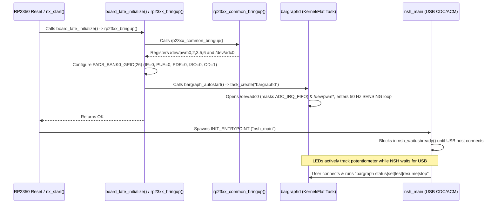
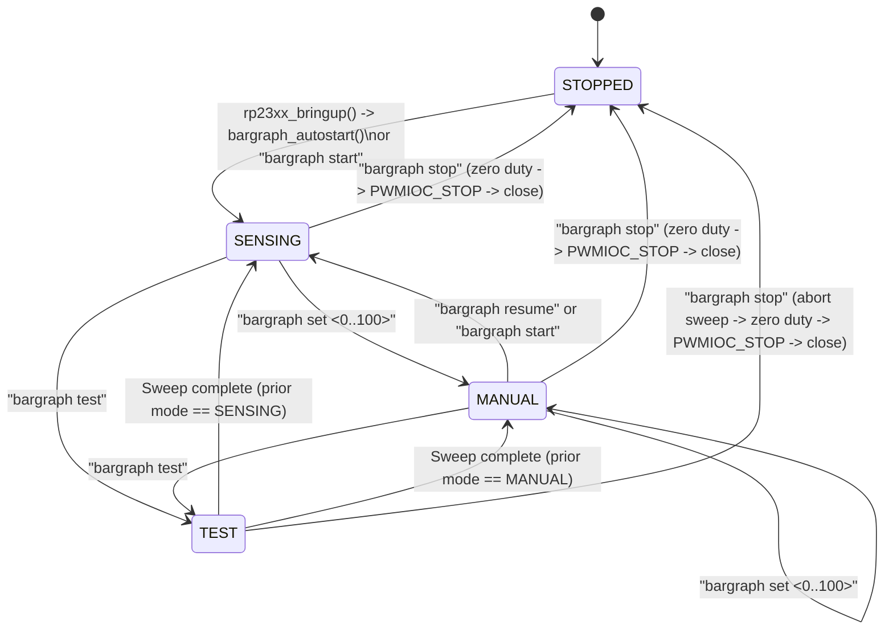

# Out-of-Tree Seeed Studio XIAO RP2350 6-Segment PWM LED Bar Graph (`xiao-rp2350-bargraph/`)

*   **Author:** Brett Morgan
*   **Status:** Draft
*   **Date:** 2026-11-16

---

## Overview

This design defines an out-of-tree Apache NuttX board support package (`xiao-rp2350-bargraph/board/`) and built-in user-space application (`xiao-rp2350-bargraph/apps/bargraph/`) for a Seeed Studio XIAO RP2350 wired on a 400-tie-point solderless breadboard with one linear potentiometer and six discrete active-high LEDs.

At power-on, the firmware initializes the RP2350 analog-to-digital converter (`/dev/adc0`) and five hardware pulse-width modulation slices (`/dev/pwm0`, `/dev/pwm2`, `/dev/pwm3`, `/dev/pwm5`, and `/dev/pwm6`), and launches a background daemon (`bargraphd`) before any USB-C host serial connection is opened. The daemon samples the potentiometer on `D0/A0` (`GPIO26`) at 50 Hz and drives the six LEDs on `D1` through `D6` (`GPIO27`, `GPIO28`, `GPIO5`, `GPIO6`, `GPIO7`, and `GPIO0`) as a continuous bar graph: lower segments below the reading illuminate at 100% duty cycle, the active segment modulates its brightness proportionally to the position within that sixth of the range, and upper segments remain off (`0%` duty cycle). When a host computer attaches over USB-C CDC/ACM (`/dev/ttyACM0`), NuttShell (`nsh`) provides an interactive console where the `bargraph` command can query telemetry or control the daemon (`start`, `stop`, `status`, `test`, `set <0..100>`, and `resume`). Both the `nuttx/` and `apps/` git submodules remain unmodified.

## The Problem

Building a self-contained analog sensor and multi-channel PWM display on the Seeed Studio XIAO RP2350 under Apache NuttX exposes seven concrete hardware, driver, and boot-sequencing obstacles when keeping `nuttx/` and `apps/` clean:

1.  **Unregistered Peripheral Devices in Default Board Configuration**: The upstream `xiao-rp2350:usbnsh` configuration omits `CONFIG_BOARD_LATE_INITIALIZE=y`, which compiles out `board_late_initialize()` in `rp23xx_boardinitialize.c` and prevents `rp23xx_bringup()` from registering `/dev/adc0` and `/dev/pwm*`.
2.  **USB Console Blocking Before Application Startup**: When NSH runs over USB CDC/ACM (`nsh_usbconsole.c`), `nsh_consolemain()` blocks inside `nsh_waitusbready()` until a host computer opens `/dev/ttyACM0` and sends three newline or carriage-return characters. Starting the bar graph from an interactive NSH login script or foreground entrypoint leaves the LEDs dark when the board is powered from a standalone USB power supply without a host PC.
3.  **Multi-Channel PWM Indexing and Dual Kconfig Guards**: The RP2350 shares PWM slice 3 between `D4` (`GPIO6`, `PWM3A`) and `D5` (`GPIO7`, `PWM3B`), while `D1` (`GPIO27`, `PWM5B`) and `D3` (`GPIO5`, `PWM2B`) reside on hardware channel B of their respective slices. In `nuttx/arch/arm/src/rp23xx/rp23xx_pwm.c`, `pwm_start()` and `setup_pulse()` ignore `info->channels[i].channel` and map `channels[0].duty` to channel A (`CC[15:0]`) and `channels[1].duty` to channel B (`CC[31:16]`), whereas the upper-half API contract in `nuttx/include/nuttx/timers/pwm.h` treats `channel == 0` as an unused slot and `channel == -1` as a terminator (while `nuttx/drivers/timers/pwm.c` copies `struct pwm_info_s` verbatim via `memcpy()`). Furthermore, the RP23xx C sources check `CONFIG_PWM_NCHANNELS == 2` while `arch/arm/src/rp23xx/Kconfig` defines `CONFIG_RP23XX_PWM_MULTICHAN` and `CONFIG_RP23XX_PWM_NCHANNELS`.
4.  **16-Bit Duty Truncation (`b16ONE` Overflow)**: `struct rp23xx_pwm_lowerhalf_s` stores duty cycle as `uint16_t` rather than `ub16_t` (`uint32_t`). Passing the standard NuttX 100% fixed-point value `b16ONE` (`0x00010000` = `65536`) truncates to `0x0000`, turning a segment off at 100% brightness.
5.  **Frozen GPIO State on `PWMIOC_STOP` While Descriptor Remains Open**: `pwm_stop()` (`clear_enabled()`) in `rp23xx_pwm.c` clears `1 << priv->num` in `RP23XX_PWM_EN` without driving the output low, freezing each LED pad at whichever level the counter held until `close()` invokes `pwm_shutdown()` to mux the pin back to `RP23XX_GPIO_FUNC_SIO` driven low (`0`).
6.  **ADC Pin-Mux Reset on `GPIO26`–`GPIO29`, Round-Robin Channel Scanning, and RP2350-E9 Pad Leakage on `D0`**: During `/dev/adc0` registration, `my_reset()` in `rp23xx_adc.c` unconditionally resets all four ADC GPIOs (`GPIO26`–`GPIO29`) to `RP23XX_GPIO_FUNC_NULL`, and `get_next_channel()` round-robin scans every enabled `CONFIG_RP23XX_ADC_CHANNEL*` entry into `/dev/adc0`. Additionally, leaving the digital input buffer enabled (`IE=1`) on `GPIO26` introduces RP2350-E9 pad leakage across mid-scale potentiometer voltages.
7.  **500 kS/s Self-Retriggering `START_ONCE` ADC Interrupt Storm, FIFO Staleness, and 19-Bit Left-Shift**: In `rp23xx_adc.c`, `interrupt_handler()` unconditionally calls `get_next_channel()` at the end of every FIFO IRQ (even when `au_receive()` returns `-ENOMEM` on a full upper-half FIFO), writing `RP23XX_ADC_CS_START_ONCE` to trigger an immediate 96-cycle (`2 µs`, 500,000 conversions/second) single-shot conversion and shifting each 12-bit sample left by 19 bits (`value <<= 19`). Because the RP2350 `ADC_DIV` register only paces free-running `START_MANY` conversions and has no effect on `START_ONCE` writes, keeping `/dev/adc0` open with `RP23XX_ADC_IRQ_FIFO` unmasked in the NVIC starves the CPU with `500,000 IRQ/s` and fills the software FIFO with stale samples.

This design solves these problems entirely within an out-of-tree directory (`xiao-rp2350-bargraph/`) by combining a custom board bringup layer, targeted pad register configuration during `rp23xx_bringup()`, demand-driven NVIC ADC interrupt gating inside an autonomous background daemon (`bargraphd`), and a thread-safe NSH control utility (`bargraph`).

## Goals

*   **Zero Submodule Modifications**: Ensure `git status --porcelain` and `git diff` produce empty output in both `nuttx/` and `apps/` by housing all board, driver bringup, and application files under `xiao-rp2350-bargraph/`.
*   **Autonomous Power-On Operation**: Start `bargraphd` during `board_late_initialize()` -> `rp23xx_bringup()` so the 6-LED bar graph tracks the potentiometer within milliseconds of power-on without requiring a USB-C host connection or host `genromfs`/`xxd` binaries.
*   **Stable 50 Hz Potentiometer Sensing**: Sample `D0/A0` (`GPIO26`, `ADC0`) every 20 ms using demand-driven NVIC IRQ gating (`up_disable_irq(RP23XX_ADC_IRQ_FIFO)` during sleep, `ANIOC_RESET_FIFO` + `up_enable_irq(RP23XX_ADC_IRQ_FIFO)` during a 5-sample read where the 1st latched sample is discarded and the 4 fresh samples are averaged), a Q4 integer exponential moving average filter (`alpha = 1/4`, `filtered = (ema_q4 + 8) >> 4`), endpoint deadbands (`<= 32` clamped to `0`, `>= 4063` clamped to `4095`), and RP2350-E9 digital pad isolation (`IE=0`, `PUE=0`, `PDE=0`, `ISO=0`, `OD=1`).
*   **Proportional 6-Segment Hardware PWM Display**: Drive `D1`–`D6` (`PWM5B`, `PWM6A`, `PWM2B`, `PWM3A`, `PWM3B`, `PWM0A`) at `1000 Hz` with `uint16_t`-safe duty cycles (`0..65535`), keeping lower segments at `65535` (100%), linearly interpolating the active segment across `0..65535`, and setting upper segments to `0` (0%).
*   **Interactive USB-C NSH Coexistence and CLI Control**: Provide the `bargraph` built-in command over the USB-C CDC/ACM NSH console supporting `start`, `stop`, `status`, `test`, `set <0..100>`, and `resume` with deterministic synchronization against `bargraphd`.
*   **Complete Breadboard & EGM Documentation**: Provide a reproducible 400-tie-point breadboard layout, bill of materials, current budget, and Elephant/Goldfish Memory (EGM) `README.md` contracts—structured directory documentation following the workspace non-leaf blueprint format ([`README.md`](../../README.md): `Overview`, `Subdirectories & Boundaries`, `Invariants`, `Side Effects`, `Verification`) and leaf contract format ([`nuttx/boards/arm/rp23xx/xiao-rp2350/src/README.md`](../../../../nuttx/boards/arm/rp23xx/xiao-rp2350/src/README.md): `Overview`, `Interface`, `Invariants`, `Side Effects`, `Verification` with `[file:symbol]` citations)—for every directory in `xiao-rp2350-bargraph/`.

## Non-Goals

*   Modifying any tracked source file, header, Kconfig, or Makefile inside `nuttx/` or `apps/`.
*   Supporting a hardware UART console on `D6`/`D7` (`GPIO0` is dedicated to `LED6` via `PWM0A`).
*   Persisting manual override values to flash, remapping GPIO pins at runtime, or streaming continuous telemetry to the terminal without user polling.

## Open Questions

*   None. All hardware pin assignments, driver workarounds, and CLI subcommands were resolved during the concepts phase.

## Critical User Journeys (CUJs)

### CUJ 1: Standalone Power-On and Live Potentiometer Tracking

*   **Given**: The Seeed Studio XIAO RP2350 is flashed with the `xiao-rp2350-bargraph:bargraph` firmware, wired on the breadboard with the `10 kΩ` potentiometer on `D0/A0` and six LEDs (`D1`–`D6`), and connected to a 5V USB power source with no host terminal open.
*   **When**: The board powers on and the user rotates the potentiometer wiper smoothly from `0.0 V` (`GND`) to `3.3 V` (`3V3`).
*   **Then**: `bargraphd` starts automatically during `rp23xx_bringup()`. At `0.0 V`, all six LEDs are off (`duty = 0`). As the wiper sweeps upward, `D1` ramps smoothly in brightness from `0%` to `100%` (`0.0%`–`16.7%` rotation), stays locked at `100%` while `D2` ramps (`16.7%`–`33.3%`), and continues sequentially through `D3`, `D4`, `D5`, and `D6` until all six LEDs are lit at `100%` duty (`65535`) at the top of travel.

### CUJ 2: USB-C NSH Console Telemetry Inspection (`bargraph status`)

*   **Given**: The board is running `bargraphd` in `SENSING` mode and a user connects a host computer over USB-C, opens `/dev/ttyACM0`, and presses Enter three times to reach the `nsh>` prompt.
*   **When**: The user runs `bargraph status` at the `nsh>` prompt.
*   **Then**: The CLI reads a consistent snapshot of the daemon state and prints the current daemon state (`SENSING`), raw 12-bit ADC count (`0..4095`), filtered ADC count (`0..4095`), estimated voltage in millivolts (`0..3300 mV`), normalized percentage (`0.0%..100.0%`), and the per-segment PWM duty cycle (`0..65535` and `0%..100%`) for `LED1` through `LED6`, without interrupting 50 Hz LED updates.

### CUJ 3: Manual Percentage Override, Hardware Sweep Test, and Safe Stop

*   **Given**: The user is connected to the `nsh>` prompt over USB-C CDC/ACM.
*   **When**: The user executes `bargraph set 50`, then `bargraph test`, then `bargraph resume`, and finally `bargraph stop`.
*   **Then**:
    1.  On `bargraph set 50`, the daemon transitions to `MANUAL` mode, ignores potentiometer movement, lights `D1`, `D2`, and `D3` at `100%` (`65535`), and sets `D4`, `D5`, and `D6` to `0%` (`0`).
    2.  On `bargraph test`, the daemon executes a smooth `0% -> 100% -> 0%` sweep across `D1`–`D6` over ~2 seconds so the user can visually verify every LED and PWM channel, then restores the previous active mode.
    3.  On `bargraph resume` (or `bargraph start`), the daemon returns to `SENSING` mode and immediately tracks the live potentiometer position.
    4.  On `bargraph stop`, the daemon writes `duty = 0` to all six PWM channels, issues `PWMIOC_STOP`, and closes the PWM and ADC file descriptors (causing `pwm_shutdown()` to mux all six LED pins to `RP23XX_GPIO_FUNC_SIO` driven low) before terminating the daemon task.

---

## Technical Plan (Architecture)

### 1. System Architecture & Out-of-Tree Build Topology

All custom board configuration, peripheral bringup hooks, and user-space application code live inside `xiao-rp2350-bargraph/` at the repository root so that `nuttx/` and `apps/` remain clean git submodules:

```text
nuttxspace-egm/
├── nuttx/                                  # Unmodified upstream NuttX submodule
├── apps/                                   # Unmodified upstream nuttx-apps submodule
│   └── external -> ../xiao-rp2350-bargraph/apps   # Git-ignored symlink created at build time
└── xiao-rp2350-bargraph/
    ├── .gitignore
    ├── README.md
    ├── board/                              # Out-of-tree custom board (CONFIG_ARCH_BOARD_CUSTOM)
    │   ├── README.md
    │   ├── Kconfig
    │   ├── configs/
    │   │   ├── README.md
    │   │   └── bargraph/
    │   │       ├── README.md
    │   │       └── defconfig
    │   ├── include/
    │   │   ├── README.md
    │   │   └── board.h
    │   ├── scripts/
    │   │   ├── README.md
    │   │   ├── Make.defs
    │   │   └── memmap_default.ld
    │   └── src/
    │       ├── README.md
    │       ├── Make.defs
    │       ├── rp23xx_pico.h
    │       ├── rp23xx_boardinitialize.c
    │       └── rp23xx_bringup.c
    └── apps/                               # Out-of-tree application root (linked as apps/external)
        ├── README.md
        ├── Kconfig
        ├── Makefile
        ├── Make.defs
        └── bargraph/
            ├── README.md
            ├── Kconfig
            ├── Makefile
            ├── Make.defs
            ├── bargraph_internal.h
            └── bargraph_main.c
```

#### Out-of-Tree Board Discovery (`CONFIG_ARCH_BOARD_CUSTOM`)

`xiao-rp2350-bargraph/board/configs/bargraph/defconfig` sets:
*   `CONFIG_ARCH_BOARD_CUSTOM=y`
*   `CONFIG_ARCH_BOARD_CUSTOM_NAME="xiao-rp2350-bargraph"`
*   `CONFIG_ARCH_BOARD_CUSTOM_DIR="../xiao-rp2350-bargraph/board"`
*   `CONFIG_ARCH_BOARD_CUSTOM_DIR_RELPATH=y`
*   `CONFIG_ARCH_BOARD_COMMON=y`

When `tools/configure.sh ../xiao-rp2350-bargraph/board/configs/bargraph` runs inside `nuttx/`:
1.  `nuttx/tools/Config.mk` resolves `BOARD_DIR` to `$(TOPDIR)/../xiao-rp2350-bargraph/board` and `BOARD_COMMON_DIR` to `$(TOPDIR)/boards/arm/rp23xx/common`.
2.  `nuttx/tools/Unix.mk` links `include/arch/board` to `xiao-rp2350-bargraph/board/include`, links `arch/arm/src/board` to `nuttx/boards/arm/rp23xx/common` (ignored by `nuttx/boards/.gitignore` and `nuttx/arch/arm/src/.gitignore`), and links `arch/arm/src/board/board` to `xiao-rp2350-bargraph/board/src`.
3.  `nuttx/boards/arm/rp23xx/common/Makefile` includes both `src/Make.defs` (compiling `rp23xx_common_bringup.c`, `rp23xx_common_initialize.c`, and `rp23xx_pwmdev.c`) and `board/Make.defs` (compiling `xiao-rp2350-bargraph/board/src/rp23xx_boardinitialize.c` and `rp23xx_bringup.c`).

#### Out-of-Tree Application Discovery (`apps/external` Symlink)

`apps/.gitignore` explicitly ignores `/external` and `/Kconfig`. In `apps/Make.defs`, `-include $(TOPDIR)/Make.defs` executes at line 24 before `BUILDIRS := $(dir $(wildcard $(APPDIR)/*/Make.defs))` at line 32. By placing a `distclean`-guarded shell hook in `xiao-rp2350-bargraph/board/scripts/Make.defs`:

```makefile
ifeq ($(filter distclean clean_context apps_distclean,$(MAKECMDGOALS)),)
$(shell if [ ! -e "$(TOPDIR)/../apps/external" ]; then \
  ln -s ../xiao-rp2350-bargraph/apps "$(TOPDIR)/../apps/external"; \
fi)
endif
```

the symlink `apps/external -> ../xiao-rp2350-bargraph/apps` is created automatically before `apps` scans its subdirectories and is not recreated when `nuttx/tools/Unix.mk` runs `$(MAKE) clean_context` during `make distclean`. Furthermore, `xiao-rp2350-bargraph/apps/Kconfig` is tracked in git with relative `source "$APPSDIR/external/bargraph/Kconfig"`, `xiao-rp2350-bargraph/apps/Makefile` omits `MENUDESC` before including `$(APPDIR)/Directory.mk` (preventing `make distclean` from deleting `xiao-rp2350-bargraph/apps/Kconfig`) and removes `$(APPDIR)/external` on `distclean`, and `xiao-rp2350-bargraph/.gitignore` ignores generated NuttX build files (`*.o`, `.built`, `.depend`, `.kconfig`, `Make.dep`, `.context`).

---

### 2. Hardware Pinout, Breadboard Layout & Electrical Budget

#### Pin Assignment & Peripheral Mapping

| Signal Role | Bar Segment & Range | XIAO Pin | RP2350 GPIO | Peripheral Device | Hardware Slice & Channel | `pwm_info_s` Index |
| :--- | :--- | :--- | :--- | :--- | :--- | :--- |
| Potentiometer Wiper | `0.0% – 100.0%` (`0–3.3V`) | Pin 1 (`D0/A0`) | `GPIO26` | `/dev/adc0` | `ADC` Channel 0 | N/A |
| `LED1` (Lowest) | Segment 1 (`0.0% – 16.7%`) | Pin 2 (`D1/A1`) | `GPIO27` | `/dev/pwm5` | Slice 5, Channel B (`PWM5B`) | `channels[1]` (`channel = 2`) |
| `LED2` | Segment 2 (`16.7% – 33.3%`) | Pin 3 (`D2/A2`) | `GPIO28` | `/dev/pwm6` | Slice 6, Channel A (`PWM6A`) | `channels[0]` (`channel = 1`) |
| `LED3` | Segment 3 (`33.3% – 50.0%`) | Pin 4 (`D3`) | `GPIO5` | `/dev/pwm2` | Slice 2, Channel B (`PWM2B`) | `channels[1]` (`channel = 2`) |
| `LED4` | Segment 4 (`50.0% – 66.7%`) | Pin 5 (`D4/SDA`) | `GPIO6` | `/dev/pwm3` | Slice 3, Channel A (`PWM3A`) | `channels[0]` (`channel = 1`) |
| `LED5` | Segment 5 (`66.7% – 83.3%`) | Pin 6 (`D5/SCL`) | `GPIO7` | `/dev/pwm3` | Slice 3, Channel B (`PWM3B`) | `channels[1]` (`channel = 2`) |
| `LED6` (Highest) | Segment 6 (`83.3% – 100.0%`) | Pin 7 (`D6/TX`) | `GPIO0` | `/dev/pwm0` | Slice 0, Channel A (`PWM0A`) | `channels[0]` (`channel = 1`) |
| `3.3V` Rail Supply | Analog & logic reference | Pin 12 (`3V3`) | `3V3_OUT` | On-board LDO | `3.3 V` nominal | N/A |
| Ground Reference | Common return | Pin 13 (`GND`) | `GND` | Ground plane | `0.0 V` | N/A |

#### 400-Tie-Point Breadboard Layout

```text
       +3.3V Rail (Red +)                         GND Rail (Blue -)
         |                                          |
  Row 1: +---[ Potentiometer Lug 1 (CW / 3.3V) ]    |
  Row 2:     [ Potentiometer Lug 2 (Wiper) ]--------+---> Jumper to Row 5A (D0/A0, GPIO26)
  Row 3:     [ Potentiometer Lug 3 (CCW / GND) ]----+     (Optional 100 nF cap: Row 5B to GND)
                                                    |
                   Cols A..E     Center    Cols F..J|
  Row 5:     [D0/A0  GPIO26 (5E)]  ||  [(5F) 5V    ] (Unconnected)
  Row 6:     [D1/A1  GPIO27 (6E)]  ||  [(6F) GND   ]+---> Jumper Row 6J to Blue (-) GND Rail
  Row 7:     [D2/A2  GPIO28 (7E)]  ||  [(7F) 3V3   ]+---> Jumper Row 7J to Red (+) 3.3V Rail
  Row 8:     [D3     GPIO5  (8E)]  ||  [(8F) GPIO2 ]
  Row 9:     [D4     GPIO6  (9E)]  ||  [(9F) GPIO4 ]
  Row 10:    [D5     GPIO7 (10E)]  ||  [(10F) GPIO3]
  Row 11:    [D6     GPIO0 (11E)]  ||  [(11F) GPIO1]
                                                    |
  Row 14: Jumper from 6A  (D1) -> [330 Ohm] -> [LED1 +  -] ---> Blue (-) GND Rail
  Row 15: Jumper from 7A  (D2) -> [330 Ohm] -> [LED2 +  -] ---> Blue (-) GND Rail
  Row 16: Jumper from 8A  (D3) -> [330 Ohm] -> [LED3 +  -] ---> Blue (-) GND Rail
  Row 17: Jumper from 9A  (D4) -> [330 Ohm] -> [LED4 +  -] ---> Blue (-) GND Rail
  Row 18: Jumper from 10A (D5) -> [330 Ohm] -> [LED5 +  -] ---> Blue (-) GND Rail
  Row 19: Jumper from 11A (D6) -> [330 Ohm] -> [LED6 +  -] ---> Blue (-) GND Rail
```

#### Electrical & Current Budget

*   **LED Current (per segment at 100% duty)**: With $V_{DD} = 3.3\text{ V}$, $V_F \approx 2.0\text{ V}$ (standard red/yellow/green diffused LED), and $R = 330\ \Omega$:
    $$I_{\text{LED}} = \frac{3.3\text{ V} - 2.0\text{ V}}{330\ \Omega} \approx 3.94\text{ mA}$$
    This is below the RP2350 default 4 mA / 8 mA pad drive limit (12 mA max per GPIO pin).
*   **Total 6-LED Current (all segments at 100% duty)**: $6 \times 3.94\text{ mA} \approx 23.6\text{ mA}$, well within the RP2350 200 mA total `IOVDD` current limit and the XIAO 3.3V regulator budget.
*   **Potentiometer Current (`10 kΩ` linear `B10K`)**: $3.3\text{ V} / 10\text{ k}\Omega = 0.33\text{ mA}$ continuous draw. Maximum Thevenin source impedance at mid-scale ($50\%$) is $R_S = 10\text{ k}\Omega / 4 = 2.5\text{ k}\Omega$.

---

### 3. Boot Sequence & Autonomous Startup Coexistence with USB-C NSH

In upstream NuttX, `nsh_usbconsole.c` waits inside `nsh_waitusbready()` until a USB host opens `/dev/ttyACM0` and transmits three `\r` or `\n` bytes. To ensure the LED bar graph operates immediately at power-on (even on a standalone 5V USB power brick), `bargraphd` is spawned during `board_late_initialize()` before `nx_start_application()` starts `nsh_main`:



---

### 4. RP2350 Peripheral & Driver Mitigation Design

#### 4.1 ADC Subsystem Mitigations (`GPIO26` / `ADC0`)

1.  **Single-Channel `ADC0` Selection & `GPIO26`–`GPIO29` Pin-Mux Ordering**:
    In `nuttx/arch/arm/src/rp23xx/rp23xx_adc.c`, `my_reset()` loops unconditionally over all four ADC GPIOs (`g_gpio_map = {26, 27, 28, 29, -1}`) when `/dev/adc0` is registered and calls `rp23xx_gpio_set_function(pin, RP23XX_GPIO_FUNC_NULL)`. Because `rp23xx_pwm_initialize()` only records pin numbers during `rp23xx_common_bringup()` and defers `rp23xx_gpio_set_function(pin, RP23XX_GPIO_FUNC_PWM)` to `pwm_setup()` when `/dev/pwm5` (`GPIO27`) and `/dev/pwm6` (`GPIO28`) are opened by `bargraphd` after `rp23xx_common_bringup()`, `D1` and `D2` automatically acquire `RP23XX_GPIO_FUNC_PWM`. Meanwhile, `get_next_channel()` in `rp23xx_adc.c` round-robin scans all enabled `priv->has_channel[]` entries into `/dev/adc0`. To prevent `get_next_channel()` from multiplexing non-potentiometer channels into the `/dev/adc0` FIFO, the board `defconfig` enables **only** `CONFIG_RP23XX_ADC_CHANNEL0=y` and leaves `ADC_CHANNEL1`, `ADC_CHANNEL2`, `ADC_CHANNEL3`, and `ADC_TEMPERATURE` disabled.
2.  **Erratum RP2350-E9 Digital Pad Isolation on `GPIO26`**:
    `rp23xx_adc.c` sets `GPIO26` function to `NULL` (`0x1f`) and disables pulls, but leaves `RP23XX_PADS_BANK0_GPIO_IE` (`bit 6`, Input Enable) set. On RP2350, an enabled digital input buffer causes mid-scale analog pad leakage (RP2350-E9). Immediately after `rp23xx_common_bringup()` returns in `xiao-rp2350-bargraph/board/src/rp23xx_bringup.c`, the board bringup modifies `RP23XX_PADS_BANK0_GPIO(26)`:
    *   Clears `RP23XX_PADS_BANK0_GPIO_IE` (`bit 6`), `RP23XX_PADS_BANK0_GPIO_PUE` (`bit 3`), `RP23XX_PADS_BANK0_GPIO_PDE` (`bit 2`), and `RP23XX_PADS_BANK0_GPIO_ISO` (`bit 8`).
    *   Sets `RP23XX_PADS_BANK0_GPIO_OD` (`bit 7`, Output Disable).
3.  **Demand-Driven NVIC IRQ Gating (`RP23XX_ADC_IRQ_FIFO`)**:
    In `rp23xx_adc.c`, `interrupt_handler()` unconditionally calls `get_next_channel()` at the end of every FIFO interrupt (even when `au_receive()` returns `-ENOMEM` on a full upper-half FIFO), writing `RP23XX_ADC_CS_START_ONCE` (`bit 2`) to start a new 96-cycle (`2 µs`, 500 kS/s) single-shot conversion. Because the RP2350 `ADC_DIV` register only paces free-running `START_MANY` conversions and does not delay `START_ONCE` triggers, `bargraphd` (running in flat build mode, `CONFIG_BUILD_FLAT=y`) gates `RP23XX_ADC_IRQ_FIFO` at the NVIC via `up_disable_irq(RP23XX_ADC_IRQ_FIFO)` and `up_enable_irq(RP23XX_ADC_IRQ_FIFO)`:
    *   Immediately after `open("/dev/adc0", O_RDONLY)`, `bargraphd` calls `up_disable_irq(RP23XX_ADC_IRQ_FIFO)`. The single in-flight `START_ONCE` conversion finishes in `2 µs` and latches one sample in `RP23XX_ADC_FIFO`, leaving the IRQ pending in the NVIC with **zero** ADC interrupts firing during the `20 ms` sleep window.
    *   On each `50 Hz` (`20 ms`) sample burst, `bargraphd` flushes the software FIFO (`ANIOC_RESET_FIFO`), unmasks `RP23XX_ADC_IRQ_FIFO` via `up_enable_irq(RP23XX_ADC_IRQ_FIFO)`, reads `5` `struct adc_msg_s` samples (`~10 µs` total), and immediately masks `up_disable_irq(RP23XX_ADC_IRQ_FIFO)`.
    *   This reduces the ADC interrupt rate from `500,000 IRQ/s` to `250 IRQ/s` (`99.95%` reduction) and reduces per-tick acquisition blocking to `~10 µs`.
4.  **Persistent Descriptor, FIFO Flush, and 19-Bit Shift Recovery**:
    *   In `rp23xx_adc.c`, closing `/dev/adc0` invokes `my_shutdown()` -> `remove_device(dev)` under `dev->ad_lock` without masking `RP23XX_ADC_IRQ_FIFO`, relying on the next `interrupt_handler()` seeing `g_active_count == 0` to clear `RP23XX_ADC_CS` and `RP23XX_ADC_INTE`. `bargraphd` therefore opens `/dev/adc0` once on startup, keeps the descriptor open until `bargraph stop`, and calls `up_enable_irq(RP23XX_ADC_IRQ_FIFO)` immediately before `close(adc_fd)` on shutdown so `interrupt_handler()` completes its `g_active_count == 0` teardown cleanly.
    *   During each 50 Hz burst, `bargraphd` calls `ioctl(adc_fd, ANIOC_RESET_FIFO, 0)`, unmasks `RP23XX_ADC_IRQ_FIFO`, reads `5` `struct adc_msg_s` entries (`CONFIG_ADC_FIFOSIZE=16`), masks `RP23XX_ADC_IRQ_FIFO`, discards the first entry `msgs[0]` (which was latched in the hardware FIFO at the end of the previous burst), and averages the `4` fresh samples `msgs[1..4]`.
    *   Because `rp23xx_adc.c` shifts the 12-bit result left by 19 bits (`value <<= 19`) and sets `am_data = -value` on conversion errors, `bargraphd` checks `msg.am_data >= 0` and extracts the 12-bit unsigned value as:
        $$\text{raw}_{12} = (\text{uint16\_t})((\text{msg.am\_data} \gg 19) \ \& \ \text{0x0FFF})$$
5.  **Filtering & Endpoint Deadband Clamping**:
    *   The 4 fresh burst samples (`msgs[1..4]`) are averaged into `raw_avg` (`0..4095`).
    *   An integer exponential moving average (EMA) with $\alpha = 1/4$ smooths mechanical wiper jitter using a fixed-point Q4 accumulator (`ema_q4`), seeded on the first sample burst (`!ema_initialized`) to `ema_q4 = (uint32_t)raw_avg << 4`:
        $$\text{ema\_q4} \leftarrow \text{ema\_q4} - (\text{ema\_q4} \gg 2) + (\text{raw\_avg} \ll 2), \quad \text{filtered} = (\text{ema\_q4} + 8) \gg 4$$
    *   Endpoint deadbands clamp `filtered <= 32` (`~0.8%`) to `0` and `filtered >= 4063` (`~99.2%`) to `4095` so the user can reliably reach zero duty (`0%` across all 6 LEDs) and full saturation (`100%` on all 6 LEDs) despite potentiometer mechanical end-stop resistance.

#### 4.2 Hardware PWM Subsystem Mitigations (`D1`–`D6`)

1.  **Dual Kconfig Multi-Channel Guards & Unused Sibling Pin Masking**:
    `nuttx/boards/arm/rp23xx/common/src/rp23xx_common_bringup.c`, `rp23xx_pwmdev.c`, and `rp23xx_pwm.c` check `#if defined(CONFIG_PWM_NCHANNELS) && CONFIG_PWM_NCHANNELS == 2`, whereas `arch/arm/src/rp23xx/Kconfig` defines `CONFIG_RP23XX_PWM_MULTICHAN` and `CONFIG_RP23XX_PWM_NCHANNELS` (while `drivers/timers/Kconfig` defines `CONFIG_PWM` and `CONFIG_PWM_NCHANNELS` without a `CONFIG_PWM_MULTICHAN` symbol). The board `defconfig` enables `CONFIG_PWM=y`, `CONFIG_PWM_NCHANNELS=2`, `CONFIG_RP23XX_PWM=y`, `CONFIG_RP23XX_PWM_MULTICHAN=y`, and `CONFIG_RP23XX_PWM_NCHANNELS=2`, and sets unused sibling pins to `-1`:
    *   Slice 0 (`/dev/pwm0`): `PWM0A_GPIO=0` (`D6`), `PWM0B_GPIO=-1`
    *   Slice 2 (`/dev/pwm2`): `PWM2A_GPIO=-1`, `PWM2B_GPIO=5` (`D3`)
    *   Slice 3 (`/dev/pwm3`): `PWM3A_GPIO=6` (`D4`), `PWM3B_GPIO=7` (`D5`)
    *   Slice 5 (`/dev/pwm5`): `PWM5A_GPIO=-1`, `PWM5B_GPIO=27` (`D1`)
    *   Slice 6 (`/dev/pwm6`): `PWM6A_GPIO=28` (`D2`), `PWM6B_GPIO=-1`
    In `rp23xx_pwm.h`, `priv->pin[i]` is a signed `int8_t`, and `pwm_setup()` in `rp23xx_pwm.c` checks `if (priv->pin[i] >= 0)`, so setting `-1` leaves the sibling GPIOs untouched.
2.  **Two-Channel `struct pwm_info_s` Population**:
    Because the upper-half contract in `nuttx/include/nuttx/timers/pwm.h` treats `channel == 0` as an unused slot and `channel == -1` as a terminator (while `nuttx/drivers/timers/pwm.c` copies `struct pwm_info_s` via `memcpy()` and calls `lower->ops->start()` automatically inside `PWMIOC_SETCHARACTERISTICS` once `upper->started` is true) and the lower-half driver (`rp23xx_pwm.c`) maps `channels[0].duty` to hardware channel A (`CC[15:0]`) and `channels[1].duty` to hardware channel B (`CC[31:16]`), `bargraphd` always populates every slice's `struct pwm_info_s` with:
    *   `info.frequency = 1000` (`1 kHz`, which in `setup_period()` at `150 MHz` peripheral clock computes `DIV = 36` [`0x24`, divider `2.25` in 8.4 fixed-point] and `TOP = 65535` [`0xffff`] for full 16-bit counter resolution at `~1017.25 Hz`)
    *   `info.channels[0].channel = 1`, `info.channels[0].duty = duty_a`
    *   `info.channels[1].channel = 2`, `info.channels[1].duty = duty_b`
    On `/dev/pwm3`, `duty_a` is `LED4` (`D4`) and `duty_b` is `LED5` (`D5`), updated atomically via `ioctl(fd, PWMIOC_SETCHARACTERISTICS, &info)` (followed by `ioctl(fd, PWMIOC_START, 0)` on the initial start of each slice).
3.  **16-Bit Duty Scaling (`0..65535`) and 6-Segment Transfer Function**:
    To avoid the `uint16_t` truncation bug in `rp23xx_pwm.c` when `duty == b16ONE` (`65536` -> `0`), maximum duty is defined as `BARGRAPH_DUTY_MAX = 65535` (`0xFFFF`). Given a normalized input level $L \in [0, 4095]$ (or in `MANUAL`/`TEST` mode, $U \in [0, 6 \times 65535]$):
    *   Scale input to total bar units $U \in [0, 6 \times 65535]$ ($[0, 393210]$):
        $$U = \left\lfloor \frac{L \times 393210 + 2047}{4095} \right\rfloor$$
    *   For each segment $k \in \{0, 1, 2, 3, 4, 5\}$ corresponding to `LED1`..`LED6` with segment threshold $T_k = k \times 65535$:
        $$\text{duty}_k = \begin{cases} 65535 & \text{if } U \ge T_k + 65535 \\ U - T_k & \text{if } T_k < U < T_k + 65535 \\ 0 & \text{if } U \le T_k \end{cases}$$
4.  **Clean Shutdown via Zero-Duty, `PWMIOC_STOP`, and `close()` (`pwm_shutdown()`)**:
    In `rp23xx_pwm.c`, `pwm_stop()` (`PWMIOC_STOP`) only clears `1 << priv->num` in `RP23XX_PWM_EN` via `clear_enabled()` (leaving the GPIO pad frozen while the descriptor remains open), whereas `close(fd)` invokes `pwm_shutdown()`, which calls `pwm_stop()`, configures `pin[0]` and `pin[1]` as outputs driven low (`0`), switches their mux to `RP23XX_GPIO_FUNC_SIO`, and zeros `priv->duty[]`. On shutdown, `bargraphd` writes `duty_a = 0` and `duty_b = 0` via `PWMIOC_SETCHARACTERISTICS`, issues `PWMIOC_STOP` (to reset `upper->started = false` in `drivers/timers/pwm.c`), and calls `close(fd)` on all 5 PWM descriptors so every LED pin is driven cleanly low.

---

### 5. Daemon State Machine & IPC Synchronization

Because NuttX on RP2350 runs in flat build mode (`CONFIG_BUILD_FLAT=y`), `bargraphd` and transient `bargraph` NSH CLI processes share a single address space. They coordinate through a static global state structure (`g_bargraph`) protected by a POSIX mutex and condition variables:



#### Shared State Summary (`struct bargraph_state_s` in `bargraph_internal.h`)

| Field Group | Fields | Purpose & Invariants |
| :--- | :--- | :--- |
| Synchronization Primitives | `lock`, `wake_cond`, `done_cond` | Static `PTHREAD_MUTEX_INITIALIZER` and `PTHREAD_COND_INITIALIZER` guarding all state transitions, 20 ms timed waits (`CLOCK_REALTIME`), and synchronous CLI handshakes (`start`, `stop`, `test`). |
| Lifecycle & Mode Flags | `mode`, `prev_mode`, `running`, `stop_requested`, `test_requested`, `init_err`, `daemon_pid` | Tracks active `enum bargraph_mode_e` (`STOPPED`, `SENSING`, `MANUAL`, `TEST`), pending CLI requests, startup error code (`0` on success, `-errno` on failure), and daemon task PID. |
| Telemetry & Duty Snapshot | `manual_pct`, `raw_adc`, `filtered_adc`, `millivolts`, `permille`, `duty[6]` | Consistent snapshot of latest 12-bit burst average (`0..4095`), Q4 EMA + deadband-clamped count (`0..4095`), estimated voltage (`0..3300 mV`), normalized permille (`0..1000`), and per-LED PWM duty (`0..65535`). |

#### CLI Subcommand Behavior (`bargraph <subcommand>`)

| Subcommand | Behavior |
| :--- | :--- |
| `bargraph start` | If `bargraphd` is not running (`STOPPED`), spawns `bargraphd` via `task_create()` and waits on `done_cond` until initialization succeeds (or returns `EXIT_FAILURE` if `init_err < 0`). If already running in `MANUAL` mode, transitions to `SENSING` mode and signals `wake_cond`. |
| `bargraph stop` | If running, sets `stop_requested = true`, signals `wake_cond`, and waits on `done_cond` until `bargraphd` aborts any in-progress `TEST` sweep, zeros all 6 PWM channels, calls `PWMIOC_STOP` and `close()` on `/dev/pwm*`, unmasks `RP23XX_ADC_IRQ_FIFO` and closes `/dev/adc0`, and sets `running = false`. |
| `bargraph status` | Locks `g_bargraph.lock`, copies a consistent snapshot of `mode`, `raw_adc`, `filtered_adc`, `millivolts`, `permille`, and `duty[0..5]`, unlocks, and prints formatted telemetry to `stdout`. |
| `bargraph set <0..100>` | Validates integer percentage `0..100` using `strtol()`. If `bargraphd` is stopped, starts it first. Sets `manual_pct`, sets `mode = BARGRAPH_MODE_MANUAL`, signals `wake_cond`, and prints confirmation. |
| `bargraph resume` | Transitions `mode` from `BARGRAPH_MODE_MANUAL` back to `BARGRAPH_MODE_SENSING` and signals `wake_cond`. Returns an informational message if already in `SENSING` mode or an error if `STOPPED`. |
| `bargraph test` | If `bargraphd` is stopped, starts it first. Sets `test_requested = true`, signals `wake_cond`, and waits on `done_cond` while `bargraphd` sweeps total bar brightness `0% -> 100% -> 0%` in 100 steps (`20 ms`/step, `2.0 s` total, checking `stop_requested` at each step), then restores `prev_mode` (`SENSING` or `MANUAL`). |

---

## Alternatives Considered

### Alternative A: Discrete On/Off GPIO Bar Graph (`/dev/userleds` or `/dev/gpioN`)

*   **Pros**: Avoids RP23xx multi-channel PWM Kconfig guards (`CONFIG_PWM_NCHANNELS` vs. `CONFIG_RP23XX_PWM_NCHANNELS`), `struct pwm_info_s` channel-array indexing mismatch, and 16-bit `uint16_t` duty truncation at `b16ONE`.
*   **Cons**: Limits the 6-LED display to 7 coarse discrete steps (`0` through `6` LEDs lit) with abrupt jumps at each `16.7%` threshold, hiding sub-segment potentiometer movement.
*   **Reason for Rejection**: Rejected by author: hardware PWM on `D1`–`D6` (`PWM5B`, `PWM6A`, `PWM2B`, `PWM3A`, `PWM3B`, `PWM0A`) provides continuous proportional brightness modulation on the active segment while locking lower segments at 100% duty and upper segments at 0% duty.

### Alternative B: Foreground Application Entrypoint (`CONFIG_INIT_ENTRYPOINT="bargraph_main"`)

*   **Pros**: Starts the bar graph loop directly as the initial user task without needing a separate `bargraph_autostart()` hook in `rp23xx_bringup()`.
*   **Cons**: Occupying the foreground init task either prevents NuttShell (`nsh_main`) from running on the USB-C CDC/ACM console or forces `bargraph_main` to duplicate NSH initialization and session management.
*   **Reason for Rejection**: Rejected by author: keeping `CONFIG_INIT_ENTRYPOINT="nsh_main"` while spawning `bargraphd` as a background daemon preserves standard interactive USB-C NSH behavior alongside continuous 50 Hz LED updates.

### Alternative C: Launching `bargraphd` Exclusively from a ROMFS Startup Script (`/etc/init.d/rcS`)

*   **Pros**: Uses the standard NSH shell script mechanism (`bargraph start`) without calling an application startup function from `rp23xx_bringup()`.
*   **Cons**: In `apps/system/nsh/nsh_main.c` and `apps/nshlib/nsh_usbconsole.c`, when `CONFIG_DEV_CONSOLE` is disabled (`usbnsh`), `nsh_initialize()` (`nsh_initscript()`) executes before `nsh_consolemain()` initializes USB CDC/ACM stdio, while `nsh_session()` (`nsh_loginscript()`) blocks inside `nsh_waitusbready()` until a host computer opens `/dev/ttyACM0` and sends three `\r` or `\n` characters. In addition, `nuttx/boards/Board.mk` requires host `genromfs` and `xxd` binaries to generate `etctmp.c`.
*   **Reason for Rejection**: Rejected by author: spawning `bargraphd` at the end of `rp23xx_bringup()` during `board_late_initialize()` guarantees immediate power-on operation before USB enumeration and removes external host build tool dependencies.

### Alternative D: Reusing `bargraph start` Alone Without a Dedicated `bargraph resume` Subcommand

*   **Pros**: Reduces the CLI surface by one subcommand name.
*   **Cons**: When the daemon is already running in `MANUAL` override mode after `bargraph set <0..100>`, typing `bargraph start` is less explicit to an interactive user than `bargraph resume`.
*   **Reason for Rejection**: Rejected by author: supporting `bargraph resume` while accepting `bargraph start` as a synonym to exit `MANUAL` mode back to `SENSING` mode makes interactive CLI usage explicit.

---

## Non-Functional Requirements

*   **Performance & CPU Utilization**:
    *   Gating `RP23XX_ADC_IRQ_FIFO` via `up_disable_irq()` / `up_enable_irq()` around each 50 Hz 5-sample burst reduces the `rp23xx_adc.c` `START_ONCE` interrupt rate from `500,000 IRQ/s` to `250 IRQ/s` (`99.95%` reduction).
    *   `bargraphd` runs at `50 Hz` (`20 ms` cycle period), reading a 5-sample burst (`~10 µs` acquisition window) and issuing 5 `PWMIOC_SETCHARACTERISTICS` ioctls per frame (`< 1%` Cortex-M33 CPU utilization at `150 MHz`).
*   **Electrical Safety & Pad Integrity**:
    *   Series `330 Ω` resistors limit each LED to `~3.94 mA` at `100%` duty (`~23.6 mA` total across all 6 LEDs), staying below the RP2350 per-pin (`12 mA`) and total `IOVDD` (`200 mA`) limits.
    *   Disabling `IE`, `PUE`, `PDE`, and `ISO` and enabling `OD` on `RP23XX_PADS_BANK0_GPIO(26)` eliminates RP2350-E9 digital input buffer leakage on the analog potentiometer input.
*   **Repository Hygiene & Reproducibility**:
    *   `git status --porcelain` and `git diff` inside `nuttx/`, `apps/`, and the top-level workspace remain empty after configuration, build, and `distclean`.

---

## Additional Resources

*   [`nuttx/arch/arm/src/rp23xx/rp23xx_pwm.c`](../../../../nuttx/arch/arm/src/rp23xx/rp23xx_pwm.c) — RP2350 PWM lower-half driver (`setup_period()`, `setup_pulse()`, `pwm_stop()`, `pwm_shutdown()`, `uint16_t` duty calculation).
*   [`nuttx/arch/arm/src/rp23xx/rp23xx_adc.c`](../../../../nuttx/arch/arm/src/rp23xx/rp23xx_adc.c) — RP2350 ADC lower-half driver (`my_reset()`, `interrupt_handler()`, `get_next_channel()`, `<< 19` sample shift).
*   [`nuttx/boards/arm/rp23xx/common/src/rp23xx_common_bringup.c`](../../../../nuttx/boards/arm/rp23xx/common/src/rp23xx_common_bringup.c) — Common RP23xx peripheral bringup (`rp23xx_pwmdev_initialize()`, `rp23xx_adc_setup()`).
*   [`apps/nshlib/nsh_usbconsole.c`](../../../../apps/nshlib/nsh_usbconsole.c) — USB CDC/ACM console startup sequence (`nsh_waitusbready()`).
*   Raspberry Pi RP2350 Datasheet — Section 12.4 (ADC & Erratum RP2350-E9 Pad Leakage) and Section 12.5 (PWM Slices & Counter Compare Registers).

## Future Improvements

*   **Perceptual Gamma Correction Table**: Add an optional CLI toggle (`bargraph gamma on|off`) applying a CIE 1931 lightness curve ($\gamma \approx 2.2$) to the active segment's `0..65535` PWM duty so human-perceived brightness scales linearly with wiper angle.
*   **Peak-Hold Indicator Mode**: Allow the highest reached LED segment (`D6` down to `D1`) to hold briefly at `25%` duty cycle for `1.0 s` after rapid downward potentiometer sweeps.

---

## Detailed Implementation Plan

### Target Files to Create/Modify

#### 1. `README.md` (Modify)

*   **Type / Scope**: Top-Level Workspace EGM Blueprint Documentation
*   **Rationale**: Registers the new `xiao-rp2350-bargraph` out-of-tree project directory in the workspace root blueprint ([`README.md`](../../README.md)) alongside `apps` and `nuttx`.
*   **Proposed Changes**:
    *   Add `- xiao-rp2350-bargraph: [./xiao-rp2350-bargraph/README.md](./xiao-rp2350-bargraph/README.md) - Out-of-tree Seeed Studio XIAO RP2350 custom board support package (board) and 6-segment hardware PWM LED bar graph application (apps/bargraph).` under `## Subdirectories & System Boundaries`.

#### 2. `xiao-rp2350-bargraph/.gitignore` (Create)

*   **Type / Scope**: Out-of-Tree Project Git Ignore Rules
*   **Rationale**: Prevents intermediate NuttX application build artifacts generated when building `apps/external` from appearing as untracked files in the top-level repository.
*   **Proposed Changes**:
    *   Ignore `*.o`, `*.a`, `*.d`, `.built`, `.depend`, `.kconfig`, `Make.dep`, and `.context`.

#### 3. `xiao-rp2350-bargraph/README.md` (Create)

*   **Type / Scope**: Project Root EGM Blueprint & Hardware Assembly Guide
*   **Rationale**: Documents the top-level boundaries between `board` (`./xiao-rp2350-bargraph/board/README.md`) and `apps` (`./xiao-rp2350-bargraph/apps/README.md`), the bill of materials, the 400-tie-point breadboard layout, pinout table, current budget, build/flash commands (`nuttx.uf2`), and NSH CLI usage.
*   **Proposed Changes**:
    *   Include `## Overview`, `## Subdirectories & Boundaries` linking to `./board/README.md` and `./apps/README.md`, `## Hardware Bill of Materials & Breadboard Wiring`, `## Invariants`, `## Side Effects`, and `## Verification`.

#### 4. `xiao-rp2350-bargraph/board/README.md` (Create)

*   **Type / Scope**: Board Support Package EGM Blueprint Documentation
*   **Rationale**: Documents the out-of-tree BSP directory hierarchy (`configs`, `include`, `scripts`, `src`) and its integration with `nuttx/boards/arm/rp23xx/common`.
*   **Proposed Changes**:
    *   Link to `./configs/README.md`, `./include/README.md`, `./scripts/README.md`, and `./src/README.md` and document `Kconfig` symbol `[Kconfig:ARCH_BOARD_XIAO_RP2350_BARGRAPH]`.

#### 5. `xiao-rp2350-bargraph/board/Kconfig` (Create)

*   **Type / Scope**: Board Kconfig Definition
*   **Rationale**: Satisfies `CUSTOM_BOARD_KPATH = $(BOARD_DIR)/Kconfig` in `nuttx/tools/Config.mk` when `CONFIG_ARCH_BOARD_CUSTOM=y`.
*   **Proposed Changes**:
    *   Define `if ARCH_BOARD_CUSTOM`, `config ARCH_BOARD_XIAO_RP2350_BARGRAPH` (`bool`, `default y`), and `endif` so `nuttx` Kconfig parsing succeeds without falling back to `dummy_kconfig`.

#### 6. `xiao-rp2350-bargraph/board/configs/README.md` (Create)

*   **Type / Scope**: Board Configurations EGM Index Documentation
*   **Rationale**: Indexes available build configurations under `xiao-rp2350-bargraph/board/configs/`.
*   **Proposed Changes**:
    *   Link to `./bargraph/README.md` and describe the `bargraph` target configuration.

#### 7. `xiao-rp2350-bargraph/board/configs/bargraph/README.md` (Create)

*   **Type / Scope**: Leaf EGM Documentation for `bargraph` Defconfig
*   **Rationale**: Documents the Kconfig invariants and peripheral selections in `xiao-rp2350-bargraph/board/configs/bargraph/defconfig`.
*   **Proposed Changes**:
    *   Document the `CONFIG_BOARD_LATE_INITIALIZE=y`, multi-channel PWM, single-channel ADC0 (`CONFIG_ANALOG=y`, `CONFIG_ADC=y`, `CONFIG_RP23XX_ADC_CHANNEL0=y`), USB CDC/ACM console, and `CONFIG_BARGRAPH=y` invariants.

#### 8. `xiao-rp2350-bargraph/board/configs/bargraph/defconfig` (Create)

*   **Type / Scope**: NuttX Board Build Configuration (`defconfig`)
*   **Rationale**: Configures the RP2350 kernel, USB CDC/ACM NSH console, ADC0, 5 multi-channel PWM slices, custom board paths, UF2/raw binary generation, and built-in `bargraph` app without touching `nuttx/boards/arm/rp23xx/xiao-rp2350/configs/usbnsh/defconfig`.
*   **Proposed Changes**:
    *   Base on `nuttx/boards/arm/rp23xx/xiao-rp2350/configs/usbnsh/defconfig` with the following explicit removals and additions:
        *   **Removals from `usbnsh/defconfig`**: Remove `CONFIG_ARCH_BOARD="xiao-rp2350"` and `CONFIG_ARCH_BOARD_XIAO_RP2350=y` (mutually exclusive with `CONFIG_ARCH_BOARD_CUSTOM=y` in `nuttx/boards/Kconfig`).
        *   **Custom board routing**: `CONFIG_ARCH_BOARD_CUSTOM=y`, `CONFIG_ARCH_BOARD_CUSTOM_NAME="xiao-rp2350-bargraph"`, `CONFIG_ARCH_BOARD_CUSTOM_DIR="../xiao-rp2350-bargraph/board"`, `CONFIG_ARCH_BOARD_CUSTOM_DIR_RELPATH=y`, `CONFIG_ARCH_BOARD_COMMON=y`.
        *   **Late board bringup & descriptor table sizing**: `CONFIG_BOARD_LATE_INITIALIZE=y`, `CONFIG_NFILE_DESCRIPTORS_PER_BLOCK=12` (accommodating 9 open descriptors in `bargraphd`: `0, 1, 2` + `/dev/adc0` + 5 `/dev/pwm*` without runtime block reallocation).
        *   **Binary output formats**: `CONFIG_RAW_BINARY=y` (`nuttx.bin`), `CONFIG_RP23XX_UF2_BINARY=y` (`nuttx.uf2`).
        *   **Multi-channel PWM (upper-half and arch symbols)**: `CONFIG_PWM=y`, `CONFIG_PWM_NCHANNELS=2`, `CONFIG_RP23XX_PWM=y`, `CONFIG_RP23XX_PWM_MULTICHAN=y`, `CONFIG_RP23XX_PWM_NCHANNELS=2`.
        *   **PWM slices & GPIO pins**:
            *   `CONFIG_RP23XX_PWM0=y`, `CONFIG_RP23XX_PWM0A_GPIO=0`, `CONFIG_RP23XX_PWM0B_GPIO=-1` (`D6` / `LED6`)
            *   `CONFIG_RP23XX_PWM2=y`, `CONFIG_RP23XX_PWM2A_GPIO=-1`, `CONFIG_RP23XX_PWM2B_GPIO=5` (`D3` / `LED3`)
            *   `CONFIG_RP23XX_PWM3=y`, `CONFIG_RP23XX_PWM3A_GPIO=6`, `CONFIG_RP23XX_PWM3B_GPIO=7` (`D4` / `LED4` and `D5` / `LED5`)
            *   `CONFIG_RP23XX_PWM5=y`, `CONFIG_RP23XX_PWM5A_GPIO=-1`, `CONFIG_RP23XX_PWM5B_GPIO=27` (`D1` / `LED1`)
            *   `CONFIG_RP23XX_PWM6=y`, `CONFIG_RP23XX_PWM6A_GPIO=28`, `CONFIG_RP23XX_PWM6B_GPIO=-1` (`D2` / `LED2`)
        *   **ADC0 only**: `CONFIG_ANALOG=y`, `CONFIG_ADC=y`, `CONFIG_ADC_FIFOSIZE=16`, `CONFIG_RP23XX_ADC=y`, `CONFIG_RP23XX_ADC_CHANNEL0=y` (leaving `CHANNEL1`, `CHANNEL2`, `CHANNEL3`, and `TEMPERATURE` unset).
        *   **Application enable**: `CONFIG_BARGRAPH=y`, `CONFIG_BARGRAPH_PRIORITY=100`, `CONFIG_BARGRAPH_STACKSIZE=2048`.

#### 9. `xiao-rp2350-bargraph/board/include/README.md` (Create)

*   **Type / Scope**: Leaf EGM Documentation for Board Public Headers
*   **Rationale**: Documents the clock, pin, and prototype declarations exported in `board.h`.
*   **Proposed Changes**:
    *   Document `[board.h:BOARD_SYS_FREQ]`, `[board.h:BARGRAPH_ADC_GPIO]`, `[board.h:BARGRAPH_LED1_GPIO]`..`[board.h:BARGRAPH_LED6_GPIO]`, `[board.h:rp23xx_boardearlyinitialize]`, and `[board.h:rp23xx_boardinitialize]`.

#### 10. `xiao-rp2350-bargraph/board/include/board.h` (Create)

*   **Type / Scope**: C Header File (`<arch/board/board.h>`)
*   **Rationale**: Provides clock definitions (`150 MHz` `BOARD_SYS_FREQ`, `48 MHz` `BOARD_ADC_FREQ`) required by `arch/arm/src/rp23xx` and `boards/arm/rp23xx/common`, plus named constants for the bargraph potentiometer and LED GPIOs/devices.
*   **Proposed Changes**:
    *   Retain standard XIAO RP2350 clock macros and on-board `GPIO25` status LED definitions while omitting the four unused sibling `#include` directives (`"rp23xx_i2cdev.h"`, `"rp23xx_spidev.h"`, `"rp23xx_i2sdev.h"`, `"rp23xx_spisd.h"`) present in `nuttx/boards/arm/rp23xx/xiao-rp2350/include/board.h`.
    *   Set `BOARD_NGPIOOUT 0`, `BOARD_NGPIOIN 0`, and `BOARD_NGPIOINT 0` so `GPIO26`–`GPIO28` are dedicated to `ADC0`, `PWM5B`, and `PWM6A`.
    *   Define `BARGRAPH_ADC_DEVPATH "/dev/adc0"`, `BARGRAPH_ADC_GPIO 26`, and LED segment pin/device macros (`BARGRAPH_LED1_GPIO 27` through `BARGRAPH_LED6_GPIO 0`).
    *   Declare `void rp23xx_boardearlyinitialize(void)` and `void rp23xx_boardinitialize(void)`.

#### 11. `xiao-rp2350-bargraph/board/scripts/README.md` (Create)

*   **Type / Scope**: Leaf EGM Documentation for Board Build Scripts & Linker Script
*   **Rationale**: Documents the toolchain flags, `memmap_default.ld` flash layout, and the `apps/external` symlink hook in `Make.defs`.
*   **Proposed Changes**:
    *   Document `[Make.defs:LDSCRIPT]`, `[Make.defs:apps/external]`, and `[memmap_default.ld:MEMORY]`.

#### 12. `xiao-rp2350-bargraph/board/scripts/Make.defs` (Create)

*   **Type / Scope**: Board Top-Level Makefile Definitions
*   **Rationale**: Copied to `nuttx/Make.defs` during configuration; configures ARMv8-M compiler flags, points `ARCHSCRIPT` to `memmap_default.ld`, and creates the git-ignored `apps/external -> ../xiao-rp2350-bargraph/apps` symlink before `apps/Make.defs` scans `$(APPDIR)/*/Make.defs`.
*   **Proposed Changes**:
    *   Include `$(TOPDIR)/.config`, `$(TOPDIR)/tools/Config.mk`, `$(TOPDIR)/tools/rp23xx/Config.mk`, and `$(TOPDIR)/arch/arm/src/armv8-m/Toolchain.defs`.
    *   Guard the `$(shell ...)` symlink creation with `ifeq ($(filter distclean clean_context apps_distclean,$(MAKECMDGOALS)),)` so `$(TOPDIR)/../apps/external` is linked to `../xiao-rp2350-bargraph/apps` during configuration and build but is not recreated during `make distclean`.
    *   Append `$(BOARD_DIR)/scripts/$(LDSCRIPT)` to `ARCHSCRIPT`.

#### 13. `xiao-rp2350-bargraph/board/scripts/memmap_default.ld` (Create)

*   **Type / Scope**: GNU LD Linker Script
*   **Rationale**: Defines the RP2350 2 MB QSPI XIP flash (`0x10000000`) and 520 KB SRAM (`0x20000000` + `SCRATCH_X`/`SCRATCH_Y`) memory layout and Picobin `IMAGE_DEF` block required by the RP2350 bootrom.
*   **Proposed Changes**:
    *   Provide the standard XIAO RP2350 flash/SRAM linker script matching `nuttx/boards/arm/rp23xx/xiao-rp2350/scripts/memmap_default.ld`.

#### 14. `xiao-rp2350-bargraph/board/src/README.md` (Create)

*   **Type / Scope**: Leaf EGM Documentation for Board Source Implementation
*   **Rationale**: Documents the board initialization functions, RP2350-E9 pad register fixup on `GPIO26`, and `bargraph_autostart()` invocation in `rp23xx_bringup.c`.
*   **Proposed Changes**:
    *   Document interfaces, invariants, and side effects for `Make.defs`, `rp23xx_pico.h`, `rp23xx_boardinitialize.c`, and `rp23xx_bringup.c`.

#### 15. `xiao-rp2350-bargraph/board/src/Make.defs` (Create)

*   **Type / Scope**: Board Source Makefile Fragment
*   **Rationale**: Included as `board/Make.defs` by `nuttx/boards/arm/rp23xx/common/Makefile` to compile custom board C files into `libboard.a`.
*   **Proposed Changes**:
    *   Set `CSRCS = rp23xx_boardinitialize.c rp23xx_bringup.c` (omitting unused `rp23xx_autoleds.c`, `rp23xx_userleds.c`, and `rp23xx_gpio.c`).
    *   Set `DEPPATH += --dep-path board`, `VPATH += :board`, and `CFLAGS += ${INCDIR_PREFIX}$(TOPDIR)/arch/$(CONFIG_ARCH)/src/board/board`.

#### 16. `xiao-rp2350-bargraph/board/src/rp23xx_pico.h` (Create)

*   **Type / Scope**: Internal Board Header
*   **Rationale**: Declares `GPIO_LED1` (`25`), `int rp23xx_bringup(void)`, and `int bargraph_autostart(void)` for board bringup.
*   **Proposed Changes**:
    *   Declare `int rp23xx_bringup(void)` and conditionally declare `int bargraph_autostart(void)` under `#ifdef CONFIG_BARGRAPH`.

#### 17. `xiao-rp2350-bargraph/board/src/rp23xx_boardinitialize.c` (Create)

*   **Type / Scope**: Board Early and Late Initialization C Source
*   **Rationale**: Implements `rp23xx_boardearlyinitialize()`, `rp23xx_boardinitialize()`, and `board_late_initialize()` (which invokes `rp23xx_bringup()` when `CONFIG_BOARD_LATE_INITIALIZE=y`).
*   **Proposed Changes**:
    *   Call `rp23xx_common_earlyinitialize()`, initialize onboard LED `GPIO25`, call `rp23xx_common_initialize()`, and call `rp23xx_bringup()` inside `board_late_initialize()`.

#### 18. `xiao-rp2350-bargraph/board/src/rp23xx_bringup.c` (Create)

*   **Type / Scope**: Board Peripheral Bringup & Daemon Autostart C Source
*   **Rationale**: Executes after kernel hardware init and before `nsh_main`. Registers `/dev/pwm*` and `/dev/adc0` via `rp23xx_common_bringup()`, applies the RP2350-E9 analog pad isolation on `GPIO26`, and spawns `bargraphd` via `bargraph_autostart()`.
*   **Proposed Changes**:
    *   Include `<nuttx/config.h>`, `<sys/types.h>`, `<syslog.h>`, `<arch/board/board.h>`, `"arm_internal.h"`, `"hardware/rp23xx_pads_bank0.h"`, `"rp23xx_pico.h"`, and `"rp23xx_common_bringup.h"`.
    *   Call `rp23xx_common_bringup()`.
    *   Modify `RP23XX_PADS_BANK0_GPIO(26)` via `modreg32(RP23XX_PADS_BANK0_GPIO_OD, RP23XX_PADS_BANK0_GPIO_IE | RP23XX_PADS_BANK0_GPIO_PUE | RP23XX_PADS_BANK0_GPIO_PDE | RP23XX_PADS_BANK0_GPIO_ISO, RP23XX_PADS_BANK0_GPIO(26))`.
    *   If `CONFIG_BARGRAPH` is defined, call `bargraph_autostart()` and log any negative return value via `syslog(LOG_ERR, ...)`.

#### 19. `xiao-rp2350-bargraph/apps/README.md` (Create)

*   **Type / Scope**: External Applications Root EGM Blueprint Documentation
*   **Rationale**: Documents the out-of-tree application container linked at `apps/external` and links to `./bargraph/README.md`.
*   **Proposed Changes**:
    *   Describe the `apps/external` symlink discovery mechanism, `Kconfig` inclusion, and `bargraph` (`./xiao-rp2350-bargraph/apps/bargraph/README.md`) subcomponent.

#### 20. `xiao-rp2350-bargraph/apps/Kconfig` (Create)

*   **Type / Scope**: External Applications Kconfig Aggregator
*   **Rationale**: Sourced by `apps/Kconfig` (via `apps/tools/mkkconfig.sh`) when linked as `apps/external/Kconfig`.
*   **Proposed Changes**:
    *   Contain `menu "External Applications"` and `source "$APPSDIR/external/bargraph/Kconfig"` followed by `endmenu`.

#### 21. `xiao-rp2350-bargraph/apps/Makefile` (Create)

*   **Type / Scope**: External Applications Directory Makefile
*   **Rationale**: Delegates `all`, `clean`, and `distclean` across subdirectories of `xiao-rp2350-bargraph/apps/` via `$(APPDIR)/Directory.mk` and removes the `$(APPDIR)/external` symlink during `distclean`.
*   **Proposed Changes**:
    *   Leave `MENUDESC` unset (so `Directory.mk` `distclean` does not delete the tracked `xiao-rp2350-bargraph/apps/Kconfig`), `include $(APPDIR)/Directory.mk`, and append a `distclean::` rule that executes `$(Q) rm -f "$(APPDIR)/external"`.

#### 22. `xiao-rp2350-bargraph/apps/Make.defs` (Create)

*   **Type / Scope**: External Applications Make Discovery Fragment
*   **Rationale**: Included by `apps/Make.defs` via `$(wildcard $(APPDIR)/*/Make.defs)` to include each child application's `Make.defs`.
*   **Proposed Changes**:
    *   Include `$(wildcard $(APPDIR)/external/*/Make.defs)`.

#### 23. `xiao-rp2350-bargraph/apps/bargraph/README.md` (Create)

*   **Type / Scope**: Leaf EGM Documentation for `bargraph` Application & Daemon
*   **Rationale**: Documents the public entrypoints (`bargraph_main`, `bargraph_autostart`), state machine invariants, ADC/PWM ioctl contracts, and verification commands.
*   **Proposed Changes**:
    *   Document `## Overview`, `## Interface`, `## Invariants`, `## Side Effects`, and `## Verification`.

#### 24. `xiao-rp2350-bargraph/apps/bargraph/Kconfig` (Create)

*   **Type / Scope**: Application Kconfig Specification
*   **Rationale**: Defines `CONFIG_BARGRAPH`, `CONFIG_BARGRAPH_PROGNAME`, `CONFIG_BARGRAPH_PRIORITY`, and `CONFIG_BARGRAPH_STACKSIZE`.
*   **Proposed Changes**:
    *   Define `config BARGRAPH` (`bool "Seeed XIAO RP2350 6-LED PWM Bar Graph"`, `default n`), `BARGRAPH_PROGNAME` (`default "bargraph"`), `BARGRAPH_PRIORITY` (`default 100`), and `BARGRAPH_STACKSIZE` (`default 2048`).

#### 25. `xiao-rp2350-bargraph/apps/bargraph/Make.defs` (Create)

*   **Type / Scope**: Application Build Registration Fragment
*   **Rationale**: Appends `$(APPDIR)/external/bargraph` to `CONFIGURED_APPS` when `CONFIG_BARGRAPH=y`.
*   **Proposed Changes**:
    *   Guard `CONFIGURED_APPS += $(APPDIR)/external/bargraph` with `ifneq ($(CONFIG_BARGRAPH),)`.

#### 26. `xiao-rp2350-bargraph/apps/bargraph/Makefile` (Create)

*   **Type / Scope**: Built-in Application Makefile
*   **Rationale**: Compiles `bargraph_main.c` and registers the `bargraph` built-in NSH command via `$(APPDIR)/Application.mk`.
*   **Proposed Changes**:
    *   Set `PROGNAME = $(CONFIG_BARGRAPH_PROGNAME)`, `PRIORITY = $(CONFIG_BARGRAPH_PRIORITY)`, `STACKSIZE = $(CONFIG_BARGRAPH_STACKSIZE)`, `MODULE = $(CONFIG_BARGRAPH)`, `MAINSRC = bargraph_main.c`, and `include $(APPDIR)/Application.mk` (which compiles `MAINSRC` with `-Dmain=bargraph_main`).

#### 27. `xiao-rp2350-bargraph/apps/bargraph/bargraph_internal.h` (Create)

*   **Type / Scope**: Application Internal Header
*   **Rationale**: Centralizes hardware constants, filter/deadband thresholds, PWM slice mapping structures, shared state `struct bargraph_state_s`, and function prototypes.
*   **Proposed Changes**:
    *   Define constants:
        *   `BARGRAPH_NUM_LEDS 6`
        *   `BARGRAPH_NUM_PWM_SLICES 5`
        *   `BARGRAPH_PWM_FREQ_HZ 1000`
        *   `BARGRAPH_DUTY_MAX 65535u`
        *   `BARGRAPH_TOTAL_UNITS_MAX (BARGRAPH_NUM_LEDS * BARGRAPH_DUTY_MAX)` (`393210u`)
        *   `BARGRAPH_ADC_MAX 4095u`
        *   `BARGRAPH_ADC_DEADBAND_LOW 32u`
        *   `BARGRAPH_ADC_DEADBAND_HIGH 4063u`
        *   `BARGRAPH_ADC_BURST_SAMPLES 4`
        *   `BARGRAPH_ADC_READ_SAMPLES (BARGRAPH_ADC_BURST_SAMPLES + 1)` (`5`: 1 latched sample discarded + 4 fresh samples averaged)
        *   `BARGRAPH_ADC_SHIFT 19`
        *   `BARGRAPH_TICK_USEC 20000` (`50 Hz`)
        *   `BARGRAPH_TICK_NSEC 20000000L` (`20 ms`)
        *   `BARGRAPH_TEST_HALF_STEPS 50u` (`100` total steps: `0..50` up, `51..100` down)
    *   Define `enum bargraph_mode_e` and `struct bargraph_state_s`:
        ```c
        enum bargraph_mode_e
        {
          BARGRAPH_MODE_STOPPED = 0,
          BARGRAPH_MODE_SENSING,
          BARGRAPH_MODE_MANUAL,
          BARGRAPH_MODE_TEST
        };

        struct bargraph_state_s
        {
          pthread_mutex_t      lock;
          pthread_cond_t       wake_cond;
          pthread_cond_t       done_cond;
          enum bargraph_mode_e mode;
          enum bargraph_mode_e prev_mode;
          bool                 running;
          bool                 stop_requested;
          bool                 test_requested;
          int                  init_err;        /* 0 on success, -errno on startup failure */
          uint8_t              manual_pct;      /* 0..100 */
          uint16_t             raw_adc;         /* 0..4095 latest burst average */
          uint16_t             filtered_adc;    /* 0..4095 Q4 EMA + deadband clamped */
          uint16_t             millivolts;      /* 0..3300 mV */
          uint16_t             permille;        /* 0..1000 (0.0%..100.0%) */
          uint16_t             duty[BARGRAPH_NUM_LEDS]; /* 0..65535 per LED1..LED6 */
          pid_t                daemon_pid;
        };
        ```
    *   Declare `int bargraph_autostart(void)`, `void bargraph_compute_duties(uint32_t total_units, FAR uint16_t duties[BARGRAPH_NUM_LEDS])`, and `uint16_t bargraph_filter_adc(uint16_t raw_avg, FAR uint32_t *ema_q4, FAR bool *ema_initialized)`.

#### 28. `xiao-rp2350-bargraph/apps/bargraph/bargraph_main.c` (Create)

*   **Type / Scope**: Daemon (`bargraphd`) and NSH CLI (`bargraph`) C Implementation
*   **Rationale**: Implements autonomous startup (`bargraph_autostart()`), the 50 Hz NVIC-gated ADC sampling and 6-segment PWM update loop (`bargraphd_daemon()`), pure duty-cycle and Q4 EMA transfer math, and the NSH CLI command parser (`int main(int argc, FAR char *argv[])`, compiled as `bargraph_main` via `-Dmain=bargraph_main` in `Application.mk`).
*   **Proposed Changes**:
    *   **Static Global State (`g_bargraph`)**:
        *   Initialize `static struct bargraph_state_s g_bargraph` with `lock = PTHREAD_MUTEX_INITIALIZER`, `wake_cond = PTHREAD_COND_INITIALIZER`, `done_cond = PTHREAD_COND_INITIALIZER`, `mode = BARGRAPH_MODE_STOPPED`, and `daemon_pid = -1`.
    *   **Pure Transfer Function (`bargraph_compute_duties`)**:
        *   Input: `uint32_t total_units` in `0 .. 393210` (`6 * 65535`), output: `uint16_t duties[6]`.
        *   Clamp `total_units` to `BARGRAPH_TOTAL_UNITS_MAX` (`393210u`). For each segment `i` in `0..5`: compute `seg_base = i * 65535u`; if `total_units <= seg_base`, `duties[i] = 0`; else if `total_units >= seg_base + 65535u`, `duties[i] = 65535u`; else `duties[i] = (uint16_t)(total_units - seg_base)`.
    *   **Pure Q4 EMA & Deadband Filter (`bargraph_filter_adc`)**:
        *   On the first sample after daemon startup (`!*ema_initialized`), set `*ema_q4 = (uint32_t)raw_avg << 4` and `*ema_initialized = true`.
        *   On subsequent samples, update `*ema_q4 = *ema_q4 - (*ema_q4 >> 2) + ((uint32_t)raw_avg << 2)`.
        *   Extract `filtered = (uint16_t)((*ema_q4 + 8u) >> 4)`.
        *   Clamp `filtered <= 32u` to `0u` and `filtered >= 4063u` to `4095u`.
    *   **PWM Slice Update (`bargraph_apply_pwm`)**:
        *   Maintains 5 open file descriptors (`pwm_fds[5]`) and 5 started flags (`pwm_started[5]`) for `/dev/pwm0`, `/dev/pwm2`, `/dev/pwm3`, `/dev/pwm5`, `/dev/pwm6`.
        *   Populates `struct pwm_info_s` with `frequency = 1000`, `channels[0].channel = 1`, `channels[1].channel = 2`, and maps:
            *   `/dev/pwm5`: `channels[0].duty = 0`, `channels[1].duty = duties[0]` (`LED1` / `D1`)
            *   `/dev/pwm6`: `channels[0].duty = duties[1]` (`LED2` / `D2`), `channels[1].duty = 0`
            *   `/dev/pwm2`: `channels[0].duty = 0`, `channels[1].duty = duties[2]` (`LED3` / `D3`)
            *   `/dev/pwm3`: `channels[0].duty = duties[3]` (`LED4` / `D4`), `channels[1].duty = duties[4]` (`LED5` / `D5`)
            *   `/dev/pwm0`: `channels[0].duty = duties[5]` (`LED6` / `D6`), `channels[1].duty = 0`
        *   Calls `ioctl(pwm_fds[s], PWMIOC_SETCHARACTERISTICS, (unsigned long)&info)` on every 50 Hz tick (which automatically calls `lower->ops->start()` in `drivers/timers/pwm.c` once `upper->started` is true), and calls `ioctl(pwm_fds[s], PWMIOC_START, 0)` once when `!pwm_started[s]` (then sets `pwm_started[s] = true`).
    *   **Safe Shutdown (`bargraph_shutdown_pwm`)**:
        *   Writes all zeros (`duties[0..5] = 0`) via `bargraph_apply_pwm()`, then for each open slice calls `ioctl(pwm_fds[s], PWMIOC_STOP, 0)` and `close(pwm_fds[s])` (which invokes `pwm_shutdown()` in `rp23xx_pwm.c` to mux all 6 LED pins to `RP23XX_GPIO_FUNC_SIO` driven low), and resets `pwm_fds[s] = -1` and `pwm_started[s] = false`.
    *   **NVIC-Gated ADC Burst Read (`bargraph_sample_adc`)**:
        *   Includes `<nuttx/irq.h>` and `<arch/rp23xx/irq.h>`.
        *   Calls `ioctl(adc_fd, ANIOC_RESET_FIFO, 0)`.
        *   Calls `up_enable_irq(RP23XX_ADC_IRQ_FIFO)` to allow the pending in-flight conversion and 4 subsequent `START_ONCE` conversions to complete (`~10 µs`).
        *   Reads `5` `struct adc_msg_s` entries (`msgs[0..4]`) from `adc_fd`, then immediately calls `up_disable_irq(RP23XX_ADC_IRQ_FIFO)`.
        *   Discards `msgs[0]` (latched at the end of the previous burst), validates `msgs[i].am_data >= 0` for `i = 1..4`, extracts `(uint16_t)((msgs[i].am_data >> 19) & 0x0fff)`, averages the 4 fresh readings into `raw_avg`, and filters via `bargraph_filter_adc()`.
    *   **Daemon Main Loop (`bargraphd_daemon`)**:
        *   Opens `/dev/adc0` (`O_RDONLY`), immediately calls `up_disable_irq(RP23XX_ADC_IRQ_FIFO)`, and opens `/dev/pwm0`, `/dev/pwm2`, `/dev/pwm3`, `/dev/pwm5`, `/dev/pwm6` (`O_RDONLY`). If any `open()` fails, closes any already-opened descriptors (calling `up_enable_irq(RP23XX_ADC_IRQ_FIFO)` before `close(adc_fd)`), locks `g_bargraph.lock`, sets `g_bargraph.init_err = -errno`, `g_bargraph.running = false`, `g_bargraph.mode = BARGRAPH_MODE_STOPPED`, broadcasts `done_cond`, unlocks, and exits.
        *   On successful open, locks `g_bargraph.lock`, sets `g_bargraph.init_err = 0`, `g_bargraph.running = true`, `g_bargraph.mode = BARGRAPH_MODE_SENSING`, broadcasts `done_cond`, and enters the 50 Hz loop.
        *   On each 50 Hz iteration:
            *   **`SENSING` mode**: samples ADC (`raw_adc`, `filtered_adc`), computes:
                *   `total_units = ((uint32_t)filtered_adc * 393210u + 2047u) / 4095u`
                *   `millivolts = (uint16_t)(((uint32_t)filtered_adc * 3300u + 2047u) / 4095u)`
                *   `permille = (uint16_t)(((uint32_t)filtered_adc * 1000u + 2047u) / 4095u)`
            *   **`MANUAL` mode**: uses `manual_pct` (`0..100`) to compute:
                *   `total_units = ((uint32_t)manual_pct * 393210u + 50u) / 100u`
                *   `millivolts = (uint16_t)(((uint32_t)manual_pct * 3300u + 50u) / 100u)`
                *   `permille = (uint16_t)manual_pct * 10u`
            *   **`TEST` mode**: steps `test_step` across `0..100` (`1` step per 20 ms tick, aborting immediately if `stop_requested` is set); for `step <= 50`, `level_step = step`, else `level_step = 100u - step`; computes `total_units = (level_step * 393210u + 25u) / 50u` and `permille = level_step * 20u`. When `test_step == 100`, restores `mode = prev_mode`, clears `test_requested = false`, and broadcasts `done_cond`.
            *   Calls `bargraph_compute_duties(total_units, duties)`, updates `g_bargraph.duty[0..5]`, and applies them via `bargraph_apply_pwm()`.
            *   Waits for the next 20 ms tick (or immediate CLI wake signal) using `clock_gettime(CLOCK_REALTIME, &ts)`, adding `BARGRAPH_TICK_NSEC` (`20,000,000 ns`), and calling `pthread_cond_timedwait(&g_bargraph.wake_cond, &g_bargraph.lock, &ts)`.
        *   When `stop_requested` is true, breaks out of the loop, calls `bargraph_shutdown_pwm()`, calls `up_enable_irq(RP23XX_ADC_IRQ_FIFO)` and `close(adc_fd)`, sets `running = false`, `stop_requested = false`, `test_requested = false`, `mode = BARGRAPH_MODE_STOPPED`, broadcasts `done_cond`, and returns `EXIT_SUCCESS`.
    *   **CLI Entrypoint (`int main(int argc, FAR char *argv[])`)**:
        *   Parses `start`, `stop`, `status`, `test`, `set <0..100>`, and `resume`; prints usage help on invalid arguments and returns `EXIT_SUCCESS` (`0`) or `EXIT_FAILURE` (`1`).
        *   `bargraph status` output format:
            ```text
            state:        SENSING | MANUAL | TEST | STOPPED
            raw_adc:      <0..4095>
            filtered_adc: <0..4095>
            voltage_mv:   <0..3300> mV
            level_pct:    <0.0..100.0>%
            led_duty:     LED1=<0..65535> (<0..100>%) LED2=<...> LED3=<...> LED4=<...> LED5=<...> LED6=<...>
            ```

---

### Verification Plan

*   **Out-of-Tree Configuration & Firmware Build**:
    *   Ensure `picotool` is available in `PATH` (or `PICO_SDK_PATH` is set) for `CONFIG_RP23XX_UF2_BINARY=y`, then run from repository root:
        ```bash
        cd nuttx
        ./tools/configure.sh -l ../xiao-rp2350-bargraph/board/configs/bargraph
        make -j$(sysctl -n hw.ncpu)
        ```
    *   Verify `nuttx/nuttx`, `nuttx/nuttx.bin`, and `nuttx/nuttx.uf2` are generated with zero compiler warnings in `xiao-rp2350-bargraph/`.
*   **Submodule & Workspace Cleanliness Check**:
    *   Run `git -C nuttx status --porcelain` and `git -C apps status --porcelain` (both during an active build and after `make -C nuttx distclean`) and verify both produce empty output (zero modified or untracked files in either submodule, and `apps/external` removed after `distclean`).
*   **Host-Side Pure Math & Transfer Function Unit Verification**:
    *   Verify the 6-segment duty cycle transfer function (`0%`, `16.7%`, `33.3%`, `50.0%`, `66.7%`, `83.3%`, `100.0%`), `>> 19` ADC sample extraction, Q4 EMA filter (`filtered = (ema_q4 + 8) >> 4`, first-sample seeding `ema_q4 = raw_avg << 4`), and endpoint deadband clamping across boundary values (`0`, `32`, `33`, `2048`, `4062`, `4063`, `4095`), confirming no duty value ever exceeds `65535` (`0xFFFF`).
*   **Hardware-in-the-Loop Breadboard Verification**:
    *   Flash `nuttx.uf2` to the Seeed Studio XIAO RP2350 in BOOTSEL mode (`RPI-RP2` mass storage volume).
    *   Verify standalone power-on operation (bar graph tracks potentiometer immediately prior to opening `/dev/ttyACM0`).
    *   Connect to `/dev/ttyACM0` (`115200 8N1`), press Enter three times to open `nsh>`, and verify `bargraph status`, `bargraph set 0`, `bargraph set 50`, `bargraph set 100`, `bargraph test`, `bargraph resume`, `bargraph stop`, and `bargraph start`.

---

<!-- Provenance: Indicates initial structural drafting via EGM. -->

*Drafted with EGM*
