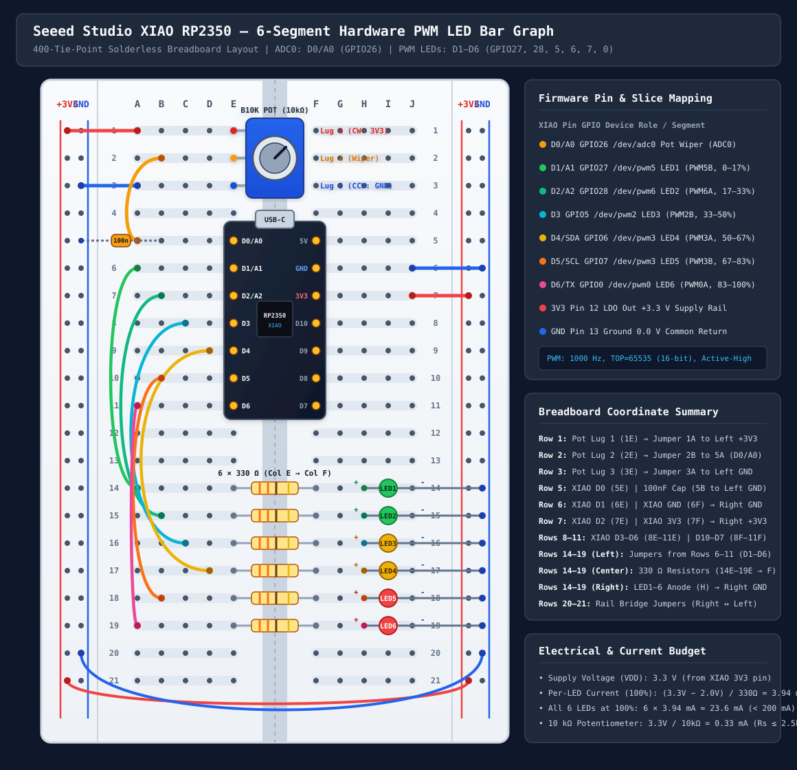

:::callout title="Recommended Primary Sources"
- **Companion project**: `apps/0001-breadboard-circuit-and-current-budget/` (`make -C apps/0001-breadboard-circuit-and-current-budget test`)
- **Primary hardware docs**: [Seeed Studio XIAO RP2350 Pinout Guide](https://wiki.seeedstudio.com/getting_started_with_xiao_rp2350/) and [RP2350 Datasheet (Section 12.4: ADC & Section 9.4: PADS_BANK0)](https://datasheets.raspberrypi.com/rp2350/rp2350-datasheet.pdf)
- **Course references**: [Glossary](../reference/GLOSSARY.md), [Hardware Pinout & Breadboard Sheet](../reference/hardware-pinout-and-wiring.md), and [Lesson 0002: Proportional 6-Segment Bar Graph Math](0002-proportional-bargraph-math-and-pwm-scaling.md)
:::

## 1. Physical Breadboard Topology (`Rows 1–21`) {#breadboard-topology}

Every reliable embedded system starts with an unambiguous electrical contract between the microcontroller and the outside world. Before touching a kernel driver, we seat the **Seeed Studio XIAO RP2350** across the center trench of a 400-tie-point solderless breadboard (`Rows 5–11`, `Columns E` and `F`) with the USB-C receptacle pointing toward `Row 1`.{{sidenote:Placing the XIAO RP2350 across Columns E and F leaves four tie-points (Columns A–D on the left and G–J on the right) open on every header row for jumper wires.}}



:::callout-warn title="3.3 V Pad Limit — Never Wire Row 5F (5V) to the Potentiometer"
The RP2350 GPIO and ADC pads are **3.3 V only** (`IOVDD = 3.3 V`). Right header Pin 1 (`Row 5F`, labeled `5V`) connects directly to the USB-C `VBUS` rail (`5.0 V`). Connecting `5V` to the potentiometer would drive `D0/A0` (`GPIO26`) above `3.63 V`, damaging the ADC input stage. Always leave `Row 5F` unconnected and power the positive rail exclusively from `Row 7J` (`3V3`, Pin 12).
:::

### Step-by-Step Breadboard Assembly

1. **Seat the XIAO RP2350 (`Rows 5–11`, `Cols E & F`)**:
   - Left header (`Cols E`, `Rows 5–11`): `5E = D0/A0` (`GPIO26`), `6E = D1/A1` (`GPIO27`), `7E = D2/A2` (`GPIO28`), `8E = D3` (`GPIO5`), `9E = D4` (`GPIO6`), `10E = D5` (`GPIO7`), `11E = D6` (`GPIO0`).
   - Right header (`Cols F`, `Rows 5–11`): `5F = 5V` *(unconnected)*, `6F = GND`, `7F = 3V3`, `8F–11F = D10–D7` *(unconnected)*.
2. **Wire the `+3.3V` and `GND` Power Rails (`W1`–`W4`)**:
   - `W1` (Blue): `Row 6J` (`GND`) to the Right `GND` (`-`) rail.
   - `W2` (Red): `Row 7J` (`3V3`) to the Right `+3.3V` (`+`) rail.
   - `W3` (Blue): Bridge Right `GND` (`-`) rail (`Row 20`) to Left `GND` (`-`) rail (`Row 20`).
   - `W4` (Red): Bridge Right `+3.3V` (`+`) rail (`Row 21`) to Left `+3.3V` (`+`) rail (`Row 21`).
3. **Wire the `10 kΩ` Linear Potentiometer (`VR1` in `Rows 1E–3E`, `W5`–`W7`)**:
   - `W5` (Red): `Row 1A` (Clockwise Lug 1) to Left `+3.3V` (`+`) rail.
   - `W6` (Yellow): `Row 2B` (Center Wiper Lug 2) to `Row 5A` (`D0/A0`, `GPIO26`).
   - `W7` (Blue): `Row 3A` (Counter-Clockwise Lug 3) to Left `GND` (`-`) rail.
   - Optional `C1` (`100 nF` ceramic): `Row 5B` (`D0/A0`) to Left `GND` (`-`) rail to filter mechanical wiper bounce.
4. **Wire the Six `330 Ω` Resistors and Active-High LEDs (`Rows 14–19`, `W8`–`W13`)**:
   - Route jumpers `W8`–`W13` from `Rows 6–11` (`D1`–`D6`) down to `Rows 14–19` (`Cols A–D`).
   - Bridge a `330 Ω` resistor across the center trench in each row (`14E→14F` through `19E→19F`).
   - Insert `LED1`–`LED6` with the **Anode (`+`, long lead)** in `Row 14H`–`19H` and the **Cathode (`-`, short lead / flat rim)** directly into the Right `GND` (`-`) rail.

```mermaid caption="Figure 1.1: Electrical Signal Chain from 3.3 V Potentiometer Divider Through RP2350 ADC0 and PWM Slices to LED1–LED6"
flowchart LR
  subgraph Pot["10 kΩ Linear Potentiometer (Rows 1–3)"]
    V33["+3.3V Rail\n(Row 7J / 3V3)"] --> VR1["VR1 Wiper\n0.0V..3.3V (R_S <= 2.5 kΩ)"]
    GND1["GND Rail\n(Row 6J)"] --> VR1
  end
  VR1 -->|"W6 -> Row 5A\nD0/A0 (GPIO26)"| ADC["RP2350 /dev/adc0\n12-bit SAR (0..4095)"]
  ADC -->|"50 Hz bargraphd"| PWM["5 Hardware PWM Slices\n/dev/pwm0,2,3,5,6 (1 kHz)"]
  PWM -->|"W8..W13 -> Rows 14–19\n6x 330 Ω Resistors"| LEDS["LED1..LED6 (Active-High)\n3.94 mA/LED • 23.6 mA Total"]
```

## 2. Interactive Breadboard & Current Budget Explorer {#interactive-breadboard}

Use the simulator below to sweep the potentiometer across its 12-bit ADC range (`0..4095`) and observe how the wiper voltage (`0..3300 mV`), Thevenin source impedance (`R_S`), and per-segment LED currents behave:

{{widget:breadboard-simulator}}

## 3. Code Walkthrough: Hardware Pin Mapping & Current Budget in C99 {#code-walkthrough}

Let's start our companion codebase (`apps/0001-breadboard-circuit-and-current-budget/src/main.c`) from scratch and build the hardware constants, the pin-to-PWM slice descriptor table, and the integer electrical budget and ADC conversion functions.

### Block 1: Electrical & Peripheral Constants

```c caption="Hardware constants for the 6-LED bar graph and 3.3 V electrical budget"
#define BARGRAPH_NUM_LEDS        6
#define BARGRAPH_NUM_PWM_SLICES  5
#define BARGRAPH_ADC_MAX         4095u
#define BARGRAPH_VDD_MV          3300u
#define BARGRAPH_LED_VF_MV       2000u
#define BARGRAPH_LED_RES_OHM     330u
#define BARGRAPH_PAD_LIMIT_UA    12000u
#define BARGRAPH_IOVDD_LIMIT_UA  200000u
#define BARGRAPH_ADC_GPIO        26u

#define PWM_IDX_SLICE0           0
#define PWM_IDX_SLICE2           1
#define PWM_IDX_SLICE3           2
#define PWM_IDX_SLICE5           3
#define PWM_IDX_SLICE6           4
```

- **`BARGRAPH_NUM_LEDS` (`6`) vs `BARGRAPH_NUM_PWM_SLICES` (`5`)**: Six LEDs occupy only five `/dev/pwm*` device nodes because `LED4` (`D4/GPIO6`, `PWM3A`) and `LED5` (`D5/GPIO7`, `PWM3B`) share hardware PWM Slice 3 (`/dev/pwm3`).
- **`BARGRAPH_VDD_MV` (`3300u`) & `BARGRAPH_LED_VF_MV` (`2000u`)**: Expressing voltages in integer millivolts (`mV`) and currents in microamperes (`uA`) avoids floating-point instructions in kernel/daemon paths.
- **`PWM_IDX_SLICE0..6`**: Maps the five open PWM file descriptors (`0..4`) to `/dev/pwm0`, `/dev/pwm2`, `/dev/pwm3`, `/dev/pwm5`, and `/dev/pwm6`.

### Block 2: XIAO Pin-to-PWM Slice Descriptor Table

```c caption="Mapping LED1–LED6 to XIAO header pins, RP2350 GPIOs, and PWM slices/channels"
struct bargraph_led_map_s
{
  const char *xiao_pin;
  uint8_t     gpio;
  const char *pwm_devpath;
  uint8_t     slice_idx;
  uint8_t     channel;
  uint8_t     breadboard_row;
};

static const struct bargraph_led_map_s g_led_map[BARGRAPH_NUM_LEDS] =
{
  { "D1", 27, "/dev/pwm5", PWM_IDX_SLICE5, 2, 14 },
  { "D2", 28, "/dev/pwm6", PWM_IDX_SLICE6, 1, 15 },
  { "D3",  5, "/dev/pwm2", PWM_IDX_SLICE2, 2, 16 },
  { "D4",  6, "/dev/pwm3", PWM_IDX_SLICE3, 1, 17 },
  { "D5",  7, "/dev/pwm3", PWM_IDX_SLICE3, 2, 18 },
  { "D6",  0, "/dev/pwm0", PWM_IDX_SLICE0, 1, 19 }
};
```

- **Hardware Channel Assignment (`channel = 1` vs `2`)**: On the RP2350, `GPIO = 2n` routes to PWM Channel A (`channel = 1`), while `GPIO = 2n + 1` routes to PWM Channel B (`channel = 2`). Thus `GPIO27` (`D1`), `GPIO5` (`D3`), and `GPIO7` (`D5`) are all odd-numbered GPIOs driven by **Channel B** (`2`), whereas `GPIO28` (`D2`), `GPIO6` (`D4`), and `GPIO0` (`D6`) are even-numbered GPIOs driven by **Channel A** (`1`).{{sidenote:Notice how `LED4` (`GPIO6`) and `LED5` (`GPIO7`) both point to `PWM_IDX_SLICE3` (`/dev/pwm3`) on Channels 1 and 2 respectively. We will use this exact pairing in Lesson 0004 when constructing `struct pwm_info_s`.}}

### Block 3: Integer Current Budget & Rounded ADC Telemetry Conversions

```c caption="Integer microampere current calculation and nearest-integer ADC scaling"
uint32_t bargraph_led_current_ua(uint32_t vdd_mv,
                                 uint32_t vf_mv,
                                 uint32_t res_ohm)
{
  if (vdd_mv <= vf_mv || res_ohm == 0u)
    {
      return 0u;
    }

  return ((vdd_mv - vf_mv) * 1000u) / res_ohm;
}

uint16_t bargraph_adc_to_mv(uint16_t adc_count)
{
  if (adc_count > BARGRAPH_ADC_MAX)
    {
      adc_count = BARGRAPH_ADC_MAX;
    }

  return (uint16_t)(((uint32_t)adc_count * BARGRAPH_VDD_MV + 2047u) /
                    BARGRAPH_ADC_MAX);
}
```

- **Per-LED Current (`bargraph_led_current_ua`)**: Multiplying `(3300 - 2000) mV` by `1000` before dividing by `330 Ω` yields `1300000 / 330 = 3939 uA` (`3.94 mA`), confirming that six LEDs at 100% duty draw `6 * 3939 = 23634 uA` (`23.63 mA`)—well below the `12 mA` single-pad and `200 mA` package `IOVDD` limits.
- **Nearest-Integer Rounding (`+ 2047u`)**: Standard C integer division truncates toward zero. Adding half the divisor (`4095 / 2 = 2047u`) before dividing by `BARGRAPH_ADC_MAX` (`4095u`) rounds to the nearest millivolt (`0..3300 mV`) and permille (`0..1000`, printed as `0.0%..100.0%`).

### Complete src/main.c Listing

```c caption="apps/0001-breadboard-circuit-and-current-budget/src/main.c"
#include <assert.h>
#include <stdbool.h>
#include <stdint.h>
#include <stdio.h>

#define BARGRAPH_NUM_LEDS        6
#define BARGRAPH_NUM_PWM_SLICES  5
#define BARGRAPH_ADC_MAX         4095u
#define BARGRAPH_VDD_MV          3300u
#define BARGRAPH_LED_VF_MV       2000u
#define BARGRAPH_LED_RES_OHM     330u
#define BARGRAPH_PAD_LIMIT_UA    12000u
#define BARGRAPH_IOVDD_LIMIT_UA  200000u
#define BARGRAPH_ADC_GPIO        26u

#define PWM_IDX_SLICE0           0
#define PWM_IDX_SLICE2           1
#define PWM_IDX_SLICE3           2
#define PWM_IDX_SLICE5           3
#define PWM_IDX_SLICE6           4

struct bargraph_led_map_s
{
  const char *xiao_pin;
  uint8_t     gpio;
  const char *pwm_devpath;
  uint8_t     slice_idx;
  uint8_t     channel;
  uint8_t     breadboard_row;
};

static const struct bargraph_led_map_s g_led_map[BARGRAPH_NUM_LEDS] =
{
  { "D1", 27, "/dev/pwm5", PWM_IDX_SLICE5, 2, 14 },
  { "D2", 28, "/dev/pwm6", PWM_IDX_SLICE6, 1, 15 },
  { "D3",  5, "/dev/pwm2", PWM_IDX_SLICE2, 2, 16 },
  { "D4",  6, "/dev/pwm3", PWM_IDX_SLICE3, 1, 17 },
  { "D5",  7, "/dev/pwm3", PWM_IDX_SLICE3, 2, 18 },
  { "D6",  0, "/dev/pwm0", PWM_IDX_SLICE0, 1, 19 }
};

uint32_t bargraph_led_current_ua(uint32_t vdd_mv,
                                 uint32_t vf_mv,
                                 uint32_t res_ohm)
{
  if (vdd_mv <= vf_mv || res_ohm == 0u)
    {
      return 0u;
    }

  return ((vdd_mv - vf_mv) * 1000u) / res_ohm;
}

uint32_t bargraph_total_led_current_ua(unsigned int num_leds)
{
  uint32_t per_led_ua = bargraph_led_current_ua(BARGRAPH_VDD_MV,
                                                BARGRAPH_LED_VF_MV,
                                                BARGRAPH_LED_RES_OHM);
  return per_led_ua * (uint32_t)num_leds;
}

uint16_t bargraph_adc_to_mv(uint16_t adc_count)
{
  if (adc_count > BARGRAPH_ADC_MAX)
    {
      adc_count = BARGRAPH_ADC_MAX;
    }

  return (uint16_t)(((uint32_t)adc_count * BARGRAPH_VDD_MV + 2047u) /
                    BARGRAPH_ADC_MAX);
}

uint16_t bargraph_adc_to_permille(uint16_t adc_count)
{
  if (adc_count > BARGRAPH_ADC_MAX)
    {
      adc_count = BARGRAPH_ADC_MAX;
    }

  return (uint16_t)(((uint32_t)adc_count * 1000u + 2047u) /
                    BARGRAPH_ADC_MAX);
}

int main(void)
{
  uint32_t single_ua = bargraph_led_current_ua(BARGRAPH_VDD_MV,
                                               BARGRAPH_LED_VF_MV,
                                               BARGRAPH_LED_RES_OHM);
  uint32_t total_ua  = bargraph_total_led_current_ua(BARGRAPH_NUM_LEDS);
  unsigned int i;

  assert(single_ua == 3939u);
  assert(single_ua < BARGRAPH_PAD_LIMIT_UA);
  assert(total_ua == 23634u);
  assert(total_ua < BARGRAPH_IOVDD_LIMIT_UA);

  assert(bargraph_adc_to_mv(0) == 0u);
  assert(bargraph_adc_to_mv(2048) == 1650u);
  assert(bargraph_adc_to_mv(4095) == 3300u);

  assert(bargraph_adc_to_permille(0) == 0u);
  assert(bargraph_adc_to_permille(2048) == 500u);
  assert(bargraph_adc_to_permille(4095) == 1000u);

  for (i = 0; i < BARGRAPH_NUM_LEDS; i++)
    {
      assert(g_led_map[i].slice_idx < BARGRAPH_NUM_PWM_SLICES);
      assert(g_led_map[i].channel == 1u || g_led_map[i].channel == 2u);
      assert(g_led_map[i].breadboard_row == 14u + i);
    }

  printf("Lesson 0001 verification passed: single=%u uA, total=%u uA\n",
         (unsigned int)single_ua, (unsigned int)total_ua);
  return 0;
}
```

## 4. Interactive Practice & Verification {#practice-and-verification}

:::exercise id="ex-0001" title="Interactive Lab: Nearest-Integer ADC Conversion & Current Budget" badge="Skill Practice • C99 Integer Math"
Complete the microampere current calculation and rounded 12-bit ADC-to-millivolt formula from `bargraph_main.c`:

```c
uint32_t single_ua = ((vdd_mv - vf_mv) * 1000u) / {{blank:330u||330|Series resistor value in Ohms|???|6}};
uint16_t millivolts = (uint16_t)(((uint32_t)filtered_adc * {{blank:3300u||3300|Full-scale reference in millivolts|????|6}} + {{blank:2047u||2047|Half of 4095 for nearest-integer rounding|????|6}}) / {{blank:BARGRAPH_ADC_MAX||4095u||4095|Maximum 12-bit ADC count|????????????????|16}});
```

:::prompts
hint: "Use the 330 Ohm series resistor, 3300u mV full-scale supply, + 2047u rounding bias, and BARGRAPH_ADC_MAX (4095u)."
success: "Verified! Your integer current and rounded millivolt conversion match bargraph_main.c."
:::
:::

:::quiz id="quiz-0001" title="Retrieval Practice: Breadboard Wiring & Electrical Budget" badge="3 Questions • Equal-Length Options"
- question: "How should the ten-kilohm potentiometer power rail be wired safely?"
  wrong_hint: "Remember that RP2350 GPIO and ADC pads are strictly 3.3 V tolerant."
  options:
    - letter: "A"
      text: "Connect Row 5F five-volt USB supply directly to potentiometer lug"
      correct: false
      explain: "Row 5F is 5.0 V VBUS, which exceeds the 3.63 V absolute maximum rating of GPIO26."
    - letter: "B"
      text: "Connect Row 7J three-volt regulator output to positive power rail"
      correct: true
      explain: "Row 7J (3V3) provides the regulated 3.3 V supply matching the RP2350 ADC reference."
    - letter: "C"
      text: "Connect Row 6J ground pin directly to potentiometer center wiper"
      correct: false
      explain: "Tying the center wiper directly to ground locks D0/A0 at 0 V."
    - letter: "D"
      text: "Connect Row 11A serial transmit pin to positive power rail"
      correct: false
      explain: "Row 11A is D6 (GPIO0), which drives LED6 via PWM0A and must never be tied to 3.3 V."
- question: "What is the approximate current budget with 330-ohm series resistors?"
  wrong_hint: "Compute (3.3 V - 2.0 V) / 330 Ohms for one LED and multiply by six."
  options:
    - letter: "A"
      text: "Twelve milliamperes per LED and seventy-two milliamperes across all six"
      correct: false
      explain: "12 mA is the single-pad hardware limit, not the actual current through 330 Ohms."
    - letter: "B"
      text: "Eight milliamperes per LED and forty-eight milliamperes across all six"
      correct: false
      explain: "With a 1.3 V drop across 330 Ohms, current is roughly half of 8 mA."
    - letter: "C"
      text: "One milliampere per LED and six milliamperes across all six"
      correct: false
      explain: "A 1 mA current would require a 1.3 kOhm resistor rather than 330 Ohms."
    - letter: "D"
      text: "Four milliamperes per LED and twenty-four milliamperes across all six"
      correct: true
      explain: "(3.3 V - 2.0 V) / 330 Ohms is 3.94 mA per LED (~4 mA) and 23.6 mA (~24 mA) total."
- question: "Why does the millivolt conversion add 2047 before dividing by 4095?"
  wrong_hint: "Consider how C integer division handles fractional remainders."
  options:
    - letter: "A"
      text: "Adding half the divisor rounds integer division to nearest value"
      correct: true
      explain: "Adding 2047 (floor(4095 / 2)) implements nearest-integer rounding instead of floor truncation."
    - letter: "B"
      text: "Adding half the divisor prevents unsigned thirty-two-bit integer multiplication overflow"
      correct: false
      explain: "4095 * 3300 is 13,513,500, which easily fits inside a 32-bit unsigned integer."
    - letter: "C"
      text: "Adding half the divisor shifts twelve-bit samples into sixteen-bit range"
      correct: false
      explain: "Adding a constant biases the numerator for rounding; bit shifting scales bit width."
    - letter: "D"
      text: "Adding half the divisor disables digital input buffer leakage currents"
      correct: false
      explain: "Erratum RP2350-E9 pad leakage is mitigated in hardware via PADS_BANK0_GPIO(26)."
:::

:::verify id="verify-0001" title="Verification Lab: Compile & Run Lesson 0001 Companion App" badge="Terminal Gate"
Run the automated C99 build and verification test suite from the `tutorial/` directory:

```bash caption="Compile and run Lesson 0001 verification gate"
make -C apps/0001-breadboard-circuit-and-current-budget test
```

Expected terminal output:

```text caption="Verified output from apps/0001-breadboard-circuit-and-current-budget"
cc -std=c99 -Wall -Wextra -Werror -pedantic -O2 src/main.c -o build/bargraph_lesson
./build/bargraph_lesson
Lesson 0001 verification passed: single=3939 uA, total=23634 uA
```

- [ ] Seat the XIAO RP2350 in `Rows 5–11` (`Cols E & F`) and confirm `Row 5F` (`5V`) is left unconnected.
- [ ] Run `make -C apps/0001-breadboard-circuit-and-current-budget test` with zero warnings and `single=3939 uA, total=23634 uA`.
:::

:::teacher-prompt title="Extend This Lesson with Your Agent"
Ask your AI teacher: *"What would happen to the per-LED current and ADC settling time if we swapped the 330 Ω resistors for 220 Ω resistors and the 10 kΩ potentiometer for a 100 kΩ potentiometer?"*
:::
