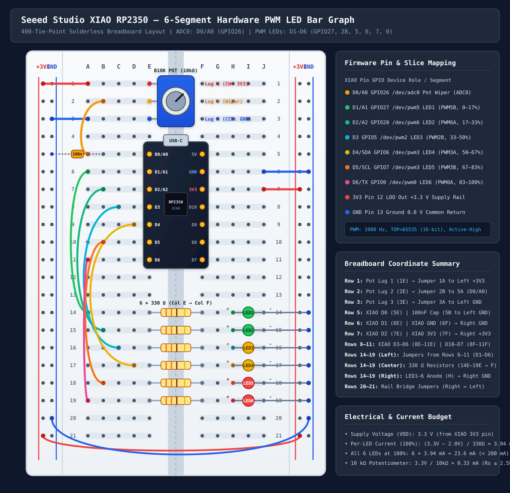

## 1. Visual Breadboard Wiring Diagram

## 2. Bill of Materials (BOM)

Table: Bill of Materials for the XIAO RP2350 6-Segment Bar Graph

| Ref | Qty | Component | Specification | Breadboard Placement |
| :--- | :--- | :--- | :--- | :--- |
| `U1` | 1 | Seeed Studio XIAO RP2350 | RP2350A Dual Cortex-M33 @ `150 MHz` | `Rows 5–11`, `Cols E & F` (USB-C pointing UP toward Row 1) |
| `BB1` | 1 | Solderless Breadboard | 400 tie-points (`Rows 1–30`, `Cols A–E` & `F–J`) | Center trench separates `Cols E` and `F` |
| `VR1` | 1 | Linear Rotary Potentiometer | `10 kΩ` linear taper (`B10K`) | `Rows 1E, 2E, 3E` (`Lug 1`: CW `+3.3V`, `Lug 2`: Wiper, `Lug 3`: CCW `GND`) |
| `R1`–`R6` | 6 | Current-Limiting Resistors | `330 Ω` (`±1%` or `±5%`, `1/4 W`) | `Rows 14–19`, bridging center trench from `Col E` to `Col F` |
| `LED1`–`LED6` | 6 | Diffused Through-Hole LEDs | 3 mm or 5 mm (`V_F ≈ 2.0 V`) | `Rows 14–19`, Anode (`+`) in `Col H`, Cathode (`-`) in Right `GND` (`-`) Rail |
| `C1` | 1 | Ceramic Bypass Capacitor *(Optional)* | `100 nF` (`0.1 µF`, code `104`) | `Row 5B` (`D0/A0`) to Left `GND` (`-`) Rail |
| `W1`–`W13` | 13 | Solid-Core Jumper Wires | 22 AWG breadboard jumpers | Power rail bridges (`W1`–`W4`), Pot (`W5`–`W7`), PWM signals (`W8`–`W13`) |

## 3. Pinout & Hardware Peripheral Mapping

Table: XIAO RP2350 Header Pin to NuttX Device and PWM Slice/Channel Mapping

| XIAO Pin | Breadboard Tie-Point | RP2350 GPIO | NuttX Device | Hardware Peripheral | `pwm_info_s` Slot | Segment Range |
| :--- | :--- | :--- | :--- | :--- | :--- | :--- |
| `D0 / A0` | `Row 5E` (Left Pin 1) | `GPIO26` | `/dev/adc0` | `ADC` Channel 0 | N/A | Potentiometer Wiper (`0.0% – 100.0%`) |
| `D1 / A1` | `Row 6E` (Left Pin 2) | `GPIO27` | `/dev/pwm5` | Slice 5, Ch B (`PWM5B`) | `channels[1]` (`channel = 2`) | `LED1` (`0.0% – 16.7%`) |
| `D2 / A2` | `Row 7E` (Left Pin 3) | `GPIO28` | `/dev/pwm6` | Slice 6, Ch A (`PWM6A`) | `channels[0]` (`channel = 1`) | `LED2` (`16.7% – 33.3%`) |
| `D3` | `Row 8E` (Left Pin 4) | `GPIO5` | `/dev/pwm2` | Slice 2, Ch B (`PWM2B`) | `channels[1]` (`channel = 2`) | `LED3` (`33.3% – 50.0%`) |
| `D4 / SDA` | `Row 9E` (Left Pin 5) | `GPIO6` | `/dev/pwm3` | Slice 3, Ch A (`PWM3A`) | `channels[0]` (`channel = 1`) | `LED4` (`50.0% – 66.7%`) |
| `D5 / SCL` | `Row 10E` (Left Pin 6) | `GPIO7` | `/dev/pwm3` | Slice 3, Ch B (`PWM3B`) | `channels[1]` (`channel = 2`) | `LED5` (`66.7% – 83.3%`) |
| `D6 / TX` | `Row 11E` (Left Pin 7) | `GPIO0` | `/dev/pwm0` | Slice 0, Ch A (`PWM0A`) | `channels[0]` (`channel = 1`) | `LED6` (`83.3% – 100.0%`) |
| `5V` | `Row 5F` (Right Pin 1) | `VBUS` | — | USB `5.0 V` Rail | — | **Leave Unconnected** (`3.3 V` pads only!) |
| `GND` | `Row 6F` (Right Pin 2) | `GND` | — | Ground Reference | — | Jumper `Row 6J` to Right `GND` (`-`) Rail |
| `3V3` | `Row 7F` (Right Pin 3) | `3V3_OUT` | — | `3.3 V` LDO Output | — | Jumper `Row 7J` to Right `+3.3V` (`+`) Rail |

## 4. Coordinate-by-Coordinate Jumper Wiring Table

Table: All 13 Jumper Wires (`W1`–`W13`) on the 400-Tie-Point Breadboard

| Wire | Color | From Tie-Point | To Tie-Point | Signal / Function |
| :--- | :--- | :--- | :--- | :--- |
| `W1` | Blue / Black | `Row 6J` (`XIAO GND`) | Right `GND` (`-`) Rail | Grounds the right negative rail |
| `W2` | Red | `Row 7J` (`XIAO 3V3`) | Right `+3.3V` (`+`) Rail | Powers the right `+3.3 V` positive rail |
| `W3` | Blue / Black | Right `GND` (`-`) Rail (`Row 20`) | Left `GND` (`-`) Rail (`Row 20`) | Bridges `GND` to the left negative rail |
| `W4` | Red | Right `+3.3V` (`+`) Rail (`Row 21`) | Left `+3.3V` (`+`) Rail (`Row 21`) | Bridges `+3.3 V` to the left positive rail |
| `W5` | Red | `Row 1A` (`VR1` Lug 1 CW) | Left `+3.3V` (`+`) Rail | Supplies `3.3 V` to potentiometer top lug |
| `W6` | Yellow | `Row 2B` (`VR1` Lug 2 Wiper) | `Row 5A` (`XIAO D0/A0`) | Routes analog wiper voltage to `GPIO26` (`/dev/adc0`) |
| `W7` | Blue / Black | `Row 3A` (`VR1` Lug 3 CCW) | Left `GND` (`-`) Rail | Grounds potentiometer bottom lug |
| `W8` | Green | `Row 6A` (`XIAO D1`) | `Row 14A` (`R1` Input) | Routes `PWM5B` (`GPIO27`) to `LED1` row |
| `W9` | Green | `Row 7B` (`XIAO D2`) | `Row 15B` (`R2` Input) | Routes `PWM6A` (`GPIO28`) to `LED2` row |
| `W10` | Yellow | `Row 8C` (`XIAO D3`) | `Row 16C` (`R3` Input) | Routes `PWM2B` (`GPIO5`) to `LED3` row |
| `W11` | Yellow | `Row 9D` (`XIAO D4`) | `Row 17D` (`R4` Input) | Routes `PWM3A` (`GPIO6`) to `LED4` row |
| `W12` | Red | `Row 10B` (`XIAO D5`) | `Row 18B` (`R5` Input) | Routes `PWM3B` (`GPIO7`) to `LED5` row |
| `W13` | Red | `Row 11A` (`XIAO D6`) | `Row 19A` (`R6` Input) | Routes `PWM0A` (`GPIO0`) to `LED6` row |

## 5. Electrical Current Budget Summary

- **Single LED Segment Current at 100% Duty (`duty = 65535`)**:
  `(3300 mV - 2000 mV) / 330 Ω = 3.939 mA` (well below the `12 mA` RP2350 single-pad limit).
- **All 6 LEDs at 100% Duty**:
  `6 * 3.939 mA = 23.64 mA` (under `12%` of the RP2350 `200 mA` total `IOVDD` package limit).
- **Potentiometer Continuous Current (`10 kΩ` across `3.3 V`)**:
  `3.3 V / 10 kΩ = 0.33 mA`, with worst-case mid-scale Thevenin source impedance `R_S = 2.5 kΩ`.
