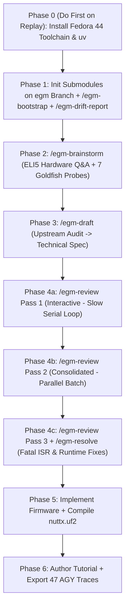

# Replicating the NuttX EGM Experiment: A Replay Guide & Post-Mortem

This is the companion guide to the firmware tutorial in [xiao-rp2350-bargraph.md](file:///home/brett/Documents/GitHub/nuttxspace/docs/tutorials/xiao-rp2350-bargraph.md). That document explains the C code, Kconfig wiring, and electronics of our potentiometer LED bar-graph daemon. This one is about *how we figured out what to build* without already being hardware engineers—and how you can replay the whole workflow cleanly from scratch.

Turns out, dropping an LLM straight into `8,121` directories of Apache NuttX (`nuttx/` plus `apps/`) and asking it to write microcontroller firmware is a reliable way to hallucinate Kconfig symbols, corrupt interrupt handlers, and burn a weekend chasing silent boot hangs. Over 10 interactive sessions (plus 37 subagent runs, totalling `4,478` logged steps across `prompts/`), we tested a different path: using the Engineering Guidance Model (EGM) skills to read architectural contracts, interrogate hardware assumptions in plain English, stress-test a design document across multiple reviewer personas, and only compile C once the fatal concurrency bugs were dead on paper.

I'm not going to pretend the run was tidy. We installed the cross-compiler backwards (right at the end), checked out the wrong Git branches first, sat through an hour-and-a-half interactive review before discovering consolidated batch reviews, watched subagents largely ignore the `README.md` contracts sitting right beside them, and hit a minor agent-tooling bug around `egm-synthesizer`. All 47 conversation traces are exported under `prompts/` (indexed in [README.md](file:///home/brett/Documents/GitHub/nuttxspace/prompts/README.md)) so you can inspect every stumble yourself—and skip every single dead end when you replay it.

> [!NOTE]
> What follows cites only observed session telemetry, committed files, review reports, and command outputs recorded in this repository. Notice also a subtle timing quirk in the traces: Session 33 logs `9:41:46` wall clock, which includes idle overnight time waiting for user confirmation between review resolution and implementation.

---

## 1. Why EGM Exists for Non-Hardware Engineers

Most software engineers approach an unfamiliar codebase by grepping for an entrypoint, reading twenty files, and sketching a fix. Try that on an embedded RTOS like NuttX and two things bite you immediately:

1. **Sheer scale and preprocessor indirection.** Across `nuttx/` (`7,197` directories) and `apps/` (`924` directories), build configuration flows through layered `Make.defs`, `Kconfig`, linker scripts, chip headers, board initialisers, and VFS device nodes. Reading one `.c` file rarely tells you *when* it runs, *which* macro swaps it out, or *whether* an interrupt handler shares a data structure with your `close()` syscall.
2. **Silent hardware consequences.** On a server, a race condition crashes with a stack trace. On an RP2350 microcontroller, an `ASSERT()` triggered from a 2 µs ADC FIFO interrupt stalls the board dead with zero serial output unless you know where to look.

EGM tackles this by separating **map-reading**, **plain-English interrogation**, **design drafting**, and **adversarial multi-persona review** from writing code:

- **Recursive directory contracts (`/egm-bootstrap` + `/egm-drift-report`).** In the `egm` branch of `nuttx` (`2,607` `README.md` contracts) and `apps` (`635` `README.md` contracts), directories carry compact architectural blueprints covering responsibilities, files, invariants, and side effects—for example `nuttx/boards/arm/rp23xx/xiao-rp2350/` [README.md](file:///home/brett/Documents/GitHub/nuttxspace/nuttx/boards/arm/rp23xx/xiao-rp2350/README.md), `src/` [README.md](file:///home/brett/Documents/GitHub/nuttxspace/nuttx/boards/arm/rp23xx/xiao-rp2350/src/README.md), `arch/arm/src/rp23xx/` [README.md](file:///home/brett/Documents/GitHub/nuttxspace/nuttx/arch/arm/src/rp23xx/README.md), and `drivers/analog/` [README.md](file:///home/brett/Documents/GitHub/nuttxspace/nuttx/drivers/analog/README.md).
- **ELI5 hardware discovery (`/egm-brainstorm`).** Forces the agent to ask one scoped question at a time in plain software-engineer English while investigating the real chip/board code behind the scenes.
- **Grounded technical spec (`/egm-draft`).** Turns the agreed brief into a concrete implementation plan pinned to actual file paths, headers, and Kconfig symbols.
- **Parallel Goldfish reviewers (`/egm-review` + `/egm-resolve`).** Spawns isolated subagents with distinct personas—for instance `egm-comprehension` (a naive reader checking undefined jargon), `egm-codebase-details`, `egm-design`, `egm-implementation-readiness`, `egm-structural`, `egm-style`, `egm-zoom-out`, and `egm-inventive-catalyst`—each reading fresh without sharing your sunk-cost bias.

---

## 2. High-Level Experiment Map & Telemetry

The diagram below traces both what actually happened (`47` sessions, `20` root Git commits from `572a92a` to `682e169`) and where the streamlined replay sequence reorders Phase 0 upfront.



> [!TIP]
> When you replay this experiment for a demo or workshop, run **Phase 0 first** (before Phase 1) and go straight to **Consolidated `/egm-review` + `/egm-resolve`** (at least two consolidated passes, skipping Pass 1's interactive stage-by-stage loop).

### Complete Session Ledger (`47` Traces, `4,478` Steps)

All metrics below come from the trace index in `prompts/` [README.md](file:///home/brett/Documents/GitHub/nuttxspace/prompts/README.md) and the audited prompt logs. Across all `37` subagent runs (`3,106` steps total), workers issued `2,397` `read_file` calls—yet read only `7` `README.md` contracts total (all in Brainstorm; `0` in Review Batches 1–3), a finding we unpack in Dead End #6.

| Phase | Parent Trace (Wall Clock, Steps) | Subagent Batch (`read_file` / `README.md`) | Root Git Commit(s) | Primary Artefact & Outcome |
| :--- | :--- | :--- | :--- | :--- |
| Phase 1 | [01-77065362-this-is-a-git-repo-i-d.md](file:///home/brett/Documents/GitHub/nuttxspace/prompts/01-77065362-this-is-a-git-repo-i-d.md) (`1:06:04`, `337` steps) | — | `572a92a`, `a0b03dd`, `4948bd9`, `cd895fb`, `c76c5b0` | Submodules wired to `egm` branch (`nuttx` `7ff82c95c2`, `apps` `23042fae3`); root [README.md](file:///home/brett/Documents/GitHub/nuttxspace/README.md) & [2026-11-13_DRIFT_REPORT.md](file:///home/brett/Documents/GitHub/nuttxspace/2026-11-13_DRIFT_REPORT.md) |
| Phase 2 | [02-5d581875-i-want-to-develop-a-nuttx-app.md](file:///home/brett/Documents/GitHub/nuttxspace/prompts/02-5d581875-i-want-to-develop-a-nuttx-app.md) (`1:14:40`, `137` steps) | Traces `03`–`09`: 7 workers (`836` steps, `687` `read_file`, `7` `README.md`) | `332f9e3` | Plain-English discovery brief [concepts_brief.md](file:///home/brett/Documents/GitHub/nuttxspace/concepts_brief.md) |
| Phase 3 | [10-4973fb71-conversation.md](file:///home/brett/Documents/GitHub/nuttxspace/prompts/10-4973fb71-conversation.md) (`0:20:49`, `99` steps) | — | `46f63d8` | Drafted full design spec [xiao-rp2350-bargraph.md](file:///home/brett/Documents/GitHub/nuttxspace/docs/designs/xiao-rp2350-bargraph.md) from 42 upstream files |
| Phase 4a | [11-2adb2b87-conversation.md](file:///home/brett/Documents/GitHub/nuttxspace/prompts/11-2adb2b87-conversation.md) (`1:26:20`, `155` steps) | Traces `12`–`21`: 10 workers (`736` steps, `568` `read_file`, `0` `README.md`) | `9d996ca`, `4fd0329`, `ebd2b4e` | Interactive Pass 1 fixed `rp23xx_pico.h`, `external/Kconfig`, `/dev/ttyACM0` FD leak |
| Phase 4b | [22-1335b34e-docs-designs-xiao-rp2350-bargraph-md.md](file:///home/brett/Documents/GitHub/nuttxspace/prompts/22-1335b34e-docs-designs-xiao-rp2350-bargraph-md.md) (`0:40:51`, `129` steps) | Traces `23`–`32`: 10 workers (`891` steps, `685` `read_file`, `0` `README.md`) | `c56b92f`, `afd8ff5`, `03878d2` | Consolidated Pass 2 ([consolidated_review_report.md](file:///home/brett/Documents/GitHub/nuttxspace/consolidated_review_report.md), `C-01`–`C-22`) |
| Phase 4c & 5 | [33-06650694-docs-designs-xiao-rp2350-bargraph-md.md](file:///home/brett/Documents/GitHub/nuttxspace/prompts/33-06650694-docs-designs-xiao-rp2350-bargraph-md.md) (`9:41:46` wall clock incl. idle, `243` steps) | Traces `34`–`43`: 10 workers (`643` steps, `457` `read_file`, `0` `README.md`) | `13f334b` | Pass 3 ([goldfish_review_report.md](file:///home/brett/Documents/GitHub/nuttxspace/goldfish_review_report.md), `CON-1`–`CON-19`) + `/egm-resolve` + generated 17 firmware files |
| Phase 0 (late) | [44-3ed3c8d3-i-think-i-ve-installed-the-required.md](file:///home/brett/Documents/GitHub/nuttxspace/prompts/44-3ed3c8d3-i-think-i-ve-installed-the-required.md) (`0:09:10`, `78` steps) | — | `e277d48` | Audited Fedora 44 host; wrote missing cross-compiler/UF2 checklist in [TODO.md](file:///home/brett/Documents/GitHub/nuttxspace/TODO.md) |
| Phase 5 (build) | [45-d1ec3eba-i-think-i-ve-installed-the-required.md](file:///home/brett/Documents/GitHub/nuttxspace/prompts/45-d1ec3eba-i-think-i-ve-installed-the-required.md) (`0:08:27`, `69` steps) | — | `9c084bc`, `3c25c8e` | Verified toolchain; built `nuttx/nuttx` & `nuttx/nuttx.uf2` (`117,320 B` flash, `15,096 B` RAM) |
| Phase 6a | [46-03e64f54-ls.md](file:///home/brett/Documents/GitHub/nuttxspace/prompts/46-03e64f54-ls.md) (`0:08:04`, `81` steps) | — | `38526f2`, `37c6f73` | Wrote software-engineer tutorial [xiao-rp2350-bargraph.md](file:///home/brett/Documents/GitHub/nuttxspace/docs/tutorials/xiao-rp2350-bargraph.md) (`1,738` lines) |
| Phase 6b | [47-413a122e-please-pull-all-agy-traces-for-this.md](file:///home/brett/Documents/GitHub/nuttxspace/prompts/47-413a122e-please-pull-all-agy-traces-for-this.md) (`0:07:35`, `44` steps) | — | `682e169` | Installed `uv 0.13.5`; exported all `47` traces to `prompts/` |

Representative subagent traces you can read directly: [03-5bb3080a-none.md](file:///home/brett/Documents/GitHub/nuttxspace/prompts/03-5bb3080a-none.md) (Brainstorm Goldfish, `120` steps, `100` `read_file` calls), [14-c321fff0-none.md](file:///home/brett/Documents/GitHub/nuttxspace/prompts/14-c321fff0-none.md) (`egm-comprehension` in Pass 1, `9` steps, reading only `comprehension.md` and the design doc so it has zero institutional bias), plus batch boundaries [12-25c73851-none.md](file:///home/brett/Documents/GitHub/nuttxspace/prompts/12-25c73851-none.md)–[21-777d8fc8-none.md](file:///home/brett/Documents/GitHub/nuttxspace/prompts/21-777d8fc8-none.md), [23-41e1fcf2-none.md](file:///home/brett/Documents/GitHub/nuttxspace/prompts/23-41e1fcf2-none.md)–[32-d239d478-none.md](file:///home/brett/Documents/GitHub/nuttxspace/prompts/32-d239d478-none.md), and [34-b25d6f75-none.md](file:///home/brett/Documents/GitHub/nuttxspace/prompts/34-b25d6f75-none.md)–[43-36fdaf77-none.md](file:///home/brett/Documents/GitHub/nuttxspace/prompts/43-36fdaf77-none.md).

---

## 3. Step-by-Step Replication Guide & Dead-End Post-Mortem

Each phase below gives you three things: what actually ran in the session traces, where we hit friction or dead ends, and the **Fast-Path Replay** instructions to run next time.

### Phase 0: Install the Build Toolchain & `uv` First

**What happened (out of order):** Tooling checks arrived only *after* Session 33 finished generating the C firmware (`Steps 121–128` flagged missing `arm-none-eabi-gcc`, `genromfs`, and `picotool`). That forced two separate detour sessions—[44-3ed3c8d3-i-think-i-ve-installed-the-required.md](file:///home/brett/Documents/GitHub/nuttxspace/prompts/44-3ed3c8d3-i-think-i-ve-installed-the-required.md) to write [TODO.md](file:///home/brett/Documents/GitHub/nuttxspace/TODO.md), and [45-d1ec3eba-i-think-i-ve-installed-the-required.md](file:///home/brett/Documents/GitHub/nuttxspace/prompts/45-d1ec3eba-i-think-i-ve-installed-the-required.md) after manual package installation—plus [47-413a122e-please-pull-all-agy-traces-for-this.md](file:///home/brett/Documents/GitHub/nuttxspace/prompts/47-413a122e-please-pull-all-agy-traces-for-this.md) to install `uv` for trace exports.

> [!WARNING]
> **Dead End #1 — Late Host Toolchain Setup:** Leaving compiler and `picotool` checks until after `implement` breaks momentum right when you want to see hardware blink, and creates avoidable back-and-forth check-in files.

**Fast-Path Replay (Fedora 44):** Complete [TODO.md](file:///home/brett/Documents/GitHub/nuttxspace/TODO.md) upfront before opening your first Antigravity workspace prompt:
- Host C/Kconfig tools: `gcc`, `cpp`, `make`, `bison`, `flex`, `gperf`, `gettext`, `texinfo`, `ncurses-devel`, `/usr/local/bin/kconfig-conf`, `kconfig-tweak`, `kconfig-mconf` (linked to `/usr/local/lib/libkconfig-parser-4.11.0.so`), `genromfs`, `xxd`, `picocom`.
- RP2350 cross-toolchain & flasher: `arm-none-eabi-gcc-cs` (`15.2.0-4.fc44`), `arm-none-eabi-gcc-cs-c++`, `arm-none-eabi-binutils-cs`, `arm-none-eabi-newlib`, `cmake`, `libusb1-devel`, and `picotool` (`v2.3.1` built from `/tmp/pico-sdk` + `/tmp/picotool`).
- Trace tooling: `uv` (`0.13.5`) if you intend to export your own replay logs with `/agy-brain-explorer`.

---

### Phase 1: Submodules, `/egm-bootstrap`, and `/egm-drift-report`

**What happened:** In [01-77065362-this-is-a-git-repo-i-d.md](file:///home/brett/Documents/GitHub/nuttxspace/prompts/01-77065362-this-is-a-git-repo-i-d.md) (`1:06:04`, `337` steps, `218` tool calls), the user asked the agent to add `nuttx` and `apps` as Git submodules (`Steps 8–16`), ran `/egm-bootstrap please update`, updated `33` `README.md` contracts (`Step 133+`), and then asked whether `/egm-bootstrap` can hallucinate—triggering `/egm-drift-report` (`Steps 249–285`).

**Dead ends we hit:**

1. **Dead End #2 — Checking out `master` instead of `egm`:** Adding the submodules without `-b egm` put `nuttx` and `apps` onto `master`, where none of the pre-generated EGM `README.md` blueprints existed yet. When Turn 2 ran `/egm-bootstrap please update`, the command hit its 15-directory safety gate (`Step 31`) because bootstrapping thousands of upstream folders from zero requires confirming bulk scope. Turns 3–5 fixed [.gitmodules](file:///home/brett/Documents/GitHub/nuttxspace/.gitmodules), checked out `egm`, and pulled `origin/egm` (`Steps 32–50`, submodule commits `7ff82c95c2` and `23042fae3`), leaving `3,242` `README.md` maps ready to use.
2. **Dead End #3 — Bootstrap hallucinations caught just in time:** Even on a manageable `33`-directory slice, `/egm-bootstrap` is written by an LLM reading code, so it can misread macros. In `Steps 260–274`, `/egm-drift-report` audited the newly written `nuttx/libs/libxx/libstdc++/` [README.md](file:///home/brett/Documents/GitHub/nuttxspace/nuttx/libs/libxx/libstdc++/README.md) and caught three fabrications right away:
   - Cited `libsupc++.defs:CPPSRCS` when the makefile variable is `SUPSRCS`.
   - Invented a `libstdc++-v3.tar.gz` archive name.
   - Misread `_GLIBCXX_HAVE_TLS` build logic.
   - It also documented pre-existing upstream drift across the pulled `egm` tree in [2026-11-13_DRIFT_REPORT.md](file:///home/brett/Documents/GitHub/nuttxspace/2026-11-13_DRIFT_REPORT.md) (`virtio.h:virtio_free_buf`, `boardctl.h:BOARDIOC_INIT`, `queue.h:CIRCLEQ_HEAD`, `lib_idr.c:idr_alloc_u32`, `gdbserver.py:GDBServer`).

**Fast-Path Replay Prompts:**
```text
1. Add apache/nuttx (or your EGM fork) and apps submodules tracking the `egm` branch:
   git submodule add -b egm <nuttx-url> nuttx
   git submodule add -b egm <apps-url> apps

2. Write the workspace root README blueprint:
   /egm-bootstrap create the root README.md contract for this workspace and verify submodule boundaries

3. Always verify any newly written README contracts before trusting them:
   /egm-drift-report check the README.md files modified in this session
```

---

### Phase 2: Plain-English Brainstorming (`/egm-brainstorm`)

**What happened:** In [02-5d581875-i-want-to-develop-a-nuttx-app.md](file:///home/brett/Documents/GitHub/nuttxspace/prompts/02-5d581875-i-want-to-develop-a-nuttx-app.md) (`1:14:40`, `137` steps, `64` tool calls), the goal was deliberately simple: *"I want to develop a nuttx app for xiao rp2350"*—specifically a potentiometer hooked to an ADC driving a 6-LED bar graph. Behind the scenes, the parent session dispatched 7 parallel Goldfish researchers ([03-5bb3080a-none.md](file:///home/brett/Documents/GitHub/nuttxspace/prompts/03-5bb3080a-none.md) through [09-c0c3e721-none.md](file:///home/brett/Documents/GitHub/nuttxspace/prompts/09-c0c3e721-none.md)) and synthesised [concepts_brief.md](file:///home/brett/Documents/GitHub/nuttxspace/concepts_brief.md) (`332f9e3`).

**Dead ends & friction we hit:**

- **Dead End #4 — Jargon and question overload:** Left unconstrained, `/egm-brainstorm` bundles multiple embedded hardware choices at once. By Turn 2 the user had to interrupt with `"Please ask questions one at a time"`, and by Turn 7 with `"One concern at a time. ELI5"`. Once framed that way, the agent translated pin muxing, ADC reference scaling, NSH daemon lifecycles, and out-of-tree `apps/external` symlinking into software-engineer terms without dumbing down the underlying architectural trade-offs.
- **Dead End #5 — `egm-synthesizer` lacked tools (`Steps 68–80`):** Notice in `Steps 68–80` (and again in Session 11 `Step 33` and Session 22 `Step 28`) the parent model inspected `synthesizer.md` and `plugin.json` because `egm-synthesizer` did not declare `enableSubagentTools` or `enableWriteTools`! The coordinator worked around it cleanly by launching the Goldfish subagents directly, but that inspection overhead shows up across three traces.
- **Dead End #6 — Goldfishes bypassed local `README.md` contracts:** Across all 7 brainstorm subagents (`836` steps, `687` `read_file` calls), workers read just `7` `README.md` files (`03`: 2, `05`: 1, `06`: 1, `07`: 2, `09`: 1). In Review Passes 1–3 (`1,710` `read_file` calls across 30 workers), subagents read **zero** `README.md` files. Why? Prompt briefs named concrete C/Kconfig targets, so subagents behaved like eager C grep tools rather than reading directory invariants first.

**Fast-Path Replay Prompt:**
```text
/egm-brainstorm I want to build an out-of-tree NuttX app for the Seeed Studio XIAO RP2350 (potentiometer ADC input -> 6-LED bar graph) keeping nuttx/ and apps/ unmodified.
Constraints for this session:
- Ask me one concern at a time.
- Explain hardware and RTOS concepts ELI5 for a software engineer.
- Instruct any research subagents to read nearest EGM README.md contracts before reading .c/.h files.
```

---

### Phase 3: Grounding the Technical Spec (`/egm-draft`)

**What happened:** Session [10-4973fb71-conversation.md](file:///home/brett/Documents/GitHub/nuttxspace/prompts/10-4973fb71-conversation.md) (`0:20:49`, `99` steps, `64` tool calls, `6` `ask_question` confirmation gates) took [concepts_brief.md](file:///home/brett/Documents/GitHub/nuttxspace/concepts_brief.md), read `42` upstream NuttX files in Plan Mode, drafted four structured sections into `design_draft.md`, and promoted the document to [xiao-rp2350-bargraph.md](file:///home/brett/Documents/GitHub/nuttxspace/docs/designs/xiao-rp2350-bargraph.md) (`46f63d8`).

**Commentary:** This was the cleanest 20 minutes in the entire run. Because brainstorm had already settled out-of-tree integration (`CONFIG_ARCH_BOARD_CUSTOM_DIR` + `apps/external` symlink) and error behaviour, `/egm-draft` stayed focused on turning decisions into files and contracts. However, don't mistake a clean draft for a bug-free design—Phase 4 proved this first draft still harboured fatal hardware/RTOS bugs.

**Fast-Path Replay Prompt:**
```text
/egm-draft @[concepts_brief.md] target @[docs/designs/xiao-rp2350-bargraph.md]
```

---

### Phase 4: Three Review Passes — Why One Pass Wasn't Enough (`Sessions 11–43`)

Why did it take *three* review passes ([11](file:///home/brett/Documents/GitHub/nuttxspace/prompts/11-2adb2b87-conversation.md), [22](file:///home/brett/Documents/GitHub/nuttxspace/prompts/22-1335b34e-docs-designs-xiao-rp2350-bargraph-md.md), and [33](file:///home/brett/Documents/GitHub/nuttxspace/prompts/33-06650694-docs-designs-xiao-rp2350-bargraph-md.md)) before writing code? Partly workflow friction in Pass 1, and partly genuine onion-peeling: fixing structural wiring in Pass 1 exposed build/Kconfig bugs in Pass 2, and fixing driver lifecycle assumptions in Pass 2 exposed a lethal ISR race condition in Pass 3.

#### Dead End #7 — Interactive Mode & UX Friction in Pass 1

In [11-2adb2b87-conversation.md](file:///home/brett/Documents/GitHub/nuttxspace/prompts/11-2adb2b87-conversation.md) (`1:26:20`, `155` steps, `59` tool calls, `6` `ask_question` gates), three small choices stretched Pass 1 to 86 minutes:
1. Omitted the target design file on the slash command (`Step 4`), triggering an extra prompt round-trip.
2. Selected **`Interactive review with all review rubrics`** (`Step 8`) instead of `Consolidated report`, forcing all 5 review stages to serialise while the user babysat every stage.
3. Clicked **`Conclude review and finalize document`** (`Step 112`) assuming it would apply the discussed fixes, only to realise the findings stayed open—forcing the user to ask `What’s next?` (`Step 114`), request `"Please go through the open issues, one at a time. ELI5"` (`Step 120`), and manually type `Accept` 10 times (`Turns 6–15`, `Steps 122–140`).

Pass 2 ([22-1335b34e-docs-designs-xiao-rp2350-bargraph-md.md](file:///home/brett/Documents/GitHub/nuttxspace/prompts/22-1335b34e-docs-designs-xiao-rp2350-bargraph-md.md), `0:40:51`, `129` steps) switched to **`Consolidated report`** (`Step 9`), running 9 Goldfishes in parallel (`Step 41`) into [consolidated_review_report.md](file:///home/brett/Documents/GitHub/nuttxspace/consolidated_review_report.md) (`22` deduplicated items `C-01`–`C-22` from `40` raw findings) and ending with `Accept all suggestions` (`Step 101`). Pass 3 ([33-06650694-docs-designs-xiao-rp2350-bargraph-md.md](file:///home/brett/Documents/GitHub/nuttxspace/prompts/33-06650694-docs-designs-xiao-rp2350-bargraph-md.md)) paired **`Consolidated report`** with **`/egm-resolve`** (`accept all proposed fixes` after `CON-1`), producing the final clean spec via [goldfish_review_report.md](file:///home/brett/Documents/GitHub/nuttxspace/goldfish_review_report.md) (`CON-1`–`CON-19`: 2 Blockers, 10 Majors, 7 Nits; all 19 accepted).

#### What Each Pass Caught That a Software Engineer Would Have Missed

| Review Pass | Report / Trace | Critical Bugs Caught Before Compiling C |
| :--- | :--- | :--- |
| Pass 1 (`Interactive`) | [11-2adb2b87-conversation.md](file:///home/brett/Documents/GitHub/nuttxspace/prompts/11-2adb2b87-conversation.md) (`12`–`21`) | Board header include mismatch (`board.h` vs `rp23xx_pico.h`), missing `external/Kconfig` hook, `/dev/ttyACM0` file descriptor leak on daemon start. |
| Pass 2 (`Consolidated`) | [consolidated_review_report.md](file:///home/brett/Documents/GitHub/nuttxspace/consolidated_review_report.md) (`C-01`–`C-22`) | Phase ordering bug (`CONFIG_BARGRAPH=y` enabled before `external/bargraph/` existed: `C-01`), **hallucinated Kconfig symbols** `CONFIG_ARCH_CHIP_RP2350` & `CONFIG_NSH_ARCHINIT` (`C-02`), missing header for `clrbits_reg32` (`C-04`), coupled board bringup error (`C-05`), infinite loop on `RP23XX_ADC_FIFO_ERR` (`C-06`). |
| Pass 3 (`Consolidated + /egm-resolve`) | [goldfish_review_report.md](file:///home/brett/Documents/GitHub/nuttxspace/goldfish_review_report.md) (`CON-1`–`CON-19`) | **Fatal ISR race (`CON-1`)**: `RP23XX_ADC_IRQ_FIFO` fires every ~2 µs and hits `ASSERT()` inside `adc_receive()` while `close()` tears down `remove_device()`—fixed with `enter_critical_section()`. **False hypothesis busted (`CON-2`)**: Pass 2's explanation of `CONFIG_BOARD_LATE_INITIALIZE` didn't hold up against actual NuttX init code. **Silent daemon hang (`CON-3`)**: blocking `adc_read()` stalls forever instead of using `O_NONBLOCK` + `poll()`. **Kernel `argv` shift (`CON-5`)**: NuttX `task_create()` starts `argv` at `[1]`, shifting CLI arguments. **Makefile hazard (`CON-8`)**: `DELIM=/` and `rm -f Kconfig`. **Host test split (`CON-9`)**: extracting pure-C hysteresis/mapping logic so host unit tests run with `gcc` even without flashing hardware. |

Notice `egm-structural` reported `0` findings in Stage 7 of Pass 2 (`consolidated_review_report.md`): structural lint noise drops away quickly once `/egm-draft` settles the document layout, leaving the deep adversarial personas (`egm-codebase-details`, `egm-design`, `egm-implementation-readiness`, `egm-comprehension`) to hunt real bugs.

**Fast-Path Replay Prompts:**
```text
# Pass 1 (always pass the file path explicitly and pick "Consolidated report"):
/egm-review @[docs/designs/xiao-rp2350-bargraph.md]
(Choose: "Consolidated report"; read local README.md contracts alongside the code)

# Resolve findings interactively or in batch:
/egm-resolve @[goldfish_review_report.md]

# Or let EGM manage the consolidate->resolve cycle until Blockers/Majors hit zero:
/egm-review-loop @[docs/designs/xiao-rp2350-bargraph.md]
```

---

### Phase 5: Implementing Firmware & Verifying Builds (`Sessions 33, 44, 45`)

**What happened:** Immediately after resolving `CON-1`–`CON-19` in [33-06650694-docs-designs-xiao-rp2350-bargraph-md.md](file:///home/brett/Documents/GitHub/nuttxspace/prompts/33-06650694-docs-designs-xiao-rp2350-bargraph-md.md) (`Turn 6`: `"implement"`, `Steps 107–219`), the agent created `17` out-of-tree files—including [Makefile](file:///home/brett/Documents/GitHub/nuttxspace/xiao-rp2350-bargraph/Makefile), [bargraph_main.c](file:///home/brett/Documents/GitHub/nuttxspace/xiao-rp2350-bargraph/external/bargraph/bargraph_main.c), and [test_bargraph_logic.c](file:///home/brett/Documents/GitHub/nuttxspace/xiao-rp2350-bargraph/tests/test_bargraph_logic.c)—and ran host C unit tests plus `cpp` and `mkkconfig.sh` sanity checks. After Fedora 44 packages were installed in [45-d1ec3eba-i-think-i-ve-installed-the-required.md](file:///home/brett/Documents/GitHub/nuttxspace/prompts/45-d1ec3eba-i-think-i-ve-installed-the-required.md) (`Steps 31–37`), both commands passed cleanly:

```bash
make -C xiao-rp2350-bargraph test
make -C xiao-rp2350-bargraph
```

- Output artefacts: `nuttx/nuttx` and `nuttx/nuttx.uf2`
- Verified footprint (from [README.md](file:///home/brett/Documents/GitHub/nuttxspace/README.md)): `FLASH: 117320 B / 2 MB (5.59%)`, `RAM: 15096 B / 512 KB (2.88%)`, built with `arm-none-eabi-gcc 15.2.0-4.fc44` and `picotool v2.3.1`.

> [!IMPORTANT]
> Look at how uneventful C implementation became after Phase 4: `17` files written with `enter_critical_section()` teardown guards, `O_NONBLOCK` + `poll()`, `SIGTERM` handling, singleton PID lock, and host-testable pure logic (`CON-1` through `CON-9` baked right in), with zero architectural thrashing.

---

### Phase 6: Turning Traces into Tutorials (`Sessions 46–47`)

**What happened:** Once `nuttx.uf2` built cleanly, Session [46-03e64f54-ls.md](file:///home/brett/Documents/GitHub/nuttxspace/prompts/46-03e64f54-ls.md) (`0:08:04`, `81` steps, commit `37c6f73`) synthesised [xiao-rp2350-bargraph.md](file:///home/brett/Documents/GitHub/nuttxspace/docs/tutorials/xiao-rp2350-bargraph.md) (`1,738` lines) for software engineers learning the hardware domain, and Session [47-413a122e-please-pull-all-agy-traces-for-this.md](file:///home/brett/Documents/GitHub/nuttxspace/prompts/47-413a122e-please-pull-all-agy-traces-for-this.md) (`0:07:35`, `44` steps, commit `682e169`) installed `uv 0.13.5` and ran `/agy-brain-explorer`:

```bash
uv run .agents/skills/agy-brain-explorer/scripts/agy-brain-explorer.py export --project "nuttxspace" -o ./prompts
```

---

## 4. Presentation Playbook: Using EGM to Decode Large Embedded Codebases

If you are presenting this experiment to software engineers who want to understand `nuttx` or `nuttx-apps` (or any unfamiliar multi-million-line C codebase) without an EE background, structure your story around three ideas:

### 1. Why "Ask an LLM to Write Driver C" Fails (Show the Scar Tissue)
Software engineers trust compiler errors and stack traces. In NuttX, a wrong Kconfig name silently compiles *out* your driver; an unguarded ADC FIFO interrupt hits `ASSERT()` inside an ISR and wedges the MCU; and `task_create()` shifts `argv[1]` compared to POSIX `main()`. None of those look suspicious to a generalist programmer—or to a single-pass LLM drafting C code.

### 2. What Each EGM Stage Buys a Non-Hardware Engineer
- **`egm` Branch + `/egm-drift-report` -> Territory Before Code:** Instead of reading `7,197` directories, you read 50-line architectural contracts and run drift detection before trusting any doc (remember `nuttx/libs/libxx/libstdc++/` [README.md](file:///home/brett/Documents/GitHub/nuttxspace/nuttx/libs/libxx/libstdc++/README.md) caught immediately by `/egm-drift-report`).
- **`/egm-brainstorm` (with `one concern at a time. ELI5`) -> Safe Interrogation:** Lets you ask *"Wait—why can't my NSH app just flip GPIO pins itself without a board file?"* without losing design rigour in [concepts_brief.md](file:///home/brett/Documents/GitHub/nuttxspace/concepts_brief.md).
- **Consolidated `/egm-review` + `/egm-resolve` -> Adversarial Code Review Before Code Exists:** Spawns `egm-comprehension` (verifies your explanation makes sense to a newcomer) alongside `egm-codebase-details` and `egm-design` (which prove your Kconfig symbols don't exist and your `close()` races a 2 µs ISR).

### 3. Seven Lessons at a Glance (Slide Cheat-Sheet)

| Dead End / Friction Observed | Trace Evidence | Clean Rule for Next Time |
| :--- | :--- | :--- |
| Toolchain installed after `implement` | Sessions 33, 44, 45 | Verify cross-compiler, `kconfig-conf`, `picotool`, and `uv` in **Phase 0**. |
| Submodules added on `master` | Session 01 (`Step 31`) | Clone/add `nuttx` & `apps` directly with `-b egm`. |
| Bootstrap doc hallucinations | Session 01 (`Steps 260–274`) | Always pair `/egm-bootstrap` edits with `/egm-drift-report`. |
| Dense jargon & multi-question dumps | Session 02 (Turns 2 & 7) | Put `"One concern at a time, ELI5"` in the opening `/egm-brainstorm` prompt. |
| `egm-synthesizer` permission detour | Sessions 02, 11, 22 | Fix `egm-synthesizer` tool grants (or note coordinators can dispatch directly). |
| Goldfishes skipped `README.md` (`7 / 2,397` reads) | Traces `03`–`43` | Tell Goldfish review prompts to check local EGM `README.md` contracts first. |
| Interactive review + `Conclude` ambiguity | Session 11 (`1:26:20`) | Always use `Consolidated report` + `/egm-resolve` (or `/egm-review-loop`) across 2+ passes. |

### 4. Fast-Replay Cheat-Sheet (7 Steps)
1. Install Fedora/host toolchain prerequisites ([TODO.md](file:///home/brett/Documents/GitHub/nuttxspace/TODO.md)) + `uv`.
2. Add `nuttx` and `apps` submodules tracking the `egm` branch; bootstrap root [README.md](file:///home/brett/Documents/GitHub/nuttxspace/README.md) and run `/egm-drift-report`.
3. Run `/egm-brainstorm` with `"One concern at a time, ELI5 hardware concepts"` -> [concepts_brief.md](file:///home/brett/Documents/GitHub/nuttxspace/concepts_brief.md).
4. Run `/egm-draft @[concepts_brief.md]` -> `docs/designs/<project>.md`.
5. Run two consolidated `/egm-review` + `/egm-resolve` passes (or `/egm-review-loop`)—pay special attention to `CON-1`-style ISR teardown, blocking I/O, and Kconfig symbol verification.
6. Run `implement` in execution mode, then `make -C <project> test && make -C <project>`.
7. Export session traces (`uv run .agents/skills/agy-brain-explorer/scripts/agy-brain-explorer.py export ...`) so others can inspect both the destination and the dead ends along the way.
