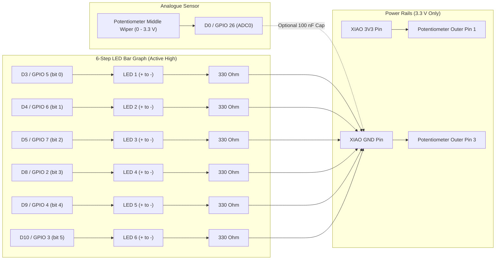

# From Zero to `xiao-rp2350-bargraph`: Building an Out-of-Tree Apache NuttX Firmware Project for Software Engineers

The joy of building with microcontrollers is watching a physical thing light up when you turn a knob. The pain is discovering why five completely reasonable software assumptions catch fire the moment you plug it in.

If you have spent your career writing backend services, web apps, or mobile UIs, embedded hardware tutorials often start by assuming you already own an oscilloscope, remember Kirchhoff's voltage law from university, and instinctively know what an "input-enable pad register" does. Or, on the other end of the spectrum, they hand you an Arduino one-liner like `analogRead()` and `digitalWrite()` that hides everything interesting behind a single-threaded polling loop.

This tutorial takes a different route. Starting from literally nothing—an empty folder and a handful of loose electronic parts—we are going to build [`xiao-rp2350-bargraph`](https://github.com/domesticmouse/nuttxspace/tree/main/xiao-rp2350-bargraph): a real, production-style embedded firmware project running on the **Apache NuttX RTOS** (Real-Time Operating System) on a **Seeed Studio XIAO RP2350**.

By the end, you will have:

*   A solderless breadboard with a potentiometer and six discrete LEDs wired cleanly without frying anything.
*   A custom, **out-of-tree** NuttX board definition and user-space C daemon that never touches a single tracked file inside the upstream `nuttx/` or `apps/` git submodules.
*   An autonomous firmware image that boots straight into a 20 Hz potentiometer-to-LED bar graph the instant it gets power—even with no laptop attached.
*   An interactive POSIX-style shell (`nsh>`) over USB-C where you can run `dmesg`, `ps`, `cat /proc/interrupts`, `kill -15`, and trigger hardware fault-blink modes on demand.
*   Native Linux host unit tests for your quantiser and ADC decoding math, compiled and verified with `gcc -Wall -Wextra -Werror` before flashing a single byte to silicon.

And, along the way, I am not going to pretend everything worked on the first try. Turns out, building this clean little bar graph exposed **four genuinely nasty driver and boot-ordering traps** inside upstream NuttX's RP2350 support. Seeing how those traps work—and how we engineered around them purely from user-space and out-of-tree board code—is where the real learning happens.

---

## Part 1: Electronics in 5 Minutes for Software Engineers

Let's clear the air first: you do not need an electrical engineering degree to wire up a breadboard safely. Every component on our desk maps cleanly to a software concept you already understand.

### The Shopping List

Here is everything you need on the table:

*   **1x Seeed Studio XIAO RP2350** (with male header pins soldered onto the two side rows so it plugs into a breadboard).
*   **1x Solderless breadboard** (a standard 400-point or 830-point board works fine).
*   **1x `10 kΩ` linear potentiometer** (a standard 3-pin rotary knob—avoid logarithmic "audio taper" pots if you want even LED spacing, though either works).
*   **6x Standard 5 mm or 3 mm through-hole LEDs** (red, yellow, or green—they have a forward voltage around `1.8 V–2.2 V`, which behaves nicely at `3.3 V`).
*   **6x Resistors, `>= 330 Ω`** (`330 Ω` or `470 Ω` quarter-watt resistors are ideal).
*   **Optional: 1x `100 nF` (`0.1 µF`) ceramic capacitor** (acts as a low-pass filter if long breadboard jumper wires pick up electrical noise).
*   **Male-to-male breadboard jumper wires**.
*   **1x USB-C *data* cable** (Watch out! Cheap charging cables that came with headphones or battery banks often leave out the USB data lines. If your Linux box shows nothing in `dmesg` when you plug the board in, swap the cable first.)

### The Breadboard: Variable Scopes in Plastic

If you have never looked inside a solderless breadboard, think of the metal clips under the plastic holes as **variable scopes**:

```text
  Power Rails (Global scope: entire row connected horizontally)
  [-]  o  o  o  o  o   o  o  o  o  o   o  o  o  o  o  ...  -> GND
  [+]  o  o  o  o  o   o  o  o  o  o   o  o  o  o  o  ...  -> 3.3 V
  ------------------------------------------------------------------
  a    o  o  o  o  o   o  o  o  o  o   ...   \
  b    o  o  o  o  o   o  o  o  o  o   ...    | Terminal Strip (Local scope:
  c    o  o  o  o  o   o  o  o  o  o   ...    | 5 vertical holes share 1 wire)
  d    o  o  o  o  o   o  o  o  o  o   ...    |
  e    o  o  o  o  o   o  o  o  o  o   ...   /
  ========== CENTRE TRENCH (Namespace barrier: no connection across!) ==========
  f    o  o  o  o  o   o  o  o  o  o   ...   \
  g    o  o  o  o  o   o  o  o  o  o   ...    | Separate 5-hole vertical strip
  h    o  o  o  o  o   o  o  o  o  o   ...    |
  i    o  o  o  o  o   o  o  o  o  o   ...    |
  j    o  o  o  o  o   o  o  o  o  o   ...   /
```

*   **The two outer rails (`+` and `-`)** run horizontally along the edges—think of them as **global buses** for `3.3 V` power and `GND` (ground). *(Double-check long 830-point breadboards: some split the power rails in half right at the middle, marked by a gap in the red/blue printed line.)*
*   **The inner 5-hole columns (`a–e` and `f–j`)** connect vertically—each 5-hole strip is a **local node**. Anything plugged into `1a` and `1e` is electrically wired together.
*   **The centre trench** isolates rows `a–e` from `f–j`. That is why you straddle the XIAO RP2350 across the centre trench: its left header pins sit in column `e` and its right header pins sit in column `f`, so the chip doesn't short its own pins together.

### Voltage (`3.3 V` vs `GND`): Never Plug `5 V` Into a GPIO Pin

Think of **voltage** like water pressure or elevation relative to sea level. `GND` (`0 V`) is sea level. The RP2350 chip on your XIAO board runs its logic and I/O pins at **`3.3 V`**.

> [!CAUTION]
> The XIAO RP2350 receives `5 V` on its USB-C port (and exposes `5V` on its `VUSB` pin), which an onboard voltage regulator steps down to `3.3 V` on the `3V3` pin. **Every GPIO pin on the RP2350 is strictly `3.3 V`-tolerant.** Connecting `5 V` directly to a GPIO pin or potentiometer outer leg is the hardware equivalent of an unhandled segfault—except instead of a core dump, you permanently damage the silicon. Always wire your potentiometer and components to the **`3V3`** pin, never `5V`.

### LEDs & Series Resistors: Why You Need a Hardware Rate-Limiter

An LED (Light-Emitting Diode) is two things at once: a one-way valve (**polarity matters**) and a component with almost zero internal resistance once it turns on.

1.  **Polarity**: Look closely at an LED. The **longer leg** is the **anode (`+`)**, which connects toward the GPIO pin. The **shorter leg** (usually next to a flat notch on the plastic rim) is the **cathode (`-`)**, which connects toward `GND`. Put one in backwards and nothing breaks—it simply never lights up.
2.  **The Series Resistor (Rate-Limiting)**: Once an LED's forward voltage threshold (~`2.0 V` for typical red/yellow/green LEDs) is reached, it behaves almost like a dead short. Wiring an LED straight from a `3.3 V` GPIO pin to `GND` without a resistor is like spinning up an unthrottled `while (true)` loop against an API with no rate limiter: current surges until either the LED pops or the microcontroller's GPIO pad burns out.

Putting a `330 Ω` resistor in series (either before the LED or between its cathode and `GND`—order in a series loop makes zero electrical difference) caps the current cleanly via Ohm's Law (`I = V / R`):

$$I = \frac{3.3\text{ V} - 2.0\text{ V}}{330\ \Omega} \approx 3.9\text{ mA per LED}$$

With all six LEDs lit at once, that is `6 × 3.9 mA ≈ 23.4 mA` total—comfortably inside the RP2350's **12 mA max per-GPIO rating** and **50 mA total `IOVDD` package budget**! Using `470 Ω` resistors drops it even further to ~`2.8 mA` per LED and still looks plenty bright on a desk.

### The Potentiometer & ADC: A Hardware Slider & Deserialiser

A potentiometer is just a resistor track with a sliding contact (**wiper**) in the middle:

*   Wire one outer pin to `3.3 V`.
*   Wire the other outer pin to `GND`.
*   Wire the middle pin (the wiper) to `D0` (`GPIO 26` / `ADC0`).

As you turn the shaft from one end-stop to the other, the wiper outputs a smooth analogue voltage anywhere from `0.0 V` to `3.3 V`. That is a hardware UI slider.

Inside the RP2350 lives a 12-bit **ADC (Analogue-to-Digital Converter)**. Think of it as a deserialiser that samples that continuous `0.0 V–3.3 V` signal and gives you a discrete integer between `0` and `4095` ($2^{12} - 1$).

### What Apache NuttX Is (And Why POSIX on a Microcontroller Feels Like Home)

So, why use Apache NuttX instead of bare-metal C or the Pico SDK?

Because NuttX gives a tiny microcontroller with **520 KB of RAM** and **2 MB of Flash** a genuine **POSIX / Unix-like OS environment**. Inside a ~117 KB firmware binary, our project gets:

*   Character device nodes in a Virtual File System: `/dev/adc0`, `/dev/userleds`, `/dev/null`, `/dev/ttyACM0`.
*   Standard syscalls in C: `open()`, `poll()`, `read()`, `ioctl()`, `close()`, `dup2()`, `sigaction()`, `kill()`, `usleep()`.
*   A live `/proc` filesystem and interactive shell (`nsh>`) with `ps`, `free`, `dmesg`, and `cat /proc/interrupts`.

However, coming from Linux, there are **two critical mental-model differences** to keep in mind before we write a single line of C:

1.  **Flat Address Space (No MMU)**: On a Cortex-M33 microcontroller in NuttX flat-build mode, there is no virtual memory isolation between processes. Every task shares one global address space. That means `static` globals in our `bargraph` app persist in RAM across shell commands—which is actually how our singleton guard knows the daemon is already running!
2.  **Upper-Half vs Lower-Half Drivers**: NuttX splits device drivers cleanly into two layers, much like an interface and a concrete implementation:
    *   **Upper-half drivers** (for example [`nuttx/drivers/analog/adc.c`](https://github.com/domesticmouse/nuttx/blob/egm/drivers/analog/adc.c) and `userled_upper.c`) implement the portable VFS glue (`open`, `read`, `poll`, `ioctl`, ring buffers, locking) that creates `/dev/adc0` and `/dev/userleds`.
    *   **Lower-half drivers** (for example [`nuttx/arch/arm/src/rp23xx/rp23xx_adc.c`](https://github.com/domesticmouse/nuttx/blob/egm/arch/arm/src/rp23xx/rp23xx_adc.c) and our custom [`rp23xx_userleds.c`](https://github.com/domesticmouse/nuttxspace/blob/main/xiao-rp2350-bargraph/board/src/rp23xx_userleds.c)) talk directly to RP2350 hardware registers and GPIO pins.

Remember that distinction—because two of our biggest hardware traps live right on the boundary between those two halves!

---

## Part 2: Setting Up the Host Toolchain & Workspace (Starting from Zero)

Before writing custom firmware, we need a Linux host environment capable of compiling ARM Cortex-M33 bare-metal code, assembling Kconfig menus, packaging an embedded ROM filesystem, and converting an ELF binary into a RP2350 `.uf2` bootloader image.

### 1. Host Prerequisites (Fedora 44 Example)

Here is the exact toolset documented in [`TODO.md`](../designs/TODO.md) for Fedora 44 (on Debian/Ubuntu, package names map closely to `gcc-arm-none-eabi`, `genromfs`, `xxd`, `kconfig-frontends`, `picocom`, and `libusb-1.0-0-dev`):

1. **Core host compiler, parser generators, and Kconfig dependencies**:
   ```bash
   sudo dnf install gcc gcc-c++ make bison flex gperf gettext texinfo \
     ncurses-devel genromfs xxd picocom cmake libusb1-devel
   ```
   *(Why `genromfs` and `xxd`? Microcontrollers don't have a hard drive! To embed our `/etc/init.d/rcS` boot script inside flash memory, NuttX builds a tiny read-only ROMFS image with `genromfs` and converts the raw binary blob into a C byte array `etctmp.c` with `xxd` so it links straight into the kernel.)*

2. **ARM Bare-Metal Cross-Compiler (`arm-none-eabi-*`)**:
   ```bash
   sudo dnf install arm-none-eabi-gcc-cs arm-none-eabi-gcc-cs-c++ \
     arm-none-eabi-binutils-cs arm-none-eabi-newlib
   ```

3. **Kconfig Frontends (`kconfig-conf`, `kconfig-tweak`, `kconfig-mconf`)**:
   NuttX uses Linux-style Kconfig menus (`make menuconfig` and `tools/configure.sh`). Make sure `kconfig-conf`, `kconfig-tweak`, and `kconfig-mconf` are installed on your `PATH` (for example under `/usr/local/bin/` from Apache NuttX's `kconfig-frontends` build, or via your distro's `kconfig-frontends` package).

4. **`picotool` (for RP2350 `.uf2` packaging & flashing)**:
   NuttX's RP2350 build rules invoke `picotool` to convert the compiled `nuttx` ELF into `nuttx.uf2` (because `CONFIG_RP23XX_UF2_BINARY=y` is enabled by default). Build and install it from Raspberry Pi's official repos:
   ```bash
   git clone https://github.com/raspberrypi/pico-sdk.git /tmp/pico-sdk
   git clone https://github.com/raspberrypi/picotool.git /tmp/picotool
   cmake -S /tmp/picotool -B /tmp/picotool/build -DPICO_SDK_PATH=/tmp/pico-sdk
   cmake --build /tmp/picotool/build
   sudo cmake --install /tmp/picotool/build
   ```

Verify everything is reachable:

```bash
which arm-none-eabi-gcc kconfig-conf genromfs xxd picotool picocom
```

### 2. Cloning the Workspace Layout

Apache NuttX splits the OS into two sibling repositories: the kernel (`nuttx`) and user-space utilities/NuttShell (`apps`). The kernel's Makefiles look for `../apps` by default, so create a workspace folder (ours is `nuttxspace`) and place them side by side:

```bash
mkdir -p ~/nuttxspace && cd ~/nuttxspace
git clone https://github.com/apache/nuttx.git nuttx
git clone https://github.com/apache/nuttx-apps.git apps
```

*(If you are working inside this existing `nuttxspace` checkout, `nuttx/` and `apps/` are already here as submodules.)*

---

## Part 3: Walking Before We Run — Flashing Stock `xiao-rp2350:usbnsh`

Here is a golden rule of embedded work: **always verify your toolchain, USB cable, and board bootloader with a known-good stock build before writing a single line of custom code.** If something fails later, you will know immediately whether it is your code or your cable.

Let's configure and build the upstream `xiao-rp2350:usbnsh` target inside `nuttx/`:

```bash
cd nuttx
./tools/configure.sh -e -l xiao-rp2350:usbnsh
make -j$(nproc)
```

If that finishes cleanly, you will see `nuttx.uf2` waiting in `nuttx/`. Now let's flash it onto the bare XIAO RP2350 (don't wire anything up yet—just the board and a USB-C cable):

1.  **Enter `BOOTSEL` mode**: Hold down the tiny **B** (`BOOT`) button on the XIAO RP2350 while plugging in the USB-C cable (or hold **B**, tap **R** `RESET`, then release **B**).
2.  The RP2350 wakes up in its ROM bootloader and mounts on your Linux machine as a USB flash drive labelled **`RP2350`**.
3.  **Flash the firmware**: Either drag and drop `nuttx/nuttx.uf2` onto the `RP2350` volume, or use `picotool`:
    ```bash
    picotool load -f nuttx.uf2 -x
    ```
    (`-x` automatically reboots the chip out of `BOOTSEL` mode into your newly flashed firmware.)

Now open your serial terminal against `/dev/ttyACM0` (Wait a couple of seconds after reboot for USB enumeration, and if you get permission denied, ensure your user is in the `dialout` group or run `sudo picocom`):

```bash
picocom -b 115200 /dev/ttyACM0
```

You will see... **a completely blank screen.**

Don't panic! This is not a crash; it is a deliberate NuttX feature we will dissect later. Press **`Enter` three times**:

```text
nsh> help
nsh> ps
nsh> exit
```

*(To exit `picocom`, press `Ctrl-A` followed by `Ctrl-X`.)*

Brilliant—your compiler, `picotool`, USB cable, and board all work. Before we move on, wipe that stock build config so `nuttx/` starts clean for our out-of-tree project:

```bash
make distclean
cd ..
```

---

## Part 4: Breadboarding the Circuit (And Avoiding Trap #1)

Now let's wire up the potentiometer and six LEDs.

### Trap #1: Why Aren't the LEDs on `D1` through `D6`?

If you glance at the XIAO RP2350 pinout, the cleanest wiring in the world would be: potentiometer on `D0`, and six LEDs neatly lined up on `D1, D2, D3, D4, D5, D6`.

Turns out, that neat wiring **breaks** on NuttX!

Here is what I found when inspecting [`nuttx/arch/arm/src/rp23xx/rp23xx_adc.c`](https://github.com/domesticmouse/nuttx/blob/egm/arch/arm/src/rp23xx/rp23xx_adc.c#L144-L147):

```c
static const int8_t g_gpio_map[ADC_CHANNEL_COUNT] =
{
  26, 27, 28, 29, -1
};
```

And inside `my_reset()` (called automatically by the ADC upper-half during `adc_register()`):

```c
for (int i = 0; i < ADC_CHANNEL_COUNT; ++i)
  {
    a_gpio = g_gpio_map[i];

    if (a_gpio >= 0)
      {
        rp23xx_gpio_setdir(a_gpio, false);
        rp23xx_gpio_set_function(a_gpio, RP23XX_GPIO_FUNC_NULL);
        rp23xx_gpio_set_pulls(a_gpio, false, false);
      }
  }
```

Even when we only enable **`CONFIG_RP23XX_ADC_CHANNEL0=y`** (`GPIO 26` / `D0`), `my_reset()` loops blindly over **all four entries** (`GPIO 26, 27, 28, 29`), resetting **`D1` (`GPIO 27`)** and **`D2` (`GPIO 28`)** back into floating `FUNC_NULL` inputs! Meanwhile, **`D6` (`GPIO 0`)** and **`D7` (`GPIO 1`)** are the hardware `UART0` pins—best left untouched in case we ever want a hardware serial adapter.

So, we sidestep the whole mess cleanly by skipping `D1`, `D2`, `D6`, and `D7` and placing our 6 LEDs on purely digital pins: **`D3, D4, D5, D8, D9, D10`**.

### The Pinout & Wiring Table

Seat your XIAO RP2350 across the breadboard's centre trench (USB-C connector pointing toward the edge so you can plug cables in easily), then wire according to this table:

| XIAO Pin Label | RP2350 GPIO | Hardware Role | NuttX Device / Bit | Breadboard Connection |
| :--- | :--- | :--- | :--- | :--- |
| **`3V3`** | — | `3.3 V` power out | — | Connect to breadboard **`+` rail** (and pot outer leg #1) |
| **`GND`** | — | `0 V` ground | — | Connect to breadboard **`-` rail** (and pot outer leg #3) |
| **`D0`** | `GPIO 26` | Analogue input (`ADC0`) | `/dev/adc0` | Potentiometer **middle leg (wiper)** *(optional `100 nF` cap from `D0` to `GND`)* |
| `D1` | `GPIO 27` | Unassigned | — | *Left unconnected (avoided due to `my_reset()`)* |
| `D2` | `GPIO 28` | Unassigned | — | *Left unconnected (avoided due to `my_reset()`)* |
| **`D3`** | `GPIO 5` | Active-high output | `/dev/userleds` bit `0` (`0x01`) | LED 1 anode (`+`) -> `>= 330 Ω` resistor -> `-` rail (`GND`) |
| **`D4`** | `GPIO 6` | Active-high output | `/dev/userleds` bit `1` (`0x02`) | LED 2 anode (`+`) -> `>= 330 Ω` resistor -> `-` rail (`GND`) |
| **`D5`** | `GPIO 7` | Active-high output | `/dev/userleds` bit `2` (`0x04`) | LED 3 anode (`+`) -> `>= 330 Ω` resistor -> `-` rail (`GND`) |
| `D6` | `GPIO 0` | Unassigned (`UART0 TX`) | — | *Left free* |
| `D7` | `GPIO 1` | Unassigned (`UART0 RX`) | — | *Left free* |
| **`D8`** | `GPIO 2` | Active-high output | `/dev/userleds` bit `3` (`0x08`) | LED 4 anode (`+`) -> `>= 330 Ω` resistor -> `-` rail (`GND`) |
| **`D9`** | `GPIO 4` | Active-high output | `/dev/userleds` bit `4` (`0x10`) | LED 5 anode (`+`) -> `>= 330 Ω` resistor -> `-` rail (`GND`) |
| **`D10`** | `GPIO 3` | Active-high output | `/dev/userleds` bit `5` (`0x20`) | LED 6 anode (`+`) -> `>= 330 Ω` resistor -> `-` rail (`GND`) |

*(Notice the non-sequential GPIO numbers on the right side: `D8` is `GPIO 2`, `D9` is `GPIO 4`, and `D10` is `GPIO 3`! Always trust the chip GPIO mapping, not physical pin order.)*

Here is the signal flow visually:



Double-check your six LED orientations (long leg toward the jumper wire from `D3..D10`, short leg/flat rim through the `>= 330 Ω` resistor to the `GND` rail) and verify the potentiometer outer pins go to `3V3` and `GND`—never `5V`.

---

## Part 5: Building the Out-of-Tree Custom Board (`xiao-rp2350-bargraph/board/`)

We could hack our LED pins straight into `nuttx/boards/arm/rp23xx/xiao-rp2350/`. Tempting, right?

Don't do it! Mixing your personal breadboard wiring into an upstream kernel submodule creates a merge nightmare the moment you pull upstream NuttX updates. Instead, NuttX supports a clean out-of-tree plugin architecture (`CONFIG_ARCH_BOARD_CUSTOM=y`) that lets us keep every custom board file, boot script, application, test, and build wrapper inside a separate sibling directory: [`xiao-rp2350-bargraph/`](https://github.com/domesticmouse/nuttxspace/tree/main/xiao-rp2350-bargraph).

Let's create the project skeleton:

```bash
mkdir -p xiao-rp2350-bargraph/board/configs/bargraph
mkdir -p xiao-rp2350-bargraph/board/include
mkdir -p xiao-rp2350-bargraph/board/scripts
mkdir -p xiao-rp2350-bargraph/board/src/etc/init.d
mkdir -p xiao-rp2350-bargraph/external/bargraph
mkdir -p xiao-rp2350-bargraph/tests
```

Here is the complete layout we are building toward:

```text
nuttxspace/
├── nuttx/                             (untouched upstream submodule)
├── apps/
│   └── external -> ../xiao-rp2350-bargraph/external   (gitignored symlink)
└── xiao-rp2350-bargraph/
    ├── Makefile
    ├── board/
    │   ├── configs/bargraph/defconfig
    │   ├── include/board.h
    │   ├── scripts/Make.defs
    │   └── src/
    │       ├── Make.defs
    │       ├── rp23xx_boardinitialize.c
    │       ├── rp23xx_bringup.c
    │       ├── rp23xx_userleds.c
    │       └── etc/init.d/rcS
    ├── external/
    │   ├── Makefile
    │   ├── Make.defs
    │   └── bargraph/
    │       ├── Makefile
    │       ├── Make.defs
    │       ├── Kconfig
    │       ├── bargraph_logic.h
    │       └── bargraph_main.c
    └── tests/
        └── test_bargraph_logic.c
```

### Four Build-System Rules That Make Out-of-Tree Builds Click

Before populating those files, save yourself hours of Makefile debugging by knowing four quirks inside NuttX's build system ([`nuttx/tools/Config.mk`](https://github.com/domesticmouse/nuttx/blob/egm/tools/Config.mk)):

1.  **`xiao-rp2350-bargraph/common/` MUST NOT exist**: Around lines 184–187 of `nuttx/tools/Config.mk`, NuttX checks if `$(BOARD_DIR)/../common` exists on disk. If it does, it hijacks `BOARD_COMMON_DIR` away from `nuttx/boards/arm/rp23xx/common`. Keeping `common/` absent from `xiao-rp2350-bargraph/` lets `CONFIG_ARCH_BOARD_COMMON=y` automatically pull in all the shared RP2350 chip initialisation and bringup helpers!
2.  **Automatic `dummy_kconfig` fallback**: Because we don't need any custom board-level Kconfig options, leaving `board/Kconfig` absent causes `nuttx/tools/Config.mk` to bind `BOARD_KCONFIG` to `boards/dummy/dummy_kconfig`. Less boilerplate for us.
3.  **Relative Board Path**: `CONFIG_ARCH_BOARD_CUSTOM_DIR="../xiao-rp2350-bargraph/board"` resolves relative to `nuttx/`, which is where `tools/configure.sh` and `make` run.
4.  **Reuse the Upstream Linker Script**: Instead of copying `memmap_default.ld` out of tree, we point `ARCHSCRIPT` straight at upstream's linker script.

### Step 5.1: Compiler Flags & Linker Script (`board/scripts/Make.defs`)

When `tools/configure.sh` sets up a build, it symlinks `nuttx/Make.defs` to your board's `scripts/Make.defs`. Create [`xiao-rp2350-bargraph/board/scripts/Make.defs`](https://github.com/domesticmouse/nuttxspace/blob/main/xiao-rp2350-bargraph/board/scripts/Make.defs):

```makefile
############################################################################
# xiao-rp2350-bargraph/board/scripts/Make.defs
############################################################################

include $(TOPDIR)/.config
include $(TOPDIR)/tools/Config.mk
include $(TOPDIR)/tools/rp23xx/Config.mk
include $(TOPDIR)/arch/arm/src/armv8-m/Toolchain.defs

ifeq ($(CONFIG_BOOT_RUNFROMFLASH),y)
  LDSCRIPT = memmap_default.ld
else ifeq ($(CONFIG_BOOT_COPYTORAM),y)
  LDSCRIPT = memmap_copy_to_ram.ld
else
  LDSCRIPT = memmap_no_flash.ld
endif

ARCHSCRIPT += $(TOPDIR)$(DELIM)boards$(DELIM)arm$(DELIM)rp23xx$(DELIM)xiao-rp2350$(DELIM)scripts$(DELIM)$(LDSCRIPT)

CFLAGS := $(ARCHCFLAGS) $(ARCHOPTIMIZATION) $(ARCHCPUFLAGS) $(ARCHINCLUDES) $(ARCHDEFINES) $(EXTRAFLAGS) -pipe
CXXFLAGS := $(ARCHCXXFLAGS) $(ARCHOPTIMIZATION) $(ARCHCPUFLAGS) $(ARCHXXINCLUDES) $(ARCHDEFINES) $(EXTRAFLAGS) -pipe
CPPFLAGS := $(ARCHINCLUDES) $(ARCHDEFINES) $(EXTRAFLAGS)
AFLAGS := $(CFLAGS) -D__ASSEMBLY__
```

### Step 5.2: Board Header (`board/include/board.h`)

Now let's write [`xiao-rp2350-bargraph/board/include/board.h`](https://github.com/domesticmouse/nuttxspace/blob/main/xiao-rp2350-bargraph/board/include/board.h).

Compare this with upstream [`nuttx/boards/arm/rp23xx/xiao-rp2350/include/board.h`](https://github.com/domesticmouse/nuttx/blob/egm/boards/arm/rp23xx/xiao-rp2350/include/board.h). We keep the RP2350 clock macros (`150 MHz` system clock, `48 MHz` USB and ADC clocks), keep `BOARD_GPIO_LED_PIN` (`25`, the onboard yellow LED), set `BOARD_NLEDS` to `6`, and add `GPIO_ADC_BASE` (`26`) and `GPIO_ADC_COUNT` (`4`).

Just as importantly, look at what we **leave out**: we deliberately omit upstream's `GPIO_OUT1` (`28`), `GPIO_IN1` (`27`), and `GPIO_IRQPIN1` (`26`) definitions, as well as unused I2C/SPI headers. That guarantees no generic `/dev/gpout*` character driver can accidentally touch our ADC pin or the clobbered pins.

```c
/****************************************************************************
 * xiao-rp2350-bargraph/board/include/board.h
 ****************************************************************************/

#ifndef __XIAO_RP2350_BARGRAPH_BOARD_INCLUDE_BOARD_H
#define __XIAO_RP2350_BARGRAPH_BOARD_INCLUDE_BOARD_H

/****************************************************************************
 * Included Files
 ****************************************************************************/

#include <nuttx/config.h>

#ifndef __ASSEMBLY__
#  include <stdint.h>
#endif

/****************************************************************************
 * Pre-processor Definitions
 ****************************************************************************/

/* Clocking *****************************************************************/

#define MHZ                     1000000

#define BOARD_XOSC_FREQ         (12 * MHZ)
#define BOARD_XOSC_STARTUPDELAY 1
#define BOARD_PLL_SYS_FREQ      (150 * MHZ)
#define BOARD_PLL_USB_FREQ      (48 * MHZ)

#define BOARD_REF_FREQ          (12 * MHZ)
#define BOARD_SYS_FREQ          (150 * MHZ)
#define BOARD_PERI_FREQ         (150 * MHZ)
#define BOARD_USB_FREQ          (48 * MHZ)
#define BOARD_ADC_FREQ          (48 * MHZ)
#define BOARD_HSTX_FREQ         (150 * MHZ)

#define BOARD_UART_BASEFREQ     BOARD_PERI_FREQ

#define BOARD_TICK_CLOCK        (1 * MHZ)

/* GPIO / ADC definitions ***************************************************/

#define BOARD_GPIO_LED_PIN      25
#define GPIO_ADC_BASE           26
#define GPIO_ADC_COUNT          4

/* LED definitions **********************************************************/

#define BOARD_NLEDS             6

#ifndef __ASSEMBLY__

#if defined(__cplusplus)
extern "C"
{
#endif

/****************************************************************************
 * Public Function Prototypes
 ****************************************************************************/

void rp23xx_boardearlyinitialize(void);
void rp23xx_boardinitialize(void);
int rp23xx_bringup(void);

#if defined(__cplusplus)
}
#endif
#endif /* __ASSEMBLY__ */
#endif /* __XIAO_RP2350_BARGRAPH_BOARD_INCLUDE_BOARD_H */
```

### Step 5.3: Early, Standard, and Late Board Initialisation (`rp23xx_boardinitialize.c`)

NuttX boots in three distinct stages:

1.  **`rp23xx_boardearlyinitialize()`**: Runs right at startup before the scheduler and drivers are up. We delegate to `rp23xx_common_earlyinitialize()` and drive the active-low onboard LED (`GPIO 25`) high (`true`) to keep it cleanly off.
2.  **`rp23xx_boardinitialize()`**: Runs during core board init and delegates to `rp23xx_common_initialize()`.
3.  **`board_late_initialize()`**: Guarded by `CONFIG_BOARD_LATE_INITIALIZE`, this runs *after* VFS and RAMLOG are ready, right before NuttShell runs `/etc/init.d/rcS`. Note that upstream `usbnsh/defconfig` leaves `CONFIG_BOARD_LATE_INITIALIZE` up to Kconfig's default (`y`), so we explicitly enable it in our `defconfig` to ensure `/dev/adc0` and `/dev/userleds` actually exist before our startup script launches!

Create [`xiao-rp2350-bargraph/board/src/rp23xx_boardinitialize.c`](https://github.com/domesticmouse/nuttxspace/blob/main/xiao-rp2350-bargraph/board/src/rp23xx_boardinitialize.c):

```c
/****************************************************************************
 * xiao-rp2350-bargraph/board/src/rp23xx_boardinitialize.c
 ****************************************************************************/

/****************************************************************************
 * Included Files
 ****************************************************************************/

#include <nuttx/config.h>

#include <stdbool.h>

#include <nuttx/board.h>
#include <arch/board/board.h>

#include "rp23xx_gpio.h"

#ifdef CONFIG_RP23XX_PSRAM
#  include "rp23xx_psram.h"
#endif

#ifdef CONFIG_ARCH_BOARD_COMMON
#  include "rp23xx_common_initialize.h"
#endif

/****************************************************************************
 * Public Functions
 ****************************************************************************/

/****************************************************************************
 * Name: rp23xx_boardearlyinitialize
 ****************************************************************************/

void rp23xx_boardearlyinitialize(void)
{
#ifdef CONFIG_ARCH_BOARD_COMMON
  rp23xx_common_earlyinitialize();
#endif

  /* Drive the active-low onboard LED pin high (LED off) at boot */

  rp23xx_gpio_init(BOARD_GPIO_LED_PIN);
  rp23xx_gpio_setdir(BOARD_GPIO_LED_PIN, true);
  rp23xx_gpio_put(BOARD_GPIO_LED_PIN, true);
}

/****************************************************************************
 * Name: rp23xx_boardinitialize
 ****************************************************************************/

void rp23xx_boardinitialize(void)
{
#ifdef CONFIG_ARCH_BOARD_COMMON
  rp23xx_common_initialize();
#endif

#ifdef CONFIG_RP23XX_PSRAM
  rp23xx_psramconfig();
#endif
}

/****************************************************************************
 * Name: board_late_initialize
 ****************************************************************************/

#ifdef CONFIG_BOARD_LATE_INITIALIZE
void board_late_initialize(void)
{
  (void)rp23xx_bringup();
}
#endif
```

### Step 5.4: Peripheral Bringup & Trap #1B (`rp23xx_bringup.c`)

Here is a sneaky hardware quirk you only uncover by reading the chip errata and driver source side by side.

In [`nuttx/boards/arm/rp23xx/common/src/rp23xx_common_initialize.c`](https://github.com/domesticmouse/nuttx/blob/egm/boards/arm/rp23xx/common/src/rp23xx_common_initialize.c#L60-L65), the RP23XX common init explicitly disables the digital input buffer (`IE`, Input Enable) on `GPIO 26–29` so analogue voltages don't cause digital pad leakage (particularly important on RP2350 silicon due to RP2350-E9 pad behaviour!).

**However**, a few milliseconds later, `rp23xx_common_bringup()` calls `rp23xx_adc_setup("/dev/adc0", ...)` -> `adc_register()` -> `my_reset()` -> `rp23xx_gpio_set_function(a_gpio, RP23XX_GPIO_FUNC_NULL)`. And what does `rp23xx_gpio_set_function()` do under the hood? **It turns `IE=1` right back on!**

Which leads me to an interesting realisation: because we aren't patching `nuttx/`, we can just clear `RP23XX_PADS_BANK0_GPIO_IE` across `GPIO 26–29` immediately *after* `rp23xx_common_bringup()` returns!

Notice one more piece of defensive engineering in [`xiao-rp2350-bargraph/board/src/rp23xx_bringup.c`](https://github.com/domesticmouse/nuttxspace/blob/main/xiao-rp2350-bargraph/board/src/rp23xx_bringup.c): if `rp23xx_common_bringup()` returns an error (say `/dev/adc0` failed to register), we log it to `syslog` **without returning early**, and still register `/dev/userleds`. Why? Because if the ADC fails at boot when no laptop is attached, the LEDs are the *only* display our daemon has to flash a fault pattern!

```c
/****************************************************************************
 * xiao-rp2350-bargraph/board/src/rp23xx_bringup.c
 ****************************************************************************/

/****************************************************************************
 * Included Files
 ****************************************************************************/

#include <nuttx/config.h>

#include <nuttx/debug.h>
#include <syslog.h>

#include <arch/board/board.h>

#ifdef CONFIG_ARCH_BOARD_COMMON
#  include "rp23xx_common_bringup.h"
#endif

#if defined(CONFIG_ADC) && defined(CONFIG_RP23XX_ADC)
#  include "rp23xx_gpio.h"
#endif

#ifdef CONFIG_USERLED
#  include <nuttx/leds/userled.h>
#endif

/****************************************************************************
 * Public Functions
 ****************************************************************************/

/****************************************************************************
 * Name: rp23xx_bringup
 ****************************************************************************/

int rp23xx_bringup(void)
{
  int ret = OK;
  int status;

#ifdef CONFIG_ARCH_BOARD_COMMON
  status = rp23xx_common_bringup();
  if (status < 0)
    {
      syslog(LOG_ERR, "ERROR: rp23xx_common_bringup() failed: %d\n", status);
      ret = status;
    }
#endif

#if defined(CONFIG_ADC) && defined(CONFIG_RP23XX_ADC)
  /* rp23xx_adc my_reset() re-enables digital pad input buffers (IE=1)
   * across GPIO 26..29 during adc_register(). Clear IE on all four ADC
   * pads so analog sampling on GPIO 26 avoids digital input-buffer leakage.
   */

  for (int i = 0; i < GPIO_ADC_COUNT; i++)
    {
      clrbits_reg32(RP23XX_PADS_BANK0_GPIO_IE,
                    RP23XX_PADS_BANK0_GPIO(GPIO_ADC_BASE + i));
    }
#endif

#ifdef CONFIG_USERLED
  /* Register /dev/userleds even if rp23xx_common_bringup() failed so the
   * daemon can still indicate faults on the hardware LEDs.
   */

  status = userled_lower_initialize("/dev/userleds");
  if (status < 0)
    {
      syslog(LOG_ERR,
             "ERROR: userled_lower_initialize() failed: %d\n", status);
      if (ret == OK)
        {
          ret = status;
        }
    }
#endif

  return ret;
}
```

### Step 5.5: The 6-LED Lower-Half Driver (`rp23xx_userleds.c`)

If you read upstream [`nuttx/boards/arm/rp23xx/xiao-rp2350/src/rp23xx_userleds.c`](https://github.com/domesticmouse/nuttx/blob/egm/boards/arm/rp23xx/xiao-rp2350/src/rp23xx_userleds.c#L192-L195), you will notice it hardcodes a single LED (`GPIO_LED1` / `GPIO 25`) inside `board_userled_all()` rather than iterating over an array. Even more subtly, `CONFIG_ARCH_LEDS` defaults to `y` in `nuttx/boards/Kconfig` whenever a board supports LEDs—which compiles NuttX's kernel panic-blink driver (`rp23xx_autoleds.c`) instead of `/dev/userleds`!

By disabling `CONFIG_ARCH_LEDS` (`# CONFIG_ARCH_LEDS is not set`) and enabling `CONFIG_BOARD_CUSTOM_LEDS=y`, `CONFIG_USERLED=y`, and `CONFIG_USERLED_LOWER=y` in our `defconfig`, NuttX builds our custom [`xiao-rp2350-bargraph/board/src/rp23xx_userleds.c`](https://github.com/domesticmouse/nuttxspace/blob/main/xiao-rp2350-bargraph/board/src/rp23xx_userleds.c) instead. All six LED pins (`D3, D4, D5, D8, D9, D10` -> `GPIO 5, 6, 7, 2, 4, 3`) are configured as active-high outputs driven low (`false`) at boot, and `board_userled_all()` updates all six LEDs from a single 6-bit integer bitmask (`0x00`..`0x3f`):

```c
/****************************************************************************
 * xiao-rp2350-bargraph/board/src/rp23xx_userleds.c
 ****************************************************************************/

/****************************************************************************
 * Included Files
 ****************************************************************************/

#include <nuttx/config.h>

#include <stdbool.h>
#include <stdint.h>

#include <nuttx/board.h>
#include <arch/board/board.h>

#include "rp23xx_gpio.h"

#ifndef CONFIG_ARCH_LEDS

/****************************************************************************
 * Private Data
 ****************************************************************************/

/* Ordered mapping for breadboard bar-graph LEDs: D3, D4, D5, D8, D9, D10 */

static const uint32_t g_ledcfg[BOARD_NLEDS] =
{
  5, 6, 7, 2, 4, 3
};

/****************************************************************************
 * Public Functions
 ****************************************************************************/

/****************************************************************************
 * Name: board_userled_initialize
 ****************************************************************************/

uint32_t board_userled_initialize(void)
{
  for (int i = 0; i < BOARD_NLEDS; i++)
    {
      rp23xx_gpio_init(g_ledcfg[i]);
      rp23xx_gpio_setdir(g_ledcfg[i], true);
      rp23xx_gpio_put(g_ledcfg[i], false);
    }

  return BOARD_NLEDS;
}

/****************************************************************************
 * Name: board_userled
 ****************************************************************************/

void board_userled(int led, bool ledon)
{
  if ((unsigned int)led < BOARD_NLEDS)
    {
      rp23xx_gpio_put(g_ledcfg[led], ledon);
    }
}

/****************************************************************************
 * Name: board_userled_all
 ****************************************************************************/

void board_userled_all(uint32_t ledset)
{
  for (int i = 0; i < BOARD_NLEDS; i++)
    {
      rp23xx_gpio_put(g_ledcfg[i], (ledset & (1UL << i)) != 0);
    }
}

#endif /* !CONFIG_ARCH_LEDS */
```

### Step 5.6: The ROMFS Boot Script & Board `Make.defs` (`rcS` and `board/src/Make.defs`)

Here is a fun gotcha in [`nuttx/boards/Board.mk`](https://github.com/domesticmouse/nuttx/blob/egm/boards/Board.mk#L29-L31): any file listed in `RCSRCS` gets piped through the **C preprocessor (`cpp`)** before `genromfs` packages it! That means if you put a normal `# shell comment` inside `rcS`, `cpp` explodes with an invalid preprocessor directive error!

Always use C-style `/* ... */` comments in `RCSRCS` scripts. Create [`xiao-rp2350-bargraph/board/src/etc/init.d/rcS`](https://github.com/domesticmouse/nuttxspace/blob/main/xiao-rp2350-bargraph/board/src/etc/init.d/rcS):

```c
/* xiao-rp2350-bargraph/board/src/etc/init.d/rcS */

#include <nuttx/config.h>

#ifdef CONFIG_BARGRAPH
bargraph
#endif
```

And wire our board source files and ROMFS script together in [`xiao-rp2350-bargraph/board/src/Make.defs`](https://github.com/domesticmouse/nuttxspace/blob/main/xiao-rp2350-bargraph/board/src/Make.defs) (notice we omit `rp23xx_gpio.c` completely, and include `board/board` because NuttX symlinks `arch/arm/src/board` to the common RP23XX directory and `arch/arm/src/board/board` to our custom `board/src`):

```makefile
############################################################################
# xiao-rp2350-bargraph/board/src/Make.defs
############################################################################

CSRCS = rp23xx_boardinitialize.c
CSRCS += rp23xx_bringup.c

ifneq ($(CONFIG_ARCH_LEDS),y)
  CSRCS += rp23xx_userleds.c
endif

ifeq ($(CONFIG_ETC_ROMFS),y)
  RCSRCS = etc/init.d/rcS
endif

DEPPATH += --dep-path board
VPATH += :board
CFLAGS += ${INCDIR_PREFIX}$(TOPDIR)$(DELIM)arch$(DELIM)$(CONFIG_ARCH)$(DELIM)src$(DELIM)board$(DELIM)board
```

---

## Part 6: Pure-C Logic & Host Unit Testing (`bargraph_logic.h` & `tests/`)

Now, before we even think about writing OS task management or hardware device loops, let's follow good software engineering hygiene: **separate pure math and decoding logic from NuttX headers so we can unit-test it natively on Linux with `gcc`.**

Flashing a microcontroller just to debug an off-by-one bug in a threshold array is slow and unnecessary. Putting pure functions in [`xiao-rp2350-bargraph/external/bargraph/bargraph_logic.h`](https://github.com/domesticmouse/nuttxspace/blob/main/xiao-rp2350-bargraph/external/bargraph/bargraph_logic.h) lets us test the *exact* production inline functions on our host machine in milliseconds.

Let's examine the three pure functions we need:

1.  **`decode_adc_sample(int32_t am_data, uint16_t *raw_out)`**:
    Look inside [`nuttx/arch/arm/src/rp23xx/rp23xx_adc.c`](https://github.com/domesticmouse/nuttx/blob/egm/arch/arm/src/rp23xx/rp23xx_adc.c#L200-L210): the RP2350 hardware produces a 12-bit sample (`0..4095`), then the driver shifts it left by 19 bits (`value <<= 19`) to pack it into a signed 32-bit integer—and if the hardware `RP23XX_ADC_FIFO_ERR` flag was set on that conversion, the driver **negates it (`value = -value`)**!
    So, `am_data < 0` means a conversion error (`-EAGAIN`), while valid readings shift right by 19 (`am_data >> 19`) to recover `0..4095`.
2.  **`quantize_level(uint16_t raw, int current_level, int hyst)`**:
    We divide the 12-bit scale (`0..4095`) into 7 discrete levels (`0` to `6` LEDs lit) at multiples of `585`: `{ 585, 1170, 1755, 2340, 2925, 3510 }`.
    Why `585` instead of `4095 / 6 = 682`? Two reasons: `585 × 7 = 4095` divides the range into 7 equal buckets (`0..6`), AND placing the 6th threshold at `3510` reserves the top ~14% of potentiometer travel (`3534..4095`) so all 6 LEDs lock solidly on before the knob hits its mechanical end-stop!
    And what about **`BARGRAPH_HYSTERESIS = 24`**? Imagine your potentiometer sits right on `1170` while electrical noise jitters the ADC reading between `1168` and `1172` twenty times a second. Without hysteresis, LED 2 flashes like an angry strobe light. Just like your home thermostat waits a couple of degrees before toggling the heater, `quantize_level()` requires crossing `threshold + 24` to step **up** and dropping below `threshold - 24` to step **down** (`±24` counts is ~0.6% of full scale). Using `while` loops also lets fast knob twists jump across multiple LEDs in a single 50 ms tick.
3.  **`level_to_led_mask(int level)`**:
    Turns `0..6` into a bitmask for `/dev/userleds`: `0` -> `0x00` (`0b000000`), `1` -> `0x01`, `3` -> `0x07`, `6` -> `0x3f` (`0b111111`).

Create [`xiao-rp2350-bargraph/external/bargraph/bargraph_logic.h`](https://github.com/domesticmouse/nuttxspace/blob/main/xiao-rp2350-bargraph/external/bargraph/bargraph_logic.h):

```c
/****************************************************************************
 * xiao-rp2350-bargraph/external/bargraph/bargraph_logic.h
 ****************************************************************************/

#ifndef __XIAO_RP2350_BARGRAPH_EXTERNAL_BARGRAPH_BARGRAPH_LOGIC_H
#define __XIAO_RP2350_BARGRAPH_EXTERNAL_BARGRAPH_BARGRAPH_LOGIC_H

/****************************************************************************
 * Included Files
 ****************************************************************************/

#include <errno.h>
#include <stddef.h>
#include <stdint.h>

/****************************************************************************
 * Pre-processor Definitions
 ****************************************************************************/

#define BARGRAPH_INTERVAL_US      50000
#define BARGRAPH_POLL_TIMEOUT_MS  10
#define BARGRAPH_FAULT_TICKS      5
#define BARGRAPH_FAULT_BLINK_US   250000
#define BARGRAPH_HYSTERESIS       24
#define BARGRAPH_NLEVELS          6

/****************************************************************************
 * Inline Functions
 ****************************************************************************/

/* rp23xx_adc shifts valid 12-bit samples left by 19 bits into am_data and
 * negates them when RP23XX_ADC_FIFO_ERR is set.
 */

static inline int decode_adc_sample(int32_t am_data, uint16_t *raw_out)
{
  if (raw_out == NULL)
    {
      return -EINVAL;
    }

  if (am_data < 0)
    {
      return -EAGAIN;
    }

  *raw_out = (uint16_t)(am_data >> 19);
  return 0;
}

static inline int quantize_level(uint16_t raw, int current_level, int hyst)
{
  static const int k_thresholds[BARGRAPH_NLEVELS] =
  {
    585, 1170, 1755, 2340, 2925, 3510
  };

  int val = (int)raw;

  if (current_level < 0)
    {
      current_level = 0;
    }
  else if (current_level > BARGRAPH_NLEVELS)
    {
      current_level = BARGRAPH_NLEVELS;
    }

  if (hyst < 0)
    {
      hyst = 0;
    }

  while (current_level < BARGRAPH_NLEVELS &&
         val >= k_thresholds[current_level] + hyst)
    {
      current_level++;
    }

  while (current_level > 0 &&
         val < k_thresholds[current_level - 1] - hyst)
    {
      current_level--;
    }

  return current_level;
}

static inline uint32_t level_to_led_mask(int level)
{
  if (level <= 0)
    {
      return 0U;
    }

  if (level > BARGRAPH_NLEVELS)
    {
      level = BARGRAPH_NLEVELS;
    }

  return (1U << level) - 1U;
}

#endif /* __XIAO_RP2350_BARGRAPH_EXTERNAL_BARGRAPH_BARGRAPH_LOGIC_H */
```

Now create the host unit test suite in [`xiao-rp2350-bargraph/tests/test_bargraph_logic.c`](https://github.com/domesticmouse/nuttxspace/blob/main/xiao-rp2350-bargraph/tests/test_bargraph_logic.c):

```c
/****************************************************************************
 * xiao-rp2350-bargraph/tests/test_bargraph_logic.c
 ****************************************************************************/

#include <assert.h>
#include <errno.h>
#include <stdint.h>
#include <stdio.h>

#include "bargraph_logic.h"

static void test_constants(void)
{
  assert(BARGRAPH_INTERVAL_US == 50000);
  assert(BARGRAPH_POLL_TIMEOUT_MS == 10);
  assert(BARGRAPH_FAULT_TICKS == 5);
  assert(BARGRAPH_FAULT_BLINK_US == 250000);
  assert(BARGRAPH_HYSTERESIS == 24);
  assert(BARGRAPH_NLEVELS == 6);
}

static void test_decode_adc_sample(void)
{
  uint16_t raw = 999;

  assert(decode_adc_sample(0, NULL) == -EINVAL);

  assert(decode_adc_sample(-1, &raw) == -EAGAIN);
  assert(raw == 999);
  assert(decode_adc_sample(-(1 << 19), &raw) == -EAGAIN);
  assert(raw == 999);
  assert(decode_adc_sample(-(4095 << 19), &raw) == -EAGAIN);
  assert(raw == 999);

  assert(decode_adc_sample(0, &raw) == 0);
  assert(raw == 0);

  assert(decode_adc_sample(1 << 19, &raw) == 0);
  assert(raw == 1);

  assert(decode_adc_sample(2048 << 19, &raw) == 0);
  assert(raw == 2048);

  assert(decode_adc_sample(4095 << 19, &raw) == 0);
  assert(raw == 4095);
}

static void test_quantize_level_thresholds_and_hysteresis(void)
{
  static const int thresholds[BARGRAPH_NLEVELS] =
  {
    585, 1170, 1755, 2340, 2925, 3510
  };

  /* Endpoints */

  assert(quantize_level(0, 0, BARGRAPH_HYSTERESIS) == 0);
  assert(quantize_level(4095, 6, BARGRAPH_HYSTERESIS) == 6);

  /* Single-step ascending and descending hysteresis bands */

  for (int i = 0; i < BARGRAPH_NLEVELS; i++)
    {
      uint16_t t = (uint16_t)thresholds[i];

      /* Below threshold + hyst stays at level i */

      assert(quantize_level((uint16_t)(t + BARGRAPH_HYSTERESIS - 1),
                            i, BARGRAPH_HYSTERESIS) == i);

      /* At threshold + hyst steps to level i + 1 */

      assert(quantize_level((uint16_t)(t + BARGRAPH_HYSTERESIS),
                            i, BARGRAPH_HYSTERESIS) == i + 1);

      /* Stationary jitter inside +-hyst around threshold does not drop */

      assert(quantize_level(t, i + 1, BARGRAPH_HYSTERESIS) == i + 1);
      assert(quantize_level((uint16_t)(t - BARGRAPH_HYSTERESIS),
                            i + 1, BARGRAPH_HYSTERESIS) == i + 1);

      /* Below threshold - hyst drops from i + 1 to i */

      assert(quantize_level((uint16_t)(t - BARGRAPH_HYSTERESIS - 1),
                            i + 1, BARGRAPH_HYSTERESIS) == i);
    }

  /* Multi-step single-tick jumps and out-of-range level clamping */

  assert(quantize_level(4095, 0, BARGRAPH_HYSTERESIS) == 6);
  assert(quantize_level(0, 6, BARGRAPH_HYSTERESIS) == 0);
  assert(quantize_level(2000, 0, BARGRAPH_HYSTERESIS) == 3);
  assert(quantize_level(1000, 6, BARGRAPH_HYSTERESIS) == 1);
  assert(quantize_level(0, -1, BARGRAPH_HYSTERESIS) == 0);
  assert(quantize_level(4095, 99, BARGRAPH_HYSTERESIS) == 6);
  assert(quantize_level(100, 1, 600) == 1);
}

static void test_level_to_led_mask(void)
{
  assert(level_to_led_mask(-1) == 0x00U);
  assert(level_to_led_mask(0) == 0x00U);
  assert(level_to_led_mask(1) == 0x01U);
  assert(level_to_led_mask(2) == 0x03U);
  assert(level_to_led_mask(3) == 0x07U);
  assert(level_to_led_mask(4) == 0x0fU);
  assert(level_to_led_mask(5) == 0x1fU);
  assert(level_to_led_mask(6) == 0x3fU);
  assert(level_to_led_mask(7) == 0x3fU);
}

int main(void)
{
  test_constants();
  test_decode_adc_sample();
  test_quantize_level_thresholds_and_hysteresis();
  test_level_to_led_mask();

  printf("PASS: test_bargraph_logic (all assertions succeeded)\n");
  return 0;
}
```

Compile and run it right on your Linux laptop:

```bash
gcc -Wall -Wextra -Werror -Ixiao-rp2350-bargraph/external/bargraph \
  -o /tmp/test_bargraph_logic xiao-rp2350-bargraph/tests/test_bargraph_logic.c
/tmp/test_bargraph_logic
```

Zero warnings, instant feedback, and we have not touched the hardware once!

---

## Part 7: The `bargraph` Daemon & Taming Traps #2, #3, and #4 (`external/bargraph/`)

Next, we wire our application into NuttX's `apps/` build tree using the built-in `apps/external` hook—a gitignored directory slot that `apps/Makefile` automatically scans when present.

### Step 7.1: External Application Glue Files

Create these four tiny build-registration files inside `xiao-rp2350-bargraph/external/`:

1. [`xiao-rp2350-bargraph/external/Makefile`](https://github.com/domesticmouse/nuttxspace/blob/main/xiao-rp2350-bargraph/external/Makefile):
   ```makefile
   ############################################################################
   # xiao-rp2350-bargraph/external/Makefile
   ############################################################################

   MENUDESC = "External"

   include $(APPDIR)/Directory.mk
   ```

2. [`xiao-rp2350-bargraph/external/Make.defs`](https://github.com/domesticmouse/nuttxspace/blob/main/xiao-rp2350-bargraph/external/Make.defs):
   ```makefile
   ############################################################################
   # xiao-rp2350-bargraph/external/Make.defs
   ############################################################################

   include $(wildcard $(APPDIR)/external/*/Make.defs)
   ```

3. [`xiao-rp2350-bargraph/external/bargraph/Kconfig`](https://github.com/domesticmouse/nuttxspace/blob/main/xiao-rp2350-bargraph/external/bargraph/Kconfig):
   ```kconfig
   #
   # For a description of the syntax of this configuration file,
   # see the file kconfig-language.txt in the NuttX tools repository.
   #

   config BARGRAPH
   	tristate "Potentiometer LED bar graph daemon"
   	default n
   	depends on ADC && USERLED && USERLED_LOWER && BUILTIN
   	---help---
   		Enable the 20 Hz potentiometer-to-LED bar graph background daemon.

   if BARGRAPH

   config BARGRAPH_PROGNAME
   	string "Program name"
   	default "bargraph"
   	---help---
   		This is the name of the program that will be used when the NSH
   		program is installed.

   config BARGRAPH_PRIORITY
   	int "Bar graph daemon task priority"
   	default 100
   	range 1 255

   config BARGRAPH_STACKSIZE
   	int "Bar graph daemon stack size"
   	default 2048
   	range 1024 8192

   endif # BARGRAPH
   ```

4. [`xiao-rp2350-bargraph/external/bargraph/Make.defs`](https://github.com/domesticmouse/nuttxspace/blob/main/xiao-rp2350-bargraph/external/bargraph/Make.defs) and [`xiao-rp2350-bargraph/external/bargraph/Makefile`](https://github.com/domesticmouse/nuttxspace/blob/main/xiao-rp2350-bargraph/external/bargraph/Makefile):
   ```makefile
   # xiao-rp2350-bargraph/external/bargraph/Make.defs
   ifneq ($(CONFIG_BARGRAPH),)
   CONFIGURED_APPS += $(APPDIR)/external/bargraph
   endif
   ```
   ```makefile
   # xiao-rp2350-bargraph/external/bargraph/Makefile
   include $(APPDIR)/Make.defs

   PROGNAME  = $(CONFIG_BARGRAPH_PROGNAME)
   PRIORITY  = $(CONFIG_BARGRAPH_PRIORITY)
   STACKSIZE = $(CONFIG_BARGRAPH_STACKSIZE)
   MODULE    = $(CONFIG_BARGRAPH)

   MAINSRC = bargraph_main.c

   include $(APPDIR)/Application.mk
   ```

### Step 7.2: Understanding Traps #2, #3, and #4 Before Writing `bargraph_main.c`

If you wrote a naive C loop that opened `/dev/adc0` once at startup, slept `50 ms`, called `read()`, and repeated, **three things would go badly wrong**:

#### Trap #2: The 500 kSPS Free-Running ADC Interrupt Storm & Stale Ring Buffer

Most ADCs in POSIX RTOSes either wait for a software trigger (`ioctl(fd, ANIOC_TRIGGER, 0)`) or sample at a configured clock divider. Not `rp23xx_adc.c`! Look at `my_ioctl()` in [`rp23xx_adc.c`](https://github.com/domesticmouse/nuttx/blob/egm/arch/arm/src/rp23xx/rp23xx_adc.c#L575-L584): it returns `-ENOTTY` for everything, configures no clock divider, and at the end of `interrupt_handler()` it unconditionally calls `get_next_channel()` to fire `RP23XX_ADC_CS_START_ONCE`.

In plain English: **as long as `/dev/adc0` stays open, the RP2350 hardware finishes a conversion every 2 microseconds and slams the CPU with ~500,000 interrupts per second.** Meanwhile, the upper-half ring buffer in [`nuttx/drivers/analog/adc.c`](https://github.com/domesticmouse/nuttx/blob/egm/drivers/analog/adc.c#L491-L508) (`CONFIG_ADC_FIFOSIZE=8`) refuses new samples once full! So keeping `/dev/adc0` open and sleeping `50 ms` gives you *stale* data from 50 ms ago while burning CPU on dropped interrupts.

**The Fix**: Open `/dev/adc0` with `O_RDONLY | O_NONBLOCK`, wait up to `10 ms` via `poll(POLLIN)` (so a dead ADC never hangs the daemon forever in a blocking semaphore), read **5 bytes** (`sizeof(struct adc_msg_s)`—notice [`adc_read()`](https://github.com/domesticmouse/nuttx/blob/egm/drivers/analog/adc.c#L241-L244) checks `buflen % 5 == 0` to decide whether to include the `am_channel` + `am_data` struct header!), and immediately **`close()`** `/dev/adc0` on every 50 ms tick. Closing the descriptor triggers `my_shutdown()`, which stops the 500 kHz interrupt stream while the daemon sleeps!

#### Trap #3: The `close()` Race Condition in `rp23xx_adc.c`

Now, remember what I said earlier about reading the upper-half and lower-half together? Here is a bug that could crash your board randomly after running cleanly for ten minutes.

Look at the doc comment on `remove_device()` in [`rp23xx_adc.c`](https://github.com/domesticmouse/nuttx/blob/egm/arch/arm/src/rp23xx/rp23xx_adc.c#L387-L407):

```c
/* Note: This is called from inside a critical section. */
```

Inside `remove_device()`, it clears `g_first_device = NULL` **before** decrementing `g_active_count -= 1`. Then look at `adc_close()` in [`nuttx/drivers/analog/adc.c`](https://github.com/domesticmouse/nuttx/blob/egm/drivers/analog/adc.c#L187-L209): the upper-half holds only a mutex (`nxmutex_lock(&dev->ad_lock)`), **not a critical section**!

If the 500 kHz ADC FIFO interrupt preempts `close()` right between setting `g_first_device = NULL` and decrementing `g_active_count`, `interrupt_handler()` sees `g_active_count != 0`, calls `get_next_channel()`, walks an empty device list, and blows an `ASSERT(next != g_current_channel)` kernel panic!

**The Fix**: Because `bargraph_daemon` is the *only* code opening `/dev/adc0` (`ad_lock` never contends and never blocks), wrapping `close(fd)` in `enter_critical_section()` / `leave_critical_section()` (`<nuttx/irq.h>`) guarantees `g_first_device` and `g_active_count` update atomically before the trailing FIFO ISR runs!

#### Trap #4: Headless Boot (`rcS`) vs Blocking USB-C Enumeration

Earlier, when we flashed stock `usbnsh` and saw a blank screen until pressing `Enter` three times, remember why? Look at [`apps/system/nsh/nsh_main.c`](https://github.com/domesticmouse/nuttx-apps/blob/egm/system/nsh/nsh_main.c#L71-L76) and [`apps/nshlib/nsh_usbconsole.c`](https://github.com/domesticmouse/nuttx-apps/blob/egm/nshlib/nsh_usbconsole.c#L160-L300):

1.  `nsh_main()` calls `nsh_initialize()`, which executes `/etc/init.d/rcS` **synchronously**.
2.  Only *after* `rcS` finishes does `nsh_main()` call `nsh_consolemain()`, which connects the USB pull-up (`BOARDIOC_USBDEV_CONNECT`) and waits in `nsh_waitusbready()` for three `\r` or `\n` keystrokes on `/dev/ttyACM0`.

If `bargraph` ran its `while` loop directly inside `main()`, **`rcS` would never return, USB would never connect, and `nsh>` would never appear.** (Even adding `&` in `rcS` fails if backgrounding is disabled, and holds open any inherited file descriptors.)

**The Fix**: Structure `bargraph_main.c` using the NuttX flat-address-space **singleton daemon pattern** (modelled on `apps/examples/leds/leds_main.c`):

*   `main()` locks the scheduler (`sched_lock()`), checks `g_bargraph_pid > 0 && kill(g_bargraph_pid, 0) == 0` (so if someone kills the daemon with `SIGKILL`, `g_bargraph_pid` doesn't lock out future restarts), spawns `bargraph_daemon` via `task_create()`, and returns `EXIT_SUCCESS` immediately so `rcS` finishes in microseconds.
*   Inside `bargraph_daemon()`, `redirect_stdio_to_null()` points FDs `0, 1, 2` to `/dev/null` via `dup2()`. That way, if you stop and restart `bargraph` interactively from `nsh>`, the daemon doesn't pin `/dev/ttyACM0` open when you unplug your USB cable.
*   An async-signal-safe `SIGTERM` handler simply sets `g_bargraph_stop = 1` (never call `syslog()` or `printf()` from a signal handler!), and every exit path goes through a unified `cleanup:` block that turns off all six LEDs (`ULEDIOC_SETALL(0UL)`), closes `/dev/userleds`, and resets `g_bargraph_pid = -1`.
*   If `/dev/adc0` fails (timeout, missing device, or negative `RP23XX_ADC_FIFO_ERR` sample) for **5 consecutive ticks (250 ms)**—isolated 1–4 tick glitches reset harmlessly—the daemon logs once via `syslog(LOG_ERR, ...)` to RAMLOG (`dmesg`) and runs `fault_blink_loop()`, alternating the hardware LEDs between `0x15` (`0b010101`) and `0x2a` (`0b101010`) every 250 ms until `SIGTERM` arrives.

### Step 7.3: Write `external/bargraph/bargraph_main.c`

Create [`xiao-rp2350-bargraph/external/bargraph/bargraph_main.c`](https://github.com/domesticmouse/nuttxspace/blob/main/xiao-rp2350-bargraph/external/bargraph/bargraph_main.c):

```c
/****************************************************************************
 * xiao-rp2350-bargraph/external/bargraph/bargraph_main.c
 ****************************************************************************/

/****************************************************************************
 * Included Files
 ****************************************************************************/

#include <nuttx/config.h>

#include <sys/ioctl.h>
#include <sys/types.h>

#include <errno.h>
#include <fcntl.h>
#include <poll.h>
#include <sched.h>
#include <signal.h>
#include <stdint.h>
#include <stdio.h>
#include <stdlib.h>
#include <string.h>
#include <syslog.h>
#include <unistd.h>

#include <nuttx/analog/adc.h>
#include <nuttx/irq.h>
#include <nuttx/leds/userled.h>

#include "bargraph_logic.h"

/****************************************************************************
 * Private Data
 ****************************************************************************/

static pid_t g_bargraph_pid = -1;
static volatile sig_atomic_t g_bargraph_stop = 0;

/****************************************************************************
 * Private Functions
 ****************************************************************************/

static void sigterm_handler(int signo, FAR siginfo_t *info, FAR void *arg)
{
  (void)info;
  (void)arg;

  if (signo == SIGTERM)
    {
      g_bargraph_stop = 1;
    }
}

static int redirect_stdio_to_null(void)
{
  int fd = open("/dev/null", O_RDWR);
  if (fd < 0)
    {
      syslog(LOG_ERR, "bargraph: failed to open /dev/null: %d\n", errno);
      return -1;
    }

  for (int target = 0; target <= 2; target++)
    {
      if (fd != target && dup2(fd, target) < 0)
        {
          syslog(LOG_ERR, "bargraph: dup2(/dev/null, %d) failed: %d\n",
                 target, errno);
          if (fd > 2)
            {
              close(fd);
            }

          return -1;
        }
    }

  if (fd > 2)
    {
      close(fd);
    }

  return 0;
}

static void close_adc_critical(int fd)
{
  /* adc_close() calls rp23xx_adc remove_device() without disabling IRQs;
   * guard close() so g_first_device and g_active_count update atomically
   * against the RP23XX ADC FIFO ISR.
   */

  irqstate_t flags = enter_critical_section();
  close(fd);
  leave_critical_section(flags);
}

static int read_adc_sample(FAR const char *adc_path, FAR uint16_t *raw_out)
{
  int fd = open(adc_path, O_RDONLY | O_NONBLOCK);
  if (fd < 0)
    {
      int err = errno;
      return (err == EINTR) ? -EINTR : -err;
    }

  struct pollfd pfd;
  pfd.fd      = fd;
  pfd.events  = POLLIN;
  pfd.revents = 0;

  int poll_ret = poll(&pfd, 1, BARGRAPH_POLL_TIMEOUT_MS);
  if (poll_ret == 0)
    {
      close_adc_critical(fd);
      return -EAGAIN;
    }

  if (poll_ret < 0 || (pfd.revents & POLLIN) == 0)
    {
      int err = errno;
      close_adc_critical(fd);
      if (poll_ret < 0 && err == EINTR)
        {
          return -EINTR;
        }

      return (poll_ret < 0) ? -err : -EIO;
    }

  struct adc_msg_s sample;
  ssize_t nbytes = read(fd, &sample, sizeof(sample));
  int err = errno;
  close_adc_critical(fd);

  if (nbytes < 0)
    {
      return (err == EINTR) ? -EINTR : -err;
    }

  if (nbytes != (ssize_t)sizeof(struct adc_msg_s))
    {
      return -EIO;
    }

  return decode_adc_sample(sample.am_data, raw_out);
}

static int fault_blink_loop(int led_fd)
{
  unsigned long pattern = 0x15UL;

  while (!g_bargraph_stop)
    {
      if (ioctl(led_fd, ULEDIOC_SETALL, pattern) < 0)
        {
          syslog(LOG_ERR,
                 "bargraph: fault ioctl(ULEDIOC_SETALL) failed: %d\n",
                 errno);
          return -1;
        }

      pattern = (pattern == 0x15UL) ? 0x2aUL : 0x15UL;
      usleep(BARGRAPH_FAULT_BLINK_US);
    }

  return 0;
}

static int bargraph_daemon(int argc, FAR char *argv[])
{
  FAR const char *adc_path = (argc >= 2 && argv[1] != NULL) ?
                             argv[1] : "/dev/adc0";
  int led_fd = -1;
  int ret_code = EXIT_SUCCESS;

  if (redirect_stdio_to_null() < 0)
    {
      ret_code = EXIT_FAILURE;
      goto cleanup;
    }

  struct sigaction act;
  memset(&act, 0, sizeof(struct sigaction));
  act.sa_sigaction = sigterm_handler;
  act.sa_flags     = SA_SIGINFO;
  sigemptyset(&act.sa_mask);

  if (sigaction(SIGTERM, &act, NULL) != 0)
    {
      syslog(LOG_ERR, "bargraph: sigaction(SIGTERM) failed: %d\n", errno);
      ret_code = EXIT_FAILURE;
      goto cleanup;
    }

  led_fd = open("/dev/userleds", O_WRONLY);
  if (led_fd < 0)
    {
      syslog(LOG_ERR, "bargraph: failed to open /dev/userleds: %d\n", errno);
      ret_code = EXIT_FAILURE;
      goto cleanup;
    }

  if (ioctl(led_fd, ULEDIOC_SETALL, 0UL) < 0)
    {
      syslog(LOG_ERR, "bargraph: failed to clear /dev/userleds: %d\n",
             errno);
      ret_code = EXIT_FAILURE;
      goto cleanup;
    }

  syslog(LOG_INFO, "bargraph: daemon started (pid=%d, adc=%s)\n",
         (int)getpid(), adc_path);

  int current_level = 0;
  int consecutive_errors = 0;

  while (!g_bargraph_stop)
    {
      uint16_t raw = 0;
      int ret = read_adc_sample(adc_path, &raw);

      if (ret == -EINTR || g_bargraph_stop)
        {
          break;
        }

      if (ret < 0)
        {
          consecutive_errors++;
          if (consecutive_errors == BARGRAPH_FAULT_TICKS)
            {
              syslog(LOG_ERR,
                     "bargraph: ADC fault after %d consecutive errors on %s "
                     "(last=%d)\n",
                     consecutive_errors, adc_path, ret);
              if (fault_blink_loop(led_fd) < 0)
                {
                  ret_code = EXIT_FAILURE;
                }

              break;
            }

          usleep(BARGRAPH_INTERVAL_US);
          continue;
        }

      consecutive_errors = 0;

      int next_level = quantize_level(raw, current_level,
                                      BARGRAPH_HYSTERESIS);
      if (next_level != current_level)
        {
          current_level = next_level;
          unsigned long mask = (unsigned long)level_to_led_mask(current_level);
          if (ioctl(led_fd, ULEDIOC_SETALL, mask) < 0)
            {
              syslog(LOG_ERR, "bargraph: ioctl(ULEDIOC_SETALL) failed: %d\n",
                     errno);
              ret_code = EXIT_FAILURE;
              goto cleanup;
            }
        }

      usleep(BARGRAPH_INTERVAL_US);
    }

cleanup:
  if (led_fd >= 0)
    {
      (void)ioctl(led_fd, ULEDIOC_SETALL, 0UL);
      close(led_fd);
    }

  sched_lock();
  if (g_bargraph_pid == getpid())
    {
      g_bargraph_pid = -1;
    }
  sched_unlock();

  return ret_code;
}

/****************************************************************************
 * Public Functions
 ****************************************************************************/

int main(int argc, FAR char *argv[])
{
  FAR const char *adc_path = (argc >= 2 && argv[1] != NULL) ?
                             argv[1] : "/dev/adc0";
  FAR char * const daemon_argv[] =
  {
    (FAR char *)adc_path,
    NULL
  };

  sched_lock();
  if (g_bargraph_pid > 0 && kill(g_bargraph_pid, 0) == 0)
    {
      sched_unlock();
      printf("bargraph: daemon already running\n");
      return EXIT_SUCCESS;
    }

  g_bargraph_stop = 0;

  pid_t pid = task_create("bargraph_daemon",
                          CONFIG_BARGRAPH_PRIORITY,
                          CONFIG_BARGRAPH_STACKSIZE,
                          bargraph_daemon,
                          daemon_argv);
  if (pid > 0)
    {
      g_bargraph_pid = pid;
    }
  sched_unlock();

  if (pid < 0)
    {
      syslog(LOG_ERR, "bargraph: task_create failed: %d\n", errno);
      return EXIT_FAILURE;
    }

  return EXIT_SUCCESS;
}
```

*(Notice `main()` accepts an optional positional `argv[1]`—for instance `bargraph /dev/adc_missing`! That gives us an easy way to test our hardware fault-blink mode interactively from `nsh>` without ripping wires off the breadboard.)*

---

## Part 8: The Build Wrapper (`Makefile`), `defconfig`, and Hardware Verification

We only need two final files to tie the entire out-of-tree workspace together.

### Step 8.1: Kernel & App Configuration (`board/configs/bargraph/defconfig`)

Starting from upstream [`xiao-rp2350/configs/usbnsh/defconfig`](https://github.com/domesticmouse/nuttx/blob/egm/boards/arm/rp23xx/xiao-rp2350/configs/usbnsh/defconfig), we drop the sample apps (`CONFIG_EXAMPLES_HELLO`, `CONFIG_TESTING_GETPRIME`, `CONFIG_TESTING_OSTEST`), swap the board target to our custom board directory, turn off `CONFIG_ARCH_LEDS`, turn on `ADC`, `RP23XX_ADC_CHANNEL0`, `USERLED`, `ETC_ROMFS`, `RAMLOG_SYSLOG` (4 KB ring buffer for `dmesg`), and enable `CONFIG_BARGRAPH=y`.

Create [`xiao-rp2350-bargraph/board/configs/bargraph/defconfig`](https://github.com/domesticmouse/nuttxspace/blob/main/xiao-rp2350-bargraph/board/configs/bargraph/defconfig):

```kconfig
#
# This file is autogenerated: PLEASE DO NOT EDIT IT.
#
# You can use "make menuconfig" to make any modifications to the installed .config file.
# You can then do "make savedefconfig" to generate a new defconfig file that includes your
# modifications.
#
# CONFIG_ARCH_LEDS is not set
# CONFIG_DEV_CONSOLE is not set
# CONFIG_NSH_ARGCAT is not set
# CONFIG_NSH_CMDOPT_HEXDUMP is not set
# CONFIG_NSH_DISABLE_DATE is not set
# CONFIG_NSH_DISABLE_LOSMART is not set
# CONFIG_NSH_DISABLESCRIPT is not set
# CONFIG_RP23XX_UART0 is not set
CONFIG_ADC=y
CONFIG_ANALOG=y
CONFIG_ARCH="arm"
CONFIG_ARCH_BOARD_COMMON=y
CONFIG_ARCH_BOARD_CUSTOM=y
CONFIG_ARCH_BOARD_CUSTOM_DIR="../xiao-rp2350-bargraph/board"
CONFIG_ARCH_BOARD_CUSTOM_DIR_RELPATH=y
CONFIG_ARCH_BOARD_CUSTOM_NAME="xiao-rp2350-bargraph"
CONFIG_ARCH_CHIP="rp23xx"
CONFIG_ARCH_CHIP_RP23XX=y
CONFIG_ARCH_RAMVECTORS=y
CONFIG_ARCH_STACKDUMP=y
CONFIG_BARGRAPH=y
CONFIG_BOARDCTL_RESET=y
CONFIG_BOARD_CUSTOM_LEDS=y
CONFIG_BOARD_LATE_INITIALIZE=y
CONFIG_BOARD_LOOPSPERMSEC=10450
CONFIG_BUILTIN=y
CONFIG_CDCACM=y
CONFIG_CDCACM_CONSOLE=y
CONFIG_DEBUG_FULLOPT=y
CONFIG_DEBUG_SYMBOLS=y
CONFIG_DEV_NULL=y
CONFIG_DISABLE_POSIX_TIMERS=y
CONFIG_ETC_ROMFS=y
CONFIG_FS_PROCFS=y
CONFIG_FS_PROCFS_REGISTER=y
CONFIG_FS_ROMFS=y
CONFIG_INIT_ENTRYPOINT="nsh_main"
CONFIG_NFILE_DESCRIPTORS_PER_BLOCK=6
CONFIG_NSH_BUILTIN_APPS=y
CONFIG_NSH_READLINE=y
CONFIG_NSH_USBCONSOLE=y
CONFIG_RAMLOG=y
CONFIG_RAMLOG_BUFSIZE=4096
CONFIG_RAMLOG_SYSLOG=y
CONFIG_RAM_SIZE=532480
CONFIG_RAM_START=0x20000000
CONFIG_READLINE_CMD_HISTORY=y
CONFIG_RP23XX_ADC=y
CONFIG_RP23XX_ADC_CHANNEL0=y
CONFIG_RR_INTERVAL=200
CONFIG_SCHED_WAITPID=y
CONFIG_START_DAY=9
CONFIG_START_MONTH=2
CONFIG_START_YEAR=2021
CONFIG_SYSTEM_NSH=y
CONFIG_USBDEV=y
CONFIG_USBDEV_BUSPOWERED=y
CONFIG_USERLED=y
CONFIG_USERLED_LOWER=y
```

### Step 8.2: The Top-Level Build Wrapper (`xiao-rp2350-bargraph/Makefile`)

Remember earlier how `apps/` generates composite `Kconfig` files? Look closely at the `setup:` rule in [`xiao-rp2350-bargraph/Makefile`](https://github.com/domesticmouse/nuttxspace/blob/main/xiao-rp2350-bargraph/Makefile). Because `apps/Makefile` caches `apps/Kconfig` and `apps/Make.defs` ignores `external/` until `external/Kconfig` is rebuilt, our `setup` target links `../apps/external -> ../xiao-rp2350-bargraph/external` and automatically clears stale `Kconfig` files whenever you first set up the link or edit `external/bargraph/Kconfig`.

Create [`xiao-rp2350-bargraph/Makefile`](https://github.com/domesticmouse/nuttxspace/blob/main/xiao-rp2350-bargraph/Makefile):

```makefile
############################################################################
# xiao-rp2350-bargraph/Makefile
############################################################################

NUTTX_DIR  := ../nuttx
APPS_DIR   := ../apps
EXT_LINK   := $(APPS_DIR)/external
EXT_TARGET := ../xiao-rp2350-bargraph/external
BOARD_CONF := ../xiao-rp2350-bargraph/board/configs/bargraph
COMMON_DIR := $(NUTTX_DIR)/boards/arm/rp23xx/common
TEST_BIN   := tests/test_bargraph_logic

.PHONY: all setup configure test clean distclean

all: setup
	@if [ ! -f "$(NUTTX_DIR)/.config" ]; then \
		cd "$(NUTTX_DIR)" && ./tools/configure.sh -e -l "$(BOARD_CONF)"; \
	fi
	$(MAKE) -C "$(NUTTX_DIR)"

setup: external/Makefile
	@if [ -e "$(EXT_LINK)" ] && [ ! -L "$(EXT_LINK)" ]; then \
		echo "error: $(EXT_LINK) exists and is not a symlink" >&2; \
		exit 1; \
	fi
	@created=0; \
	if [ ! -L "$(EXT_LINK)" ] || [ "$$(readlink "$(EXT_LINK)")" != "$(EXT_TARGET)" ]; then \
		ln -sfn "$(EXT_TARGET)" "$(EXT_LINK)"; \
		created=1; \
	fi; \
	if [ "$$created" -eq 1 ] || [ ! -f external/Kconfig ] || [ ! -f "$(APPS_DIR)/Kconfig" ] || [ external/bargraph/Kconfig -nt "$(APPS_DIR)/Kconfig" ]; then \
		rm -f "$(APPS_DIR)/Kconfig" external/Kconfig; \
	fi
	@if [ -f "$(NUTTX_DIR)/.config" ]; then \
		$(MAKE) -C "$(NUTTX_DIR)" olddefconfig; \
	fi

configure: setup
	cd "$(NUTTX_DIR)" && ./tools/configure.sh -e -l "$(BOARD_CONF)"

test: $(TEST_BIN)
	./$(TEST_BIN)

$(TEST_BIN): tests/test_bargraph_logic.c external/bargraph/bargraph_logic.h
	gcc -Wall -Wextra -Werror -Iexternal/bargraph -o $(TEST_BIN) tests/test_bargraph_logic.c

clean:
	@if [ -f "$(NUTTX_DIR)/Make.defs" ] && [ -f "$(NUTTX_DIR)/.config" ]; then \
		$(MAKE) -C "$(NUTTX_DIR)" clean; \
	fi
	rm -rf "$(COMMON_DIR)/etctmp" "$(COMMON_DIR)/etctmp.c" "$(TEST_BIN)"

distclean:
	@if [ -f "$(NUTTX_DIR)/Make.defs" ] && [ -f "$(NUTTX_DIR)/.config" ]; then \
		$(MAKE) -C "$(NUTTX_DIR)" distclean; \
	fi
	@if [ -L "$(EXT_LINK)" ]; then \
		rm -f "$(EXT_LINK)"; \
	fi
	rm -f external/Kconfig external/.kconfig "$(APPS_DIR)/Kconfig" "$(TEST_BIN)"
	rm -rf "$(COMMON_DIR)/etctmp" "$(COMMON_DIR)/etctmp.c"
```

### Step 8.3: Run Tests, Compile, Flash, and Verify All Three Journeys

Now let's run the full build-and-verify loop from the `nuttxspace/` workspace root!

1. **Run the host unit tests**:
   ```bash
   make -C xiao-rp2350-bargraph test
   ```
   Expected output:
   ```text
   PASS: test_bargraph_logic (all assertions succeeded)
   ```

2. **Configure and build the firmware**:
   ```bash
   make -C xiao-rp2350-bargraph
   ```
   Wait for the linker memory summary at the end—our verified footprint sits comfortably at roughly `FLASH: 117320 B / 2 MB (5.59%)` and `RAM: 15096 B / 512 KB (2.88%)`, producing `nuttx/nuttx.uf2`. Meanwhile, run `git -C nuttx status` and `git -C apps status`—both remain **100% clean**!

3. **Flash in `BOOTSEL` mode**:
   Hold **B** + tap **R** (or hold **B** while plugging in USB-C) so the `RP2350` volume appears, then run:
   ```bash
   picotool load -f nuttx/nuttx.uf2 -x
   ```
   *(Or drag `nuttx/nuttx.uf2` onto the `RP2350` drive.)*

4. **Verify Journey 1 — Autonomous Power-Up & Knob Tracking**:
   Power the XIAO RP2350 from a standalone 5 V USB phone charger (with *no* serial terminal attached!). Sweep the potentiometer smoothly from `0 V` to `3.3 V` and back down:
   *   All 6 LEDs (`D3, D4, D5, D8, D9, D10`) light monotonically from `0` (`0x00`) up to `6` (`0x3f`) and back down to `0x00`.
   *   Park the knob near a step boundary—the `±24`-count hysteresis keeps the edge LED rock steady with zero flicker.

5. **Verify Journey 2 — Interactive USB-C NuttShell & Interrupt Check**:
   Plug the running board into your Linux host, open `picocom -b 115200 /dev/ttyACM0`, and press `Enter` three times to reach `nsh>`. Then try these diagnostics:
   ```text
   nsh> dmesg
   ```
   You will see `bargraph: daemon started (pid=..., adc=/dev/adc0)` captured in RAMLOG before USB was even plugged in!
   ```text
   nsh> ps
   ```
   Shows `bargraph_daemon` alive with plenty of stack headroom (`<= 1536` bytes peak out of `2048` bytes).
   ```text
   nsh> cat /proc/interrupts
   ```
   Run that twice, one second apart. Instead of ~500,000 interrupts/second, the ADC FIFO interrupt count only climbs by ~20–200 per second, proving Trap #2 is completely tamed!
   Now test the singleton guard and graceful `SIGTERM` lifecycle:
   ```text
   nsh> bargraph
   bargraph: daemon already running
   nsh> kill -15 <pid>
   ```
   All 6 LEDs immediately turn off! Restart it:
   ```text
   nsh> bargraph
   ```
   The bar graph springs back to life immediately—and unplugging/replugging USB-C re-enumerates `/dev/ttyACM0` cleanly because `bargraph_daemon` redirected stdio to `/dev/null`.

6. **Verify Journey 3 — Hardware Fault Blink Indication**:
   Let's trigger the headless error path safely from `nsh>`:
   ```text
   nsh> kill -15 <pid>
   nsh> bargraph /dev/adc_missing
   ```
   Wait 250 ms (5 failed 50 ms ticks), and watch your breadboard: the 6 LEDs begin alternating between **`0x15` (`0b010101` — LEDs 1, 3, 5)** and **`0x2a` (`0b101010` — LEDs 2, 4, 6)** every 250 ms! Run `dmesg` to confirm the `ADC fault after 5 consecutive errors on /dev/adc_missing` log entry, stop it with `kill -15 <pid>`, and run `bargraph` to return to normal operation.

---

## Where to Go Next

You started with a bare breadboard and zero electrical engineering assumptions, and you now have a real-time POSIX RTOS firmware project with out-of-tree board isolation, clean driver workarounds, host unit tests, and hardware fault diagnostics.

If you want to keep exploring from here, check out [`docs/designs/xiao-rp2350-bargraph.md`](../designs/xiao-rp2350-bargraph.md) for the deeper architecture trade-offs—or try extending [`xiao-rp2350-bargraph`](https://github.com/domesticmouse/nuttxspace/tree/main/xiao-rp2350-bargraph) yourself by adding RP2350 PWM duty-cycle smoothing on spare pins so the top active LED fades smoothly between potentiometer notches instead of snapping!
