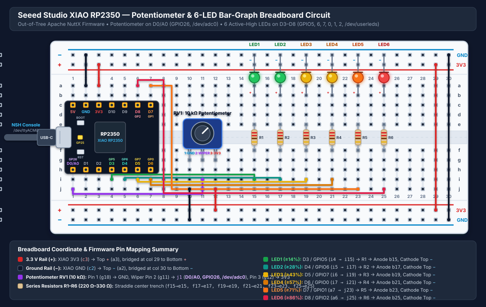

# Seeed Studio XIAO RP2350 Bar-Graph Breadboard Wiring Guide

This document provides the complete parts list, pin mapping, and hole-by-hole breadboard wiring instructions matching the out-of-tree Apache NuttX firmware in [`xiao-rp2350-bargraph/`](xiao-rp2350-bargraph/README.md) and the accompanying breadboard diagram in [`breadboard_circuit.svg`](breadboard_circuit.svg).

---

## 1. Parts List (Bill of Materials)

| Ref | Qty | Component | Value / Specification | Purpose |
| :--- | :---: | :--- | :--- | :--- |
| **`U1`** | 1 | **Seeed Studio XIAO RP2350** | Dual-row 7-pin (`0.1"` pitch, `0.6"` row spacing) | RP2350 microcontroller running Apache NuttX (`nuttx.uf2`) |
| **`BB1`** | 1 | **Solderless Breadboard** | 400-tie-point (half-size, cols `1`–`30`, rows `a`–`e` & `f`–`j`) or 830-tie-point | Prototyping base with top & bottom `+`/`-` power rails |
| **`RV1`** | 1 | **Rotary Potentiometer** | `10 kΩ` linear taper (B10K), 3-pin breadboard-friendly (`0.1"` pin spacing) | Analog voltage divider (`0 V` to `3.3 V`) read by `ADC0` |
| **`R1`–`R6`** | 6 | **Through-Hole Resistors** | `220 Ω` to `330 Ω`, ¼ W, ±5% (Red-Red-Brown-Gold) | Series current-limiting resistors for `LED1`–`LED6` (~5–6 mA per LED at `3.3 V`) |
| **`LED1`–`LED2`** | 2 | **Discrete 5 mm or 3 mm LEDs** | Green (`Vf ≈ 2.0–2.1 V`), standard polarity | Low-range bar-graph segments (levels 1 & 2: `>= 14%`, `>= 28%`) |
| **`LED3`–`LED4`** | 2 | **Discrete 5 mm or 3 mm LEDs** | Yellow (`Vf ≈ 2.0–2.1 V`), standard polarity | Mid-range bar-graph segments (levels 3 & 4: `>= 43%`, `>= 57%`) |
| **`LED5`–`LED6`** | 2 | **Discrete 5 mm or 3 mm LEDs** | Orange / Red (`Vf ≈ 1.9–2.0 V`), standard polarity | High-range bar-graph segments (levels 5 & 6: `>= 71%`, `>= 86%`) |
| **`W1`–`W13`** | 13 | **Jumper Wires** | Assorted solid-core 22 AWG or flexible M-M breadboard jumpers | Power rail distribution, ADC wiper sense, and 6 LED GPIO signals |
| **`USB1`** | 1 | **USB Type-C Data Cable** | USB-C to host computer | 5 V board power, UF2 flashing, and interactive `nsh>` serial console |

> **Why `D3`–`D8` are used for the LEDs:** On the RP2350, `rp23xx_adc.c` resets all four ADC-capable GPIOs (`GPIO26`–`GPIO29`, which correspond to XIAO pins `D0`–`D2`) to analog mode (`RP23XX_GPIO_FUNC_NULL`) when initializing the ADC peripheral. Keeping all 6 LEDs on dedicated digital pins `D3`–`D8` (`GPIO5, 6, 7, 0, 1, 2`) prevents the ADC driver from disabling any LED output pin.

---

## 2. Firmware-to-Hardware Pin Mapping

Defined in [`board/include/board.h`](xiao-rp2350-bargraph/board/include/board.h) and [`board/src/rp23xx_userleds.c`](xiao-rp2350-bargraph/board/src/rp23xx_userleds.c):

| Circuit Function | XIAO Pin | RP2350 GPIO | NuttX Device / Bitmask | Turn-On Threshold (Raw / %) | Breadboard Hole (XIAO) |
| :--- | :---: | :---: | :--- | :---: | :---: |
| **5 V USB Input (`VBUS`)** | `5V` | — | — | — | `c1` *(unconnected)* |
| **System Ground (`0 V`)** | `GND` | — | — | `0 mV` reference | `c2` |
| **Regulated `3.3 V` Output** | `3V3` | — | — | `3300 mV` reference | `c3` |
| **Potentiometer Wiper (`RV1`)** | `D0` / `A0` | `GPIO26` (`ADC0`) | `/dev/adc0` (channel `0`) | Continuous `0..4095` (`0..3300 mV`) | `h1` |
| **Bar-Graph `LED1` (Lowest)** | `D3` | `GPIO5` | `/dev/userleds` bit 0 (`0x01`) | `>= 585` (`>= 14%`, `~0.47 V`) | `h4` |
| **Bar-Graph `LED2`** | `D4` | `GPIO6` | `/dev/userleds` bit 1 (`0x02`) | `>= 1170` (`>= 28%`, `~0.94 V`) | `h5` |
| **Bar-Graph `LED3`** | `D5` | `GPIO7` | `/dev/userleds` bit 2 (`0x04`) | `>= 1755` (`>= 43%`, `~1.41 V`) | `h6` |
| **Bar-Graph `LED4`** | `D6` | `GPIO0` | `/dev/userleds` bit 3 (`0x08`) | `>= 2340` (`>= 57%`, `~1.89 V`) | `h7` |
| **Bar-Graph `LED5`** | `D7` | `GPIO1` | `/dev/userleds` bit 4 (`0x10`) | `>= 2925` (`>= 71%`, `~2.36 V`) | `c7` |
| **Bar-Graph `LED6` (Highest)** | `D8` | `GPIO2` | `/dev/userleds` bit 5 (`0x20`) | `>= 3510` (`>= 86%`, `~2.83 V`) | `c6` |
| **Unused Digital Pins** | `D1`, `D2`, `D9`, `D10` | `GPIO27, 28, 4, 3` | — | — | `h2`, `h3`, `c5`, `c4` |

---

## 3. Step-by-Step Breadboard Assembly

### Step 1: Seat the Seeed Studio XIAO RP2350 (`U1`)
1. Orient the breadboard horizontally with **column `1` on the left** and **column `30` on the right** (rows `a`–`e` above the center ravine, rows `f`–`j` below the center ravine).
2. Press the **Seeed Studio XIAO RP2350** across the center ravine in **columns `1` through `7`** with the **USB-C connector facing left** (overhanging the left edge of the breadboard for easy USB cable access):
   - **North row of XIAO pins** plugs into **`c1` through `c7`** (leaving holes `a1`–`a7` and `b1`–`b7` open above the module):
     - `c1` = `5V`, `c2` = `GND`, `c3` = `3V3`, `c4` = `D10`, `c5` = `D9`, `c6` = `D8` (`GPIO2`), `c7` = `D7` (`GPIO1`)
   - **South row of XIAO pins** plugs into **`h1` through `h7`** (leaving holes `i1`–`i7` and `j1`–`j7` open below the module):
     - `h1` = `D0/A0` (`GPIO26`), `h2` = `D1`, `h3` = `D2`, `h4` = `D3` (`GPIO5`), `h5` = `D4` (`GPIO6`), `h6` = `D5` (`GPIO7`), `h7` = `D6` (`GPIO0`)

### Step 2: Wire the `3.3 V` and `GND` Power Rails
| Wire | Color | From Hole | To Hole | Description |
| :--- | :---: | :---: | :---: | :--- |
| **`W1`** | Black | **`a2`** (`XIAO GND`) | **Top `-` rail** (col 2) | Connects XIAO ground to the top ground bus |
| **`W2`** | Red | **`a3`** (`XIAO 3V3`) | **Top `+` rail** (col 3) | Connects XIAO regulated `3.3 V` output to the top `+` bus |
| **`W3`** | Red | **Top `+` rail** (col 29) | **Bottom `+` rail** (col 29) | Bridges `3.3 V` to the bottom positive rail |
| **`W4`** | Black | **Top `-` rail** (col 30) | **Bottom `-` rail** (col 30) | Bridges `GND` to the bottom ground rail |

> **Important:** Never connect the potentiometer to the `5V` pin (`c1`). The RP2350 ADC input range is `0 V` to `3.3 V` (`IOVDD`); always power the potentiometer from the `3V3` rail.

### Step 3: Install & Wire the `10 kΩ` Potentiometer (`RV1`)
1. Insert the 3 leads of the `10 kΩ` rotary potentiometer into row **`g`**, columns **`10`, `11`, and `12`**:
   - **Pin 1 (CCW / Left outer leg)** → **`g10`**
   - **Pin 2 (Center Wiper)** → **`g11`**
   - **Pin 3 (CW / Right outer leg)** → **`g12`**
2. Connect the three potentiometer jumper wires:

| Wire | Color | From Hole | To Hole | Description |
| :--- | :---: | :---: | :---: | :--- |
| **`W5`** | Black | **`j10`** (`RV1` Pin 1) | **Bottom `-` rail** (col 10) | `0 V` (`GND`) at full counter-clockwise rotation |
| **`W6`** | Purple | **`i11`** (`RV1` Wiper) | **`j1`** (`XIAO D0/A0`, `GPIO26`) | Analog wiper voltage (`0–3.3 V`) to `ADC0` (`/dev/adc0`) |
| **`W7`** | Red | **`j12`** (`RV1` Pin 3) | **Bottom `+` rail** (col 12) | `3.3 V` (`3V3`) at full clockwise rotation |

### Step 4: Install the 6 Series Resistors (`R1`–`R6`) & 6 LEDs (`LED1`–`LED6`)
The 6 bar-graph channels are placed in even two-column intervals across **columns `15`, `17`, `19`, `21`, `23`, and `25`**:

1. **Resistors (`R1`–`R6`, `220 Ω` or `330 Ω`)**: Each resistor straddles the center ravine vertically from row **`f`** (bottom half) to row **`e`** (top half) in its assigned column:
   - **`R1`**: **`f15`** → **`e15`**
   - **`R2`**: **`f17`** → **`e17`**
   - **`R3`**: **`f19`** → **`e19`**
   - **`R4`**: **`f21`** → **`e21`**
   - **`R5`**: **`f23`** → **`e23`**
   - **`R6`**: **`f25`** → **`e25`**

2. **LEDs (`LED1`–`LED6`, Active-High)**: For each LED, insert the **Anode (`+`, longer leg)** into row **`b`** of its column and the **Cathode (`-`, shorter leg / flat rim on lens)** directly into the **Top `-` (`GND`) rail** directly above that column:
   - **`LED1` (Green, Lowest)**: Anode (`+`) in **`b15`**, Cathode (`-`) in **Top `-` rail (col 15)**
   - **`LED2` (Green)**: Anode (`+`) in **`b17`**, Cathode (`-`) in **Top `-` rail (col 17)**
   - **`LED3` (Yellow)**: Anode (`+`) in **`b19`**, Cathode (`-`) in **Top `-` rail (col 19)**
   - **`LED4` (Yellow)**: Anode (`+`) in **`b21`**, Cathode (`-`) in **Top `-` rail (col 21)**
   - **`LED5` (Orange)**: Anode (`+`) in **`b23`**, Cathode (`-`) in **Top `-` rail (col 23)**
   - **`LED6` (Red, Highest)**: Anode (`+`) in **`b25`**, Cathode (`-`) in **Top `-` rail (col 25)**

3. **GPIO Signal Jumper Wires (`W8`–`W13`)**: Connect each XIAO digital output pin to the bottom terminal strip (`f`–`j`) of its corresponding resistor column:

| Wire | Color | Bar Segment | From XIAO Hole | To Resistor Strip Hole | Current Path When GPIO High (`3.3 V`) |
| :--- | :---: | :--- | :---: | :---: | :--- |
| **`W8`** | Green | **`LED1`** (Bit 0) | **`i4`** (`D3` / `GPIO5`) | **`i15`** | `h4` → `i4` → `i15` → `f15` → **`R1`** → `e15` → `b15` → **`LED1`** → `Top - (GND)` |
| **`W9`** | Teal | **`LED2`** (Bit 1) | **`i5`** (`D4` / `GPIO6`) | **`i17`** | `h5` → `i5` → `i17` → `f17` → **`R2`** → `e17` → `b17` → **`LED2`** → `Top - (GND)` |
| **`W10`** | Yellow | **`LED3`** (Bit 2) | **`i6`** (`D5` / `GPIO7`) | **`i19`** | `h6` → `i6` → `i19` → `f19` → **`R3`** → `e19` → `b19` → **`LED3`** → `Top - (GND)` |
| **`W11`** | Amber | **`LED4`** (Bit 3) | **`i7`** (`D6` / `GPIO0`) | **`i21`** | `h7` → `i7` → `i21` → `f21` → **`R4`** → `e21` → `b21` → **`LED4`** → `Top - (GND)` |
| **`W12`** | Orange | **`LED5`** (Bit 4) | **`a7`** (`D7` / `GPIO1`) | **`j23`** | `c7` → `a7` → `j23` → `f23` → **`R5`** → `e23` → `b23` → **`LED5`** → `Top - (GND)` |
| **`W13`** | Red | **`LED6`** (Bit 5) | **`a6`** (`D8` / `GPIO2`) | **`j25`** | `c6` → `a6` → `j25` → `f25` → **`R6`** → `e25` → `b25` → **`LED6`** → `Top - (GND)` |

---

## 4. Electrical Verification Checklist

Before plugging in the USB-C cable:
1. **No `3V3`-to-`GND` short:** Verify `a3` (`3V3`) goes to the **red `+` rail** and `a2` (`GND`) goes to the **blue `-` rail**.
2. **Potentiometer wiper is on the center pin (`g11`):** Only the center wiper (`i11`) connects to `D0/A0` (`j1`). If an outer pin were wired to `D0/A0` and the wiper to `3V3`/`GND`, turning the knob to the end stop could short `3V3` to `GND`.
3. **LED polarity:** Verify the flat edge / shorter leg of every LED (`LED1`–`LED6`) is in the **Top `-` (`GND`) rail**, and the longer anode leg is in **`b15, b17, b19, b21, b23, b25`**.
4. **Power-up test:** Plug in the USB-C cable. The `bargraph_d` daemon starts automatically at boot (even without opening a serial terminal) and sweeps `LED1` through `LED6` smoothly as you turn `RV1` from counter-clockwise (`0 LEDs`) to clockwise (`6 LEDs`).
