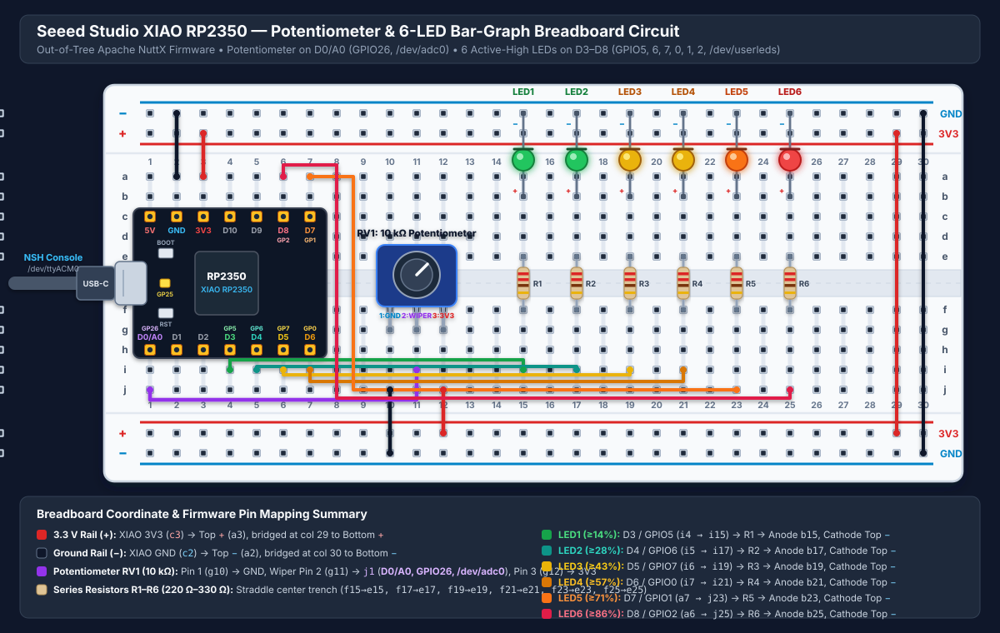

# Seeed Studio XIAO RP2350 Breadboard Bar-Graph (Out-of-Tree Apache NuttX)

Out-of-tree Apache NuttX custom board configuration and application for a **Seeed Studio XIAO RP2350** mounted on a breadboard with 1 potentiometer and 6 discrete LEDs acting as a bar graph.

## Breadboard Pinout & Wiring

See [`BREADBOARD_WIRING.md`](BREADBOARD_WIRING.md) for the complete parts list and hole-by-hole breadboard assembly guide, and [`breadboard_circuit.svg`](breadboard_circuit.svg) for the visual breadboard diagram.



| Component | XIAO RP2350 Pin | RP2350 GPIO | NuttX Device / Channel | Wiring Notes |
| :--- | :--- | :--- | :--- | :--- |
| **Potentiometer Wiper** | `D0` / `A0` | `GPIO26` | `/dev/adc0` (`ADC0`) | Outer terminals to `3V3` and `GND` |
| **Bar-Graph LED 1 (Lowest)** | `D3` | `GPIO5` | `/dev/userleds` bit 0 (`0x01`) | Active-high via series resistor to `GND` |
| **Bar-Graph LED 2** | `D4` | `GPIO6` | `/dev/userleds` bit 1 (`0x02`) | Active-high via series resistor to `GND` |
| **Bar-Graph LED 3** | `D5` | `GPIO7` | `/dev/userleds` bit 2 (`0x04`) | Active-high via series resistor to `GND` |
| **Bar-Graph LED 4** | `D6` | `GPIO0` | `/dev/userleds` bit 3 (`0x08`) | Active-high via series resistor to `GND` |
| **Bar-Graph LED 5** | `D7` | `GPIO1` | `/dev/userleds` bit 4 (`0x10`) | Active-high via series resistor to `GND` |
| **Bar-Graph LED 6 (Highest)** | `D8` | `GPIO2` | `/dev/userleds` bit 5 (`0x20`) | Active-high via series resistor to `GND` |
| **USB-C Console (`nsh>`)** | USB-C | USB CDC-ACM | `/dev/ttyACM0` | Interactive NuttShell (`nsh>`) |

## Building & Testing

- **Run host unit tests:**
  ```sh
  make -C xiao-rp2350-bargraph test
  ```
- **Build NuttX firmware (`nuttx/nuttx.uf2`):**
  ```sh
  make -C xiao-rp2350-bargraph
  ```

## Boot & NSH Behavior

- At boot, `rp23xx_bringup()` registers `/dev/adc0` and `/dev/userleds` and auto-starts the `bargraph_d` background daemon immediately (and `/etc/init.d/rcS` also invokes `bargraph` idempotently), so the 6 LEDs track the potentiometer immediately on power-up even before USB serial attaches.
- Connecting over USB-C (`115200 8N1`, press `Enter` 3 times) opens an interactive `nsh>` session where you can inspect or control the bar graph:
  ```sh
  nsh> bargraph status
  nsh> bargraph once
  nsh> bargraph stop
  nsh> bargraph start
  ```
